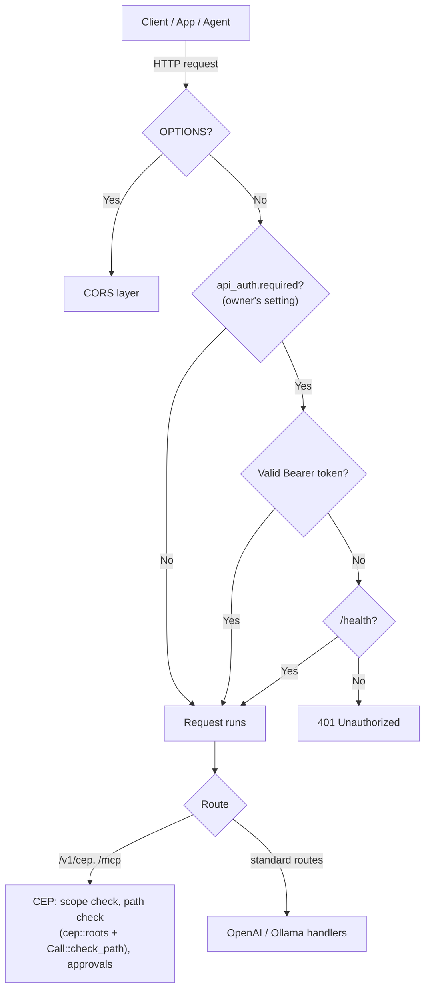
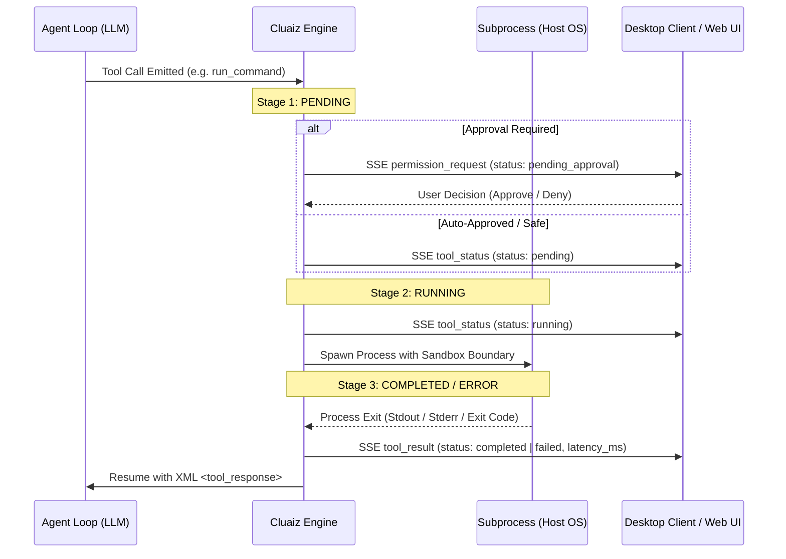

# Security & Authentication Architecture

> **Document Type:** System Architecture & Security Reference  
> **Status:** Active & Implemented  
> **Component:** `cluaiz_api`, `engines`, `engine_core`

---

## 1. Executive Summary & Threat Model

Cluaiz provides a high-performance local AI inference engine and agentic runtime. Because the engine executes tools, reads/writes files, and can run in both local desktop environments and cloud/server deployments, it enforces a defense-in-depth security model:

1. **Local Threat Model:** Protect developer laptops against browser drive-by attacks, malicious web scripts attempting cross-origin requests, and untrusted agent file escapes.
2. **Server/Cloud Threat Model:** Protect multi-tenant, remote, or LAN deployments with industry-standard Bearer Token authentication (`Authorization: Bearer sk-cluaiz-...`) without brittle hardcoded URL or origin restrictions.
3. **Reality Commitment:** The architecture is explicitly documented as **Workspace-Gated + Human-in-the-Loop (HITL) Approval**, eliminating hype terms like "OS Sandbox" in favor of concrete, verifiable controls.



---

## 2. Bearer Token Authentication Architecture

### 2.1 Dual-Token Authentication System

The engine accepts two types of cryptographic Bearer tokens via the standard `Authorization: Bearer <token>` HTTP header:

1. **User / Server API Keys (`sk-cluaiz-...`):**
   * Configured in `permission.json` under `api_auth.tokens`.
   * Generated and managed via the Developer Hub UI (Settings -> API Keys).
   * Used by external scripts, remote web apps, SDKs, and cURL clients.
2. **Local Session Token (`session.token`):**
   * Generated dynamically on engine boot (`auth::initialize_session_token`).
   * Stored in `~/.cluaiz/session.token` with restricted POSIX permissions (`0600`).
   * Injected automatically by local desktop wrappers (Tauri / Electron) for zero-configuration local security.

### 2.2 Constant-Time Comparison

To prevent timing side-channel attacks where an attacker could deduce valid token prefixes by measuring microsecond response differentials, all token checks use `constant_time_compare`:

```rust
pub fn constant_time_compare(a: &str, b: &str) -> bool {
    let a_bytes = a.as_bytes();
    let b_bytes = b.as_bytes();
    if a_bytes.len() != b_bytes.len() {
        return false;
    }
    let mut diff = 0u8;
    for (x, y) in a_bytes.iter().zip(b_bytes.iter()) {
        diff |= x ^ y;
    }
    diff == 0
}
```

### 2.3 Route Enforcement Matrix

Implemented in `api/src/auth.rs` (`auth_middleware`).

| Route | `api_auth.required` off | `api_auth.required` on |
|---|---|---|
| `GET /health` | Open | Open |
| Everything else: `/v1/cep`, `/mcp`, `/v1/chat/completions`, `/api/chat`, `/v1/embeddings`, `/v1/audio/*`, `/v1/models`, `/api/tags`, `/api/pull` | Open | **Bearer token required (401)** |

Auth on/off, the tokens, the host/IP, the port and CORS are the owner's settings (`permission.json`, `settings.json`). The Engine does not change their defaults and does not force a token. A valid token is the session token or one of `api_auth.tokens`.

What the caller may do comes after authentication, in CEP:

| Caller | Principal | Scopes | Paths |
|---|---|---|---|
| `POST /v1/cep` (HTTP), the C library (`cep_call`) | `owner` | read, write, exec, admin | no roots: any canonical path |
| `/mcp` and `cluaiz mcp-server` | `mcp` | read only; methods marked `no_mcp` (for example `system.exec`) are not listed | any canonical path (read methods only) |

`system.exec` is an `admin` method, marked destructive and hidden from MCP. Every call needs the owner's approval, and it runs a program with its arguments (`{program, args}`), not a shell line. permission.json `exec` holds the owner's two switches, both off by default: `allow_shell` (accept `{command}`, run by `cmd /C` / `sh -c`) and `without_approval`.

---

## 3. Canonical Paths and Roots

Located in [`api/src/cep/roots.rs`](../../api/src/cep/roots.rs) (path resolution) and [`cep/src/registry.rs`](../../cep/src/registry.rs) (`Call::check_path`). The old `handlers/fs_jail.rs` is gone.

### 3.1 Path Resolution Rules

1. **Relative paths** are joined to the workspace root, never to the process working directory. Drive-relative and root-relative paths (`C:foo`, `\foo`) are refused as ambiguous (`-32602`).
2. **Canonicalization:** the candidate path is canonicalized with `std::fs::canonicalize`, so links and `..` are resolved before any check, and Windows `\\?\` prefixes compare the same.
3. **New files:** for a write to a path that does not exist yet, the closest existing ancestor is canonicalized and the missing parts are folded onto it, so `new/../../outside` cannot keep a workspace prefix.
4. **Links are removed or renamed themselves:** `fs.delete` and `fs.rename` canonicalize the parent and keep the last component (`roots::resolve_entry`), as `rm` / `mv` do. Deleting a link to a folder removes the link; the folder and its files stay. Reads and writes still follow links, and the canonical target must be inside the roots.

### 3.2 Roots and approvals

* Every method that touches a path (`fs.*`, `workspace.*`, `models.*`, `system.plan`, tool install roots) calls `Call::check_path` on the canonical path.
* Inside the principal's roots, the call runs. Outside, the principal's `on_denied` decides: `error` gives `-32002 forbidden` (`data.needs: "roots"`), `ask` gives `-32003 approval_required` with an approval id.
* An approval (`approvals.approve`) is bound to the principal, the method and a digest of the params, is used once and expires after 5 minutes. One approval covers every path checked inside the same call (for example both paths of `fs.copy`).

---

---

## 4. Capability-Based Tool Approval & HITL Streaming

Located in [`inference-engine/engines/src/tools/registry/types.rs`](file:///c:/Users/Aryan/my/Cluaiz-workspace/Cluaiz-Technologies/cluaiz/inference-engine/engines/src/tools/registry/types.rs) and [`inference-engine/api/src/handlers/chat/agent_loop.rs`](file:///c:/Users/Aryan/my/Cluaiz-workspace/Cluaiz-Technologies/cluaiz/inference-engine/api/src/handlers/chat/agent_loop.rs).

### 4.1 Capability Declarations

Tools declare capabilities explicitly in their metadata:
* `exec`: Running system binaries, CLI commands, or scripts.
* `fs_write`: Mutating, writing, or deleting files on disk.
* `network`: Inbound or outbound network socket operations.

**Default-Deny Rule:** Any tool with undeclared capabilities (`capabilities.is_empty()`) requires explicit user approval by default under `sandboxed` and `strict` modes. All MCP (Model Context Protocol) external tools require approval under `sandboxed` and `strict` modes.

### 4.2 Transparent Payloads & Zero Post-Approval Mutation

1. Before tool execution, the engine yields an SSE chunk `permission_request` containing:
   * `request_id`: Unique UUID.
   * `tool_name`: Exact tool name.
   * `capabilities`: Declared capability list.
   * `parameters`: Fully expanded, untruncated JSON payload.
2. The agent loop pauses and awaits a signal on an in-memory `tokio::sync::oneshot` channel.
3. When the user approves via `approvals.approve`, the engine resumes and executes the **exact stored parameters** received during the pause. The model cannot alter the payload between approval and execution.

---

## 5. Safe Configuration Deserialization

Located in [`inference-engine/engines/core/src/environment/config_manager.rs`](file:///c:/Users/Aryan/my/Cluaiz-workspace/Cluaiz-Technologies/cluaiz/inference-engine/engines/core/src/environment/config_manager.rs).

Configuration schemas (`permission.json`, `gguf_config.json`, `system_control.json`) prioritize human-editable JSON with `serde` defaults as the primary source of truth:
* Prevents binary layout mismatches (`rkyv` offset desync) caused by struct field additions across versions.
* Eliminates out-of-memory aborts caused by unvalidated binary zero-copy deserialization.

---

## 6. Master Security Matrix & Execution Boundary (Anthropic Parity)

Located in [`inference-engine/engines/src/tools/execution/policy.rs`](file:///c:/Users/Aryan/my/Cluaiz-workspace/Cluaiz-Technologies/cluaiz/inference-engine/engines/src/tools/execution/policy.rs) and [`inference-engine/engines/src/tools/registry/types.rs`](file:///c:/Users/Aryan/my/Cluaiz-workspace/Cluaiz-Technologies/cluaiz/inference-engine/engines/src/tools/registry/types.rs).

Cluaiz enforces a two-tier security governance model combining **Global Agent Mode** (`permission.json`) with **Tool-Level Policies** (`tools_registry.json`).

### 6.1 Architectural Decision Flow

```mermaid
flowchart TD
    Req["Tool / Terminal Request"] --> CheckSuicide{"Destructive Prohibited?\n(format c:, rm -rf /, dd if=)"}
    CheckSuicide -->|Yes| HardDeny["⛔ HARD-DENIED Across All Modes\n(OS / Hardware Destruction Prohibited)"]
    
    CheckSuicide -->|No| CheckMaster{"Master Security Mode\n(permission.json)"}
    
    CheckMaster -->|full_access| ToolFullCheck{"Tool Mode == require_approval?"}
    ToolFullCheck -->|Yes| PromptUser["🟡 Prompt User (HITL Confirmation Card)"]
    ToolFullCheck -->|No| AutoRun["✅ Direct Auto-Run (Zero Friction Automation)"]
    
    CheckMaster -->|strict| ToolStrictCheck{"Tool Mode == always_allow?"}
    ToolStrictCheck -->|Yes| AutoRun
    ToolStrictCheck -->|No| PromptUser
    
    CheckMaster -->|sandboxed| CheckJail{"Target Path in Workspace Jail?"}
    CheckJail -->|Outside Workspace| OutsideCheck{"Tool Mode == always_allow?"}
    OutsideCheck -->|Yes| PromptOutside["🟡 Prompt User (Outside Boundary Alert)"]
    OutsideCheck -->|No| PromptOutside
    
    CheckJail -->|Inside Workspace| ToolSandboxCheck{"Tool Policy"}
    ToolSandboxCheck -->|always_allow| AutoRun
    ToolSandboxCheck -->|require_approval| PromptUser
    ToolSandboxCheck -->|inherit| CapCheck{"Safe Read vs Mutative/Exec?"}
    CapCheck -->|Safe Read (cat, git diff)| AutoRun
    CapCheck -->|Mutative / Exec / Shell / MCP| PromptUser
```

### 6.2 The Complete 3 × 3 = 9 Master Security Matrix

| # | Global Mode (`permission.json`) | Tool Mode (`tools_registry.json`) | Workspace Ke Andar (Read / Edit / Build) | Workspace Ke Bahar (Host / System Path) | Harmful / Destructive Action (`rm -rf`, `format`, delete) |
| :---: | :--- | :--- | :--- | :--- | :--- |
| **1** | **`full_access`** | **`always_allow`** | ✅ **Direct Auto-Run** (Zero Prompt, Maximum Speed) | ✅ **Allowed Directly** (Read/Write Allowed for automation) | ⛔ **HARD-BLOCKED** (Suicide/OS wipe strictly denied; safe delete prompts) |
| **2** | **`full_access`** | **`inherit`** | ✅ **Direct Auto-Run** (Follows Global Full Access) | ✅ **Allowed Directly** (Automation loop smooth) | ⛔ **HARD-BLOCKED** (Hardware/OS destruction prohibited) |
| **3** | **`full_access`** | **`require_approval`** | 🟡 **Prompt User** (Tool level par user ne explicitly approval maanga hai) | 🟡 **Prompt User** (Confirmation required) | ⛔ **HARD-BLOCKED** (Destructive patterns denied; normal delete prompts) |
| **4** | **`sandboxed`** *(Default)* | **`always_allow`** | ✅ **Direct Auto-Run** (Sandbox ke andar tool ko full trust hai) | 🟡 **Prompt User** (Workspace se bahar ja raha hai, confirmation compulsory) | 🟡 **Prompt User / Block** (Harmful action par prompt aayega, suicide block) |
| **5** | **`sandboxed`** *(Default)* | **`inherit`** | ✅ **Read-only Auto-Run**<br>🟡 **Mutating/Exec prompts if undeclared** | 🟡 **Prompt User** (Outside boundary requires explicit sign-off) | ⛔ **HARD-BLOCKED** for suicide; 🟡 **Prompt User** for recursive delete |
| **6** | **`sandboxed`** *(Default)* | **`require_approval`** | 🟡 **Prompt User** (Har execution par approval card aayega) | 🟡 **Prompt User** (Bahar jaane par approval zaroori) | ⛔ **HARD-BLOCKED** for suicide; 🟡 **Prompt User** for delete |
| **7** | **`strict`** | **`always_allow`** | ✅ **Direct Auto-Run** (Tool trusted by user for workspace tasks) | 🟡 **Prompt User** (Workspace ke bahar 1% bhi sensitive hone par permission) | ⛔ **HARD-BLOCKED** for suicide; 🟡 **Prompt User** for delete |
| **8** | **`strict`** | **`inherit`** | 🟡 **Prompt User** (Strict mode forces confirmation on all exec/write) | 🚫 **Access Denied / Prompt** (Strict outside boundary lock) | ⛔ **HARD-BLOCKED** (Zero-tolerance destructive block) |
| **9** | **`strict`** | **`require_approval`** | 🟡 **Prompt User** (Double-lock: Global bhi Strict, Tool bhi Strict) | 🚫 **Access Denied / Prompt** (Outside workspace strictly gated) | ⛔ **HARD-BLOCKED** (Destructive commands completely rejected) |

### 6.3 Core Security Doctrines

1. **The Workspace Privilege Boundary:** The workspace root is the default trust zone. Crossing out of the workspace requires human verification in `sandboxed` and `strict` modes.
2. **Anthropic Safety Net (Non-Bypassable Hard-Deny):** Even when running under `--dangerously-skip-permissions` or `full_access`, catastrophic commands that wipe disks or destroy operating system files (`format c:`, `rm -rf /`, `diskutil eraseDisk`, fork bombs) are unconditionally rejected at the engine level across Windows, Linux, and macOS.
3. **Sensitive Credential Protection:** Sensitive identity paths (`~/.ssh`, `~/.aws/credentials`, `~/.kube/config`, `/etc/shadow`, `system32/config`, macOS Keychains) are actively protected from unapproved reading or modification.

### 6.4 Cross-Platform Hard-Deny Catalog

The following operations are prohibited unconditionally across all 3 major platforms:

* **POSIX / Linux / macOS**:
  * Root & Home Directory Destruction: `rm -rf /`, `rm -rf /*`, `rm -rf ~`, `rm -rf $HOME`
  * Raw Disk Wiping & Partition Formatting: `mkfs`, `mkfs.ext4`, `mkfs.xfs`, `mkfs.btrfs`, `mkfs.vfat`
  * Raw Device Zeroing & Overwrites: `dd if=/dev/zero`, `dd if=/dev/urandom`, `dd if=/dev/null`, `dd of=/dev/sd*`, `dd of=/dev/nvme*`, `> /dev/sda`
  * Process Starvation & Fork Bombs: `:(){ :|:& };:`, `:(){ :|: & };:`
  * Forced Kernel Shutdown & Halts: `shutdown -h`, `shutdown -r`, `init 0`, `init 6`, `poweroff`, `reboot`, `halt`
  * System Permission Tampering: `chmod -R 777 /`, `chmod -R 000 /`, `chown -R` on `/`
* **Windows**:
  * Volume & Disk Formatting: `format c:`, `format d:`, `format /q`
  * System Drive Wiping: `rmdir /s /q c:\`, `rmdir /s /q c:/`, `rd /s /q c:\`, `rd /s /q c:/`
  * Windows Directory Deletion: `del /f /s /q c:\windows`, `del /f /s /q c:/windows`, `del /f /s /q c:\*`
  * Scripted Storage Destruction: `diskpart`, `Clear-Disk`, `Initialize-Disk`, `Remove-Partition`, `Format-Volume`
  * Host Shutdown & Reboot: `Stop-Computer`, `Restart-Computer`, `shutdown /s`, `shutdown /r`
* **macOS**:
  * Volume & Partition Destruction: `diskutil eraseDisk`, `diskutil reformat`, `diskutil unmountDisk force`
  * Firmware & NVRAM Wiping: `nvram -c`
  * System Integrity Protection Tampering: `csrutil disable`

### 6.5 3-Stage Tool Execution Lifecycle

Tool invocations in Cluaiz stream through 3 formal stages:



