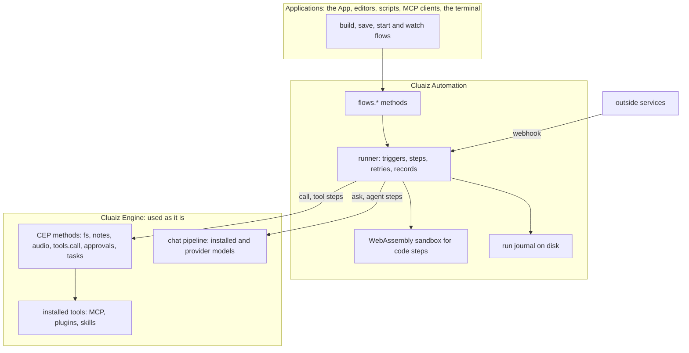
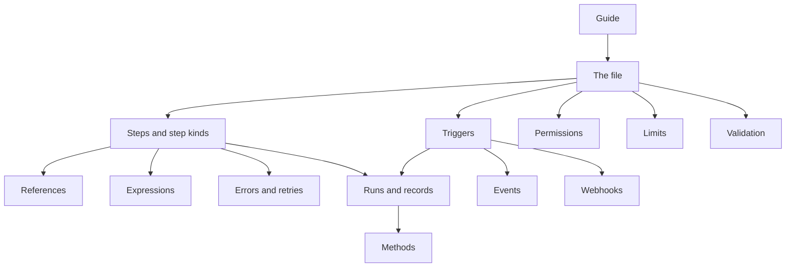
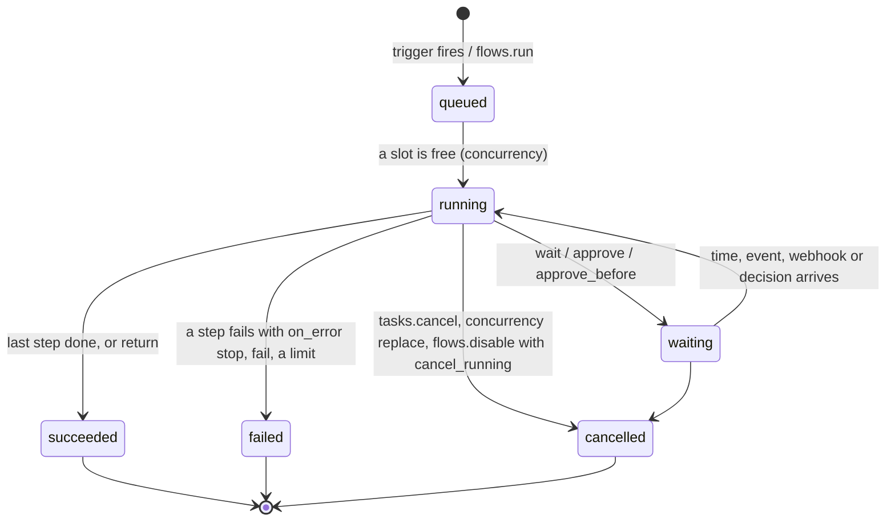

# Cluaiz Automation

> **Draft for review.** Four parts of Automation are built (not released): the format and all its
> checks, every operator, all seventeen step kinds, run records with resuming after a restart
> (waits too), every trigger (`tool` offers flows to MCP clients, chats and the coding agent), sixteen methods (drafting,
> explaining and fixing flows with a model among them) and `cluaiz flow`. Not built yet: flow templates in the registry, `tools`,
> `attachments` and `session` on `ask`, `tool_search`, `attachments` and `session` on `agent`,
> `settings` on `tool`, `call` to Engine routes, and `step.output_delta` streaming. A flow that
> uses them is checked and saved, and a run says the part is not built yet. Names, fields and
> defaults may change before a release. Defaults marked *proposed* are open decisions. What is
> built, file by file: [automation/README.md](../../automation/README.md).

Automation runs **flows**: files of steps that start on a trigger (a time, a file, a webhook, an
event, a call) and use everything Cluaiz has: installed tools (MCP servers, plugins, skills), the
Engine's methods, models (installed or a provider's), a person's approval, and your own code in
WebAssembly.

These pages explain every part in depth: each step kind, each field, each operator, each trigger.
For a quick overview of everything on one page, see the
[Automation reference](../reference/automation.md).

## Where Automation sits

Automation is **not part of the Engine and not part of the API**. It is a separate layer that uses
them, the same way an application does.

| Layer | Its job | What it does not do |
| --- | --- | --- |
| Applications | Draw flows (canvas, layout), show runs, ask the owner to confirm | Run steps |
| Automation | Read and check flow files, start runs on triggers, run steps in order, retry, wait, record every step | Load models, run tools itself, keep its own permission system |
| Engine | Models, tools, files, notes, approvals, tasks, audit, scopes | Know that flows exist |

Three rules follow from this:

1. **Automation reaches the Engine only through the Engine's own doors**: CEP methods (for `call`
   and `tool` steps) and the chat pipeline (for `ask` and `agent` steps). Every step is checked by
   the Engine's scopes and folder roots and written to the Engine's audit log, as a call from any
   other program would be. Automation has no back door.
2. **The Engine does not depend on Automation.** The Engine builds, starts and works without it. A
   broken flow file or a failed run never stops the Engine.
3. **What a flow looks like on screen is not Automation's concern.** A flow file has a `ui` field
   for an application's own data; Automation keeps it and never reads it.

Automation is started by `cluaiz serve` next to the Engine (*proposed*), and its methods are called
at the same `POST /v1/cep` address, so applications use one address, one token and one way of
calling.

## Pages

| Page | Covers |
| --- | --- |
| [Guide](guide.md) | A first flow, the pieces, ways to build one |
| [Examples](examples.md) | Ten flows, from one step to a large one, each with a diagram |
| [The file](file.md) | Formats, names, places, every top-level field, versions |
| [Triggers](triggers.md) | Each of the ten triggers: fields, what it puts in `trigger`, edge cases |
| [Steps](steps/README.md) | Fields every step has, order and `needs`, ids, statuses |
| Step kinds | [`tool`](steps/tool.md), [`call`](steps/call.md), [`ask`](steps/ask.md), [`agent`](steps/agent.md), [`code`](steps/code.md), [`if`](steps/if.md), [`switch`](steps/switch.md), [`each`](steps/each.md), [`parallel`](steps/parallel.md), [`repeat`](steps/repeat.md), [`wait`](steps/wait.md), [`approve`](steps/approve.md), [`set`](steps/set.md), [`run`](steps/run.md), [`emit`, `return`, `fail`](steps/emit-return-fail.md) |
| [References](references.md) | `${{ path }}`, the run context, types, escaping, file references, secrets |
| [Expressions](expressions.md) | Every operator: logic, comparison, text, lists, objects, types, numbers, time |
| [Errors and retries](errors.md) | Error kinds, `retry`, `on_error`, `idempotency_key` |
| [Permissions and security](permissions.md) | What a flow may do, secrets, code, outside content and AI steps |
| [Limits and concurrency](limits.md) | Run limits, data size, `concurrency`, retention |
| [Runs and records](runs.md) | Run and step records, statuses, the journal, resuming after a restart |
| [Validation](validation.md) | Every problem code `flows.validate` reports |
| [Events](events.md) | Engine events a flow can start on, and the events a run reports |
| [Webhooks](webhooks.md) | `POST /v1/hooks/{flow}`: how outside services start a flow |
| [Methods](methods/README.md) | The 16 `flows.*` methods, one page each |

## How a run goes

1. A trigger fires, or a program calls `flows.run`. The trigger's `filter` and `dedupe` are checked;
   a run is created with status `queued`.
2. When `concurrency` allows, the run starts (`running`). It is shown as a CEP task: `tasks.get`
   shows its progress and `tasks.cancel` stops it.
3. Steps run in order, or as their `needs` say. Before a step starts and after it ends, its record
   is written to the run's journal.
4. A step that waits (`wait`, `approve`) puts the run in `waiting`. A waiting run holds no worker and
   survives a restart.
5. The run ends `succeeded`, `failed` or `cancelled`. A failed run runs the flow's `on_error` steps.

## Words used in these pages

| Word | Meaning |
| --- | --- |
| Automation | The layer that runs flows. Not part of the Engine; it uses the Engine |
| Flow | One file: its triggers, permissions and steps |
| Run | One execution of a flow, with its own id (`run_…`) and record |
| Step | One item of `steps` (or of a branch inside a step) |
| Kind | What a step does: the one kind key it has (`tool`, `ask`, `if`…) |
| Node | Anything a `tool` or `call` step can run: an installed tool, a CEP method, an Engine route (`flows.nodes` lists them) |
| Trigger | What starts a run |
| Context | The values a run can read: `inputs`, `trigger`, `steps`, `vars`, `run`… |
| Reference | `${{ path }}` in a string, `{ "var": "path" }` in an expression |
| Expression | A JSON object with one operator, such as `{ "gt": [a, b] }` |
| Journal | The run's record on disk, written step by step |
