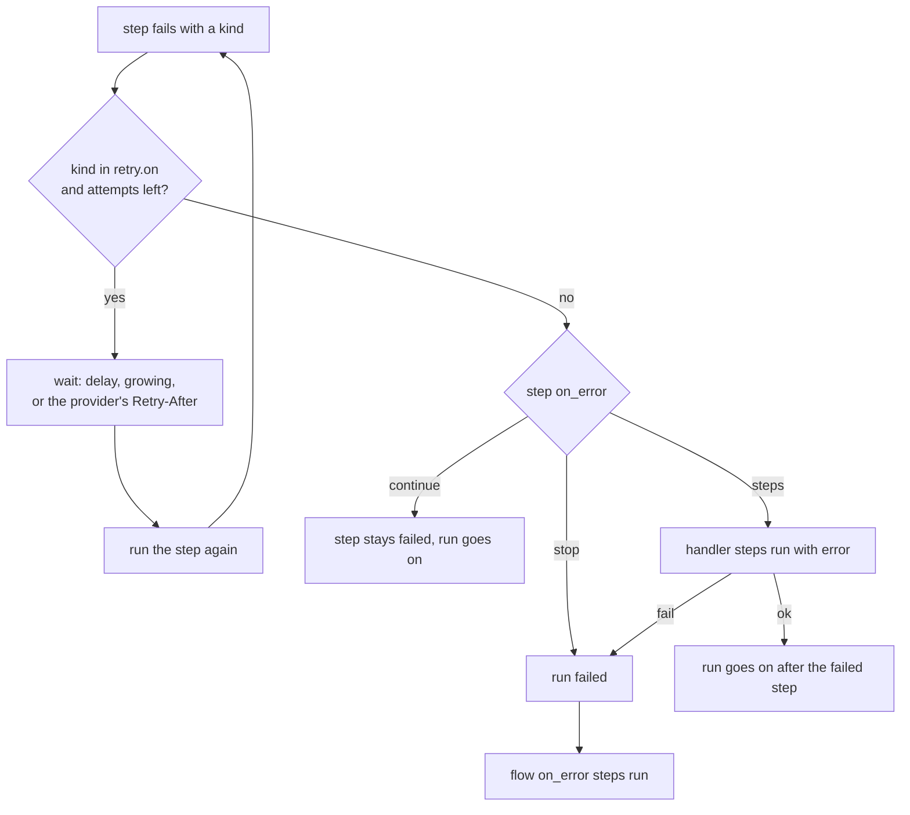
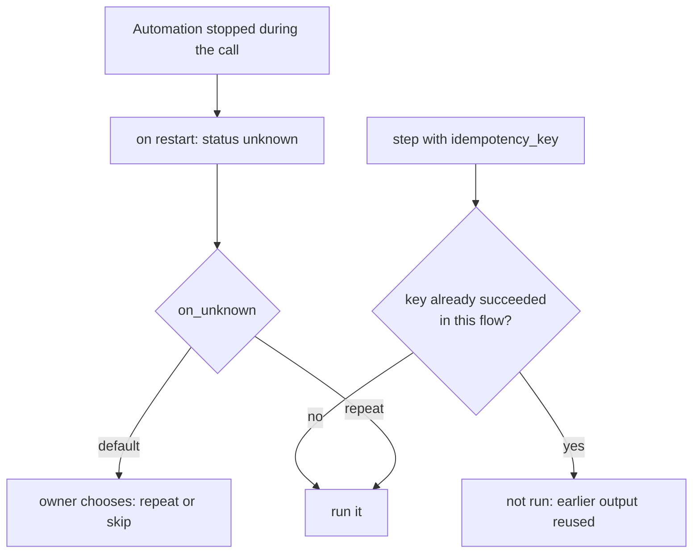

# Errors and retries

> **Draft for review.** Automation is partly built; what is and is not: [Automation](README.md).

## The error object

A failed step has `steps.<id>.error`; a failed run has `error` (in `on_error` steps and in its
record):

```json
{ "kind": "rate_limit", "message": "myapi is rate limiting this key (429)", "step": "summary", "details": { "status": 429 } }
```

| Field | Meaning |
| --- | --- |
| `kind` | One of the kinds below, or the `kind` of a [`fail`](steps/emit-return-fail.md#fail) step |
| `message` | Plain words; secrets are masked |
| `step` | The step's id (or its place, `_3.then.0`) |
| `details` | More, by kind: an HTTP status, a CEP error's `data`, a model's last answer, a sub-run's id |

## Error kinds

| Kind | Means | Retried by default |
| --- | --- | --- |
| `network` | A tool, provider or host could not be reached | Yes |
| `rate_limit` | A provider or service is limiting requests | Yes |
| `timeout` | The step took longer than its `timeout` | Yes |
| `provider` | A provider's model answered with an error (other than rate limit) | No |
| `model` | An installed model could not load or generate | No |
| `tool` | A tool answered with an error | No |
| `invalid_input` | A step's input does not match its schema; the run's inputs do not match `inputs` | No |
| `invalid_output` | A model's answer never matched `output_schema`; a module's answer is not JSON | No |
| `expression` | An expression could not be worked out (wrong types, not a boolean) | No |
| `permission` | Something outside the flow's `permissions` | No |
| `approval_rejected` | A person said no (or a timeout counted as no) | No |
| `not_found` | A method's target does not exist | No |
| `conflict` | A method's target is busy or in the wrong state | No |
| `unavailable` | An Engine backend is missing or failed | No |
| `code` | A WebAssembly module trapped or reported an error | No |
| `limit` | A limit was reached: fuel, memory, `max_steps`, `max_turns`, `repeat` `max` | No |
| `cancelled` | The run was cancelled | Never |
| `not_callable` | A `call` to a method flows may not use | No |
| `failed` | A `fail` step without its own `kind` | No |

## What happens when a step fails



## `retry`

```yaml
retry: { max: 3, delay: 10s, backoff: exponential, max_delay: 5m, on: [network, rate_limit, timeout] }
```

| Field | Type | Default | Meaning |
| --- | --- | --- | --- |
| `max` | integer | — (required) | Attempts after the first, 1–20 |
| `delay` | duration | `5s` | Wait before the first retry |
| `backoff` | `fixed`, `exponential` | `exponential` | `exponential` doubles the wait each time |
| `max_delay` | duration | `5m` | The longest wait |
| `jitter` | boolean | `true` | Adds up to 20 % at random, so many runs do not retry together |
| `on` | list of kinds | `[network, rate_limit, timeout]` | Kinds that are retried; `[any]` retries every kind except `cancelled`, `permission` and `approval_rejected` |
| `respect_retry_after` | boolean | `true` | When a provider says when to come back (`Retry-After`), wait that long instead (at most `max_delay`) |

- Each attempt is recorded (`steps.<id>.attempts`, and each attempt's error in the run's record).
- Waiting between attempts puts the run in `waiting`; it holds no worker and survives a restart.
- A step with an `idempotency_key` that succeeded is never repeated by a retry of a later step.

## `on_error`

On a step:

| Value | Effect |
| --- | --- |
| `stop` (default) | The run fails with this error; the flow's `on_error` steps run |
| `continue` | The step's status stays `failed`, its output is `null`, and the run goes on |
| A list of steps | They run with `error` set; if they succeed, the run goes on after the failed step. Their last output becomes the failed step's output |

On the flow (top-level `on_error`): steps that run when the run fails, with `error` set. They are
for telling someone, cleaning up or recording; the run stays `failed` whatever they do. If they fail
too, both errors are recorded and nothing else runs.

```yaml
steps:
  - id: fetch
    tool: mcp:shop/orders
    retry: { max: 3 }
    on_error:
      - set: { orders: [] }
      - tool: mcp:notify/send
        with: { text: "Orders could not be read: ${{ error.message }}" }
on_error:
  - tool: mcp:notify/send
    with: { text: "Flow ${{ run.flow }} failed at ${{ error.step }}: ${{ error.message }}" }
```

## Doing a thing once: `idempotency_key`

A run that resumes after a restart, or a run started twice by the same event, must not send the same
mail or payment twice.

```yaml
- tool: mcp:mail/send
  with: { to: "${{ trigger.body.customer }}", text: "${{ steps.reply.output }}" }
  idempotency_key: "reply-${{ trigger.body.message_id }}"
```

- Before the step starts, Automation looks the key up among this flow's succeeded steps. If found,
  the step is not run: its earlier output is used and its record says `reused`.
- Keys are kept at least 24 hours, and as long as the flow's longest `dedupe_for`.
- A step whose run stopped *during* the call (Automation stopped mid-call) cannot know whether the
  call happened. On resume, a step with a key is marked `unknown` and, by default, not repeated:
  the run waits for a person to choose (`approvals`), unless the step has `on_unknown: repeat`.
  Steps without a key are repeated on resume.



## After a run failed

- `flows.run_get` shows the failed step, its input, its error and every attempt.
- `flows.rerun_from` starts a new run that reuses the outputs of the steps before the chosen one and
  runs from there. See [flows.rerun_from](methods/flows.rerun_from.md).
- `flows.fix` asks a model for a change to the flow, from the error. See
  [flows.fix](methods/flows.fix.md).
