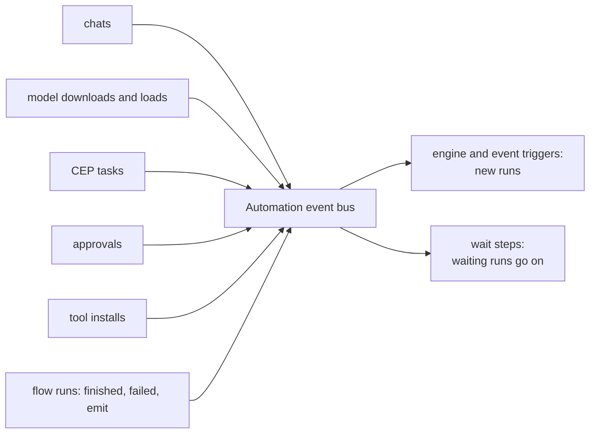

# Events

> **Draft for review.** The Engine sends these events now: `task.done`, `task.failed`,
> `approval.requested`, `approval.decided`, `tool.installed`, `tool.removed`, `model.downloaded`,
> `flow.finished`, `flow.failed` and `engine.started` (from `cep/src/events.rs`). A flow's `emit`
> travels as the Engine event `flow.event` (`{ name, data, from }`). Not sent yet: `chat.finished`,
> `model.loaded`, `model.unloaded`. See [Automation](README.md).

## How events move

## Engine events

What an [`engine` trigger](triggers.md#engine) or a [`wait`](steps/wait.md) with `event` can receive.
`trigger.data` (or the wait's output `data`) has these fields:

| Event | When | `data` |
| --- | --- | --- |
| `chat.finished` | A chat answer ended | `chat_id`, `model`, `stop` (`eos`, `limit`, `cancel`), `tokens` |
| `model.downloaded` | A download finished | `model`, `category`, `bytes` |
| `model.loaded`, `model.unloaded` | A model was loaded into memory or left it | `model` |
| `task.done` | A CEP task succeeded | `task_id`, `method` |
| `task.failed` | A CEP task failed | `task_id`, `method`, `error` |
| `approval.requested` | An approval is waiting | `approval_id`, `method`, `principal` |
| `approval.decided` | An approval was answered | `approval_id`, `status` |
| `tool.installed`, `tool.removed` | A tool was installed or removed | `kind`, `name` |
| `flow.finished` | A run of any flow succeeded | `flow`, `run_id`, `outputs` |
| `flow.failed` | A run of any flow failed | `flow`, `run_id`, `error` |
| `engine.started` | The Engine started | `version` |

A flow's own runs do not start it again through `flow.finished` or `flow.failed` (no loops of one
flow); `filter` on `trigger.data.flow` picks other flows.

Events carry ids and names, not content (no chat text, no file data): a flow that needs content
reads it with a step, under its own permissions.

## Flow events

Events sent with [`emit`](steps/emit-return-fail.md#emit): any name not starting with `engine.`;
`data` is what the step sent; `from` is `{ flow, run_id }`.

## Run events

While a run goes, its CEP task reports these events (`tasks.get` with `after`):

| Event | `data` |
| --- | --- |
| `run.queued` | `run_id`, `position` |
| `run.started` | `run_id`, `trigger` |
| `step.started` | `id`, `place`, `kind`, `item` |
| `step.retrying` | `id`, `attempt`, `error`, `next_at` |
| `step.finished` | `id`, `status`, `ms`, `tokens` (outputs are not in events; read them with `flows.run_get`) |
| `step.output_delta` | `id`, `text`: an `ask` or `agent` answer as it is written, when the run was started with `stream: true` |
| `run.waiting` | `waiting_for` |
| `run.resumed` | `after` (what arrived) |
| `run.finished` | `status`, `outputs` or `error` |

The task's `progress` is `{ steps_done, step }`.
