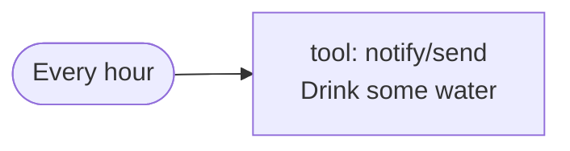
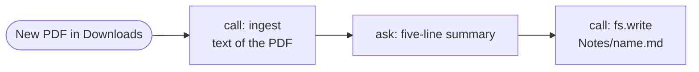
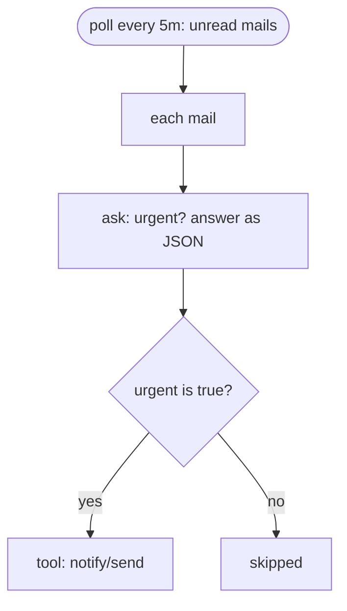
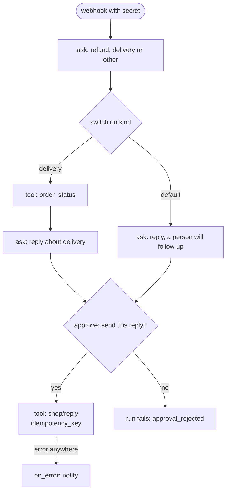
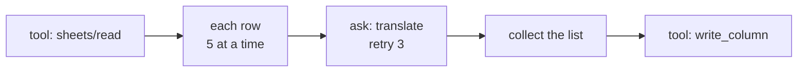
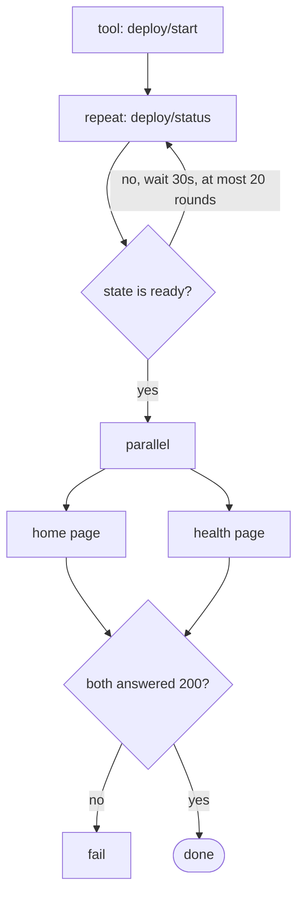
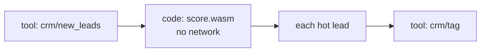
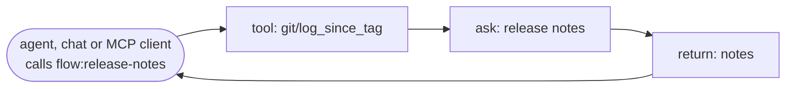
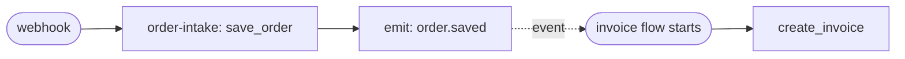
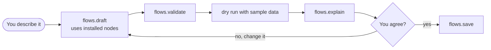

# Flow examples

> **Draft for review.** Automation is partly built; examples that use triggers or steps not built yet show the planned format. What is built: [Automation](README.md).

From one step to a large flow. The tool names (`mcp:notify/send`, `mcp:github/...`) stand for
whatever MCP servers or plugins you have installed; `flows.nodes` lists yours.

Guide: [Flows](guide.md). Reference: [Automation](README.md).

## 1. One step on a schedule



Every hour, a reminder.

```yaml
flow: cluaiz.flow/1
name: water-reminder
on: [{ schedule: "0 * * * *" }]
steps:
  - tool: mcp:notify/send
    with: { text: "Drink some water" }
```

## 2. A new file: read, summarise, keep



A PDF arrives in Downloads; its summary goes into your notes.

```yaml
flow: cluaiz.flow/1
name: pdf-to-notes
on:
  - file: { path: "~/Downloads", glob: "*.pdf" }
steps:
  - id: text
    call: ingest
    with: { source: "${{ trigger.path }}" }
  - id: summary
    ask: "Summarise this document in five lines."
    with: { document: "${{ steps.text.output.processed_sources[0].chunks }}" }
  - call: fs.write
    with:
      path: "~/Documents/Notes/${{ trigger.name }}.md"
      text: "${{ steps.summary.output }}"
```

## 3. A condition from a model's judgement



Only urgent mails send an alert.

```yaml
flow: cluaiz.flow/1
name: urgent-mail
on:
  - poll: { tool: mcp:mail/unread, every: 5m }
steps:
  - id: mails
    each: "${{ trigger.output.mails }}"
    as: mail
    do:
      - id: judge
        ask: "Is this mail urgent? Urgent means it needs an answer today."
        with: { mail: "${{ mail }}" }
        output_schema:
          type: object
          properties: { urgent: { type: boolean }, reason: { type: string } }
          required: [urgent]
      - when: { eq: [{ var: steps.judge.output.urgent }, true] }
        tool: mcp:notify/send
        with: { text: "Urgent: ${{ mail.subject }} (${{ steps.judge.output.reason }})" }
```

## 4. A webhook, branches and a person's approval



A customer message arrives; the model drafts a reply; you approve it before it is sent.

```json
{
  "flow": "cluaiz.flow/1",
  "name": "support-reply",
  "secrets": ["SHOP_HOOK"],
  "on": [{ "webhook": { "secret": "env:SHOP_HOOK" } }],
  "steps": [
    { "id": "kind", "ask": "Is this a refund request, a delivery question or something else?",
      "with": { "message": "${{ trigger.body.message }}" },
      "output_schema": { "type": "object", "properties": { "kind": { "enum": ["refund", "delivery", "other"] } }, "required": ["kind"] } },
    { "id": "route", "switch": [
        { "when": { "eq": [{ "var": "steps.kind.output.kind" }, "delivery"] },
          "do": [
            { "id": "order", "tool": "mcp:shop/order_status", "with": { "id": "${{ trigger.body.order_id }}" } },
            { "id": "draft", "ask": "Write a short, friendly reply about the delivery status.",
              "with": { "status": "${{ steps.order.output }}", "message": "${{ trigger.body.message }}" } }
          ] }
      ],
      "default": [
        { "id": "draft_other", "ask": "Write a short, friendly reply. Say a person will follow up.",
          "with": { "message": "${{ trigger.body.message }}" } }
      ] },
    { "id": "ok", "approve": "Send this reply?", "with": { "reply": "${{ steps.route.output }}" }, "timeout": "4h" },
    { "tool": "mcp:shop/reply", "with": { "to": "${{ trigger.body.customer }}", "text": "${{ steps.route.output }}" },
      "idempotency_key": "${{ trigger.body.message_id }}" }
  ],
  "on_error": [{ "tool": "mcp:notify/send", "with": { "text": "support-reply failed: ${{ error.message }}" } }]
}
```

The model reads outside text (the customer's message) and the flow can send data out, so the reply
waits for your approval. The `idempotency_key` keeps a resumed run from replying twice.

## 5. Many items, several at a time, with retries



Translate every row of a sheet, five rows at a time.

```yaml
flow: cluaiz.flow/1
name: translate-sheet
inputs:
  sheet: { type: string }
  language: { type: string, default: Hindi }
steps:
  - id: rows
    tool: mcp:sheets/read
    with: { sheet: "${{ inputs.sheet }}" }
  - id: translated
    each: "${{ steps.rows.output.rows }}"
    as: row
    parallel: 5
    stop_on_error: false
    do:
      - id: one
        ask: "Translate to ${{ inputs.language }}. Answer with the translation only."
        with: { text: "${{ row.text }}" }
        retry: { max: 3, delay: 5s, backoff: exponential }
  - tool: mcp:sheets/write_column
    with: { sheet: "${{ inputs.sheet }}", column: "translation", values: "${{ steps.translated.output }}" }
```

## 6. Waiting for something, then going on



Deploy, wait until it is ready (at most 10 minutes), then check the site.

```yaml
flow: cluaiz.flow/1
name: deploy-and-check
on: [{ manual: {} }]
steps:
  - tool: mcp:deploy/start
  - id: ready
    repeat:
      - id: status
        tool: mcp:deploy/status
    until: { eq: [{ var: steps.status.output.state }, "ready"] }
    max: 20
    delay: 30s
  - id: check
    parallel:
      home:   [ { tool: mcp:http/get, with: { url: "https://example.com/" } } ]
      health: [ { tool: mcp:http/get, with: { url: "https://example.com/health" } } ]
  - when:
      any:
        - ne: [{ var: steps.check.output.home.status }, 200]
        - ne: [{ var: steps.check.output.health.status }, 200]
    fail: "The site does not answer after the deploy"
```

## 7. Your own code in WebAssembly



Score leads with your own rules, compiled to WebAssembly from any language.

```yaml
flow: cluaiz.flow/1
name: lead-scoring
permissions:
  tools: ["mcp:crm/*"]
  network: []
steps:
  - id: leads
    tool: mcp:crm/new_leads
  - id: scored
    code: score.wasm
    fn: main
    with: { leads: "${{ steps.leads.output }}" }
  - each: "${{ steps.scored.output.hot }}"
    as: lead
    do:
      - tool: mcp:crm/tag
        with: { id: "${{ lead.id }}", tag: "hot" }
```

`score.wasm` receives `{ "leads": [...] }` as JSON and returns `{ "hot": [...] }`. With
`network: []` it can reach nothing outside.

## 8. A flow as a tool



Offer a flow to the coding agent and to MCP clients; they call it with its inputs.

```yaml
flow: cluaiz.flow/1
name: release-notes
description: Writes release notes from the commits since the last tag.
inputs:
  repo: { type: string, description: "Folder of the git repository" }
on:
  - tool: { description: "Release notes since the last tag" }
steps:
  - id: log
    tool: plugin:git/log_since_tag
    with: { repo: "${{ inputs.repo }}" }
  - id: notes
    ask: "Write release notes grouped as Added, Fixed and Changed."
    with: { commits: "${{ steps.log.output }}" }
  - return: { notes: "${{ steps.notes.output }}" }
```

## 9. Flows working together



One flow sends an event; another starts on it.

```yaml
# order-intake.flow.yaml
flow: cluaiz.flow/1
name: order-intake
secrets: [SHOP_HOOK]
on: [{ webhook: { secret: "env:SHOP_HOOK" } }]
steps:
  - id: saved
    tool: mcp:shop/save_order
    with: { order: "${{ trigger.body }}" }
  - emit: order.saved
    with: { id: "${{ steps.saved.output.id }}" }
```

```yaml
# invoice.flow.yaml
flow: cluaiz.flow/1
name: invoice
on: [{ event: order.saved }]
steps:
  - tool: mcp:billing/create_invoice
    with: { order_id: "${{ trigger.data.id }}" }
```

## 10. Described in words



You say: "Every Friday at 6 pm, read this week's closed issues in my repo and send me a short
report."

`flows.draft` returns a flow like this, checks it, runs it once with sample data, and explains it:
"Every Friday at 18:00 → list the issues closed in the last 7 days → a short report → sent to you."
You confirm, and it is saved.

```yaml
flow: cluaiz.flow/1
name: weekly-issues
on: [{ schedule: "0 18 * * 5", timezone: Asia/Kolkata }]
steps:
  - id: closed
    tool: mcp:github/list_issues
    with: { repo: "my/repo", state: closed, closed_in_last_days: 7 }
  - id: report
    ask: "Write a short weekly report of these closed issues."
    with: { issues: "${{ steps.closed.output }}" }
  - tool: mcp:notify/send
    with: { text: "${{ steps.report.output }}" }
```
