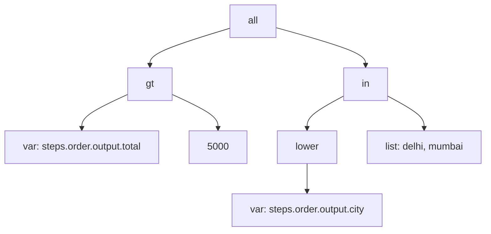
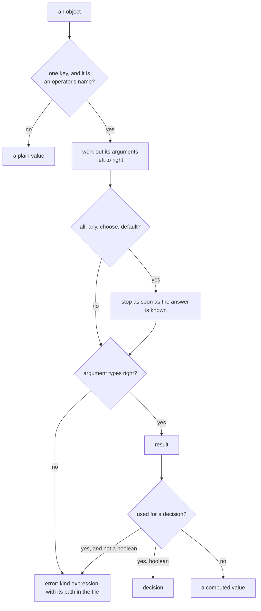

# Expressions

> **Draft for review.** Automation is partly built; what is and is not: [Automation](README.md).

An expression is a JSON object with **one operator**: its key is the operator, its value the
arguments. Expressions decide (`when`, `if`, `switch`, `until`, `filter`, `stop_when`) and compute
values (`{ "expr": … }` in `with`, `set`, `output`, `outputs`, `dedupe`).

```json
{ "all": [
  { "gt": [{ "var": "steps.order.output.total" }, 5000] },
  { "in": [{ "lower": { "var": "steps.order.output.city" } }, ["delhi", "mumbai"]] }
] }
```

The same in YAML:

```yaml
all:
  - gt: [{ var: steps.order.output.total }, 5000]
  - in: [{ lower: { var: steps.order.output.city } }, [delhi, mumbai]]
```

Expressions **only compute**. They cannot call tools, read files, reach the network, write anything
or loop without end. Their cost grows with the size of their input, so they are quick and their
result can always be explained afterwards. A judgement ("is this mail urgent?") belongs in an
[`ask`](steps/ask.md) step; the expression then reads its answer.

The example above as a tree: each box is one operator, its children are its arguments.



## Contents

- [Rules](#rules)
- [Values and references](#values-and-references)
- [Logic](#logic)
- [Comparison](#comparison)
- [Text](#text)
- [Lists](#lists)
- [Objects](#objects)
- [Types and conversion](#types-and-conversion)
- [Numbers](#numbers)
- [Time](#time)
- [Change between runs](#change-between-runs)
- [Encoding](#encoding)
- [Errors and limits](#errors-and-limits)

## Rules



1. **One operator per object.** `{ "gt": [a, b] }`. An object with one key that is an operator's
   name is that operator; any other object is a plain value. For a plain object whose only key
   happens to be an operator's name, write `{ "literal": { … } }`.
2. **Arguments.** A list for several arguments (`{ "gt": [a, b] }`); a single argument may be written
   without the list (`{ "not": c }`, `{ "upper": x }`). Each argument may itself be an expression.
3. **Arguments are worked out first**, left to right, except in `all`, `any`, `choose` and `default`,
   which stop as soon as the answer is known.
4. **Types are not guessed.** `"5"` is text and `5` a number; `{ "eq": ["5", 5] }` is false. Convert
   on purpose with `to_number` or `to_text`.
5. **`null` means missing.** A reference that finds nothing gives `null`. Comparisons with `null`
   are false (except `eq` and `ne`); text and list functions treat `null` as empty; number functions
   with `null` give `null`. Write `{ "default": [x, 0] }` to choose a value for missing data.
6. **Decisions need booleans.** `when`, `if`, `until`, `filter` must get `true` or `false`; anything
   else is an error with kind `expression`. There is no "truthy": use `empty`, `exists`, `eq`.
7. **An error in an expression** fails the step that holds it, with kind `expression` and the path
   of the expression in the file. In a trigger's `filter`, it means no run, and is recorded on the
   trigger.

## Values and references

| Operator | Form | Gives | Example → result |
| --- | --- | --- | --- |
| `var` | `{ var: "path" }` | The value at the path, or `null` | `{ var: inputs.days }` → `7` |
| `var` with default | `{ var: ["path", default] }` | The value, or `default` when it is `null` | `{ var: [inputs.days, 7] }` → `7` |
| `literal` | `{ literal: value }` | The value exactly, not read as an expression | `{ literal: { gt: 1 } }` → `{ "gt": 1 }` |
| `default` | `{ default: [a, b, …] }` | The first argument that is not `null` | `{ default: [null, "", "x"] }` → `""` |
| `choose` | `{ choose: [condition, then, else] }` | `then` when the condition is true, else `else` | `{ choose: [true, "a", "b"] }` → `"a"` |

Paths are as in [References](references.md#paths). `now` is a path: `{ var: now }`.

## Logic

| Operator | Form | Gives | Notes |
| --- | --- | --- | --- |
| `all` | `{ all: [c1, c2, …] }` | `true` when every one is true | Stops at the first false. `{ all: [] }` is `true` |
| `any` | `{ any: [c1, c2, …] }` | `true` when at least one is true | Stops at the first true. `{ any: [] }` is `false` |
| `not` | `{ not: c }` | The opposite | `c` must be a boolean |

Every argument of `all`, `any` and `not` must be a boolean (rule 6).

## Comparison

| Operator | Form | True when | Types |
| --- | --- | --- | --- |
| `eq` | `{ eq: [a, b] }` | Equal | Any. Numbers by value (`1` = `1.0`); text exactly (case counts); lists item by item; objects field by field. `null` equals only `null` |
| `ne` | `{ ne: [a, b] }` | Not equal | As `eq` |
| `gt`, `gte`, `lt`, `lte` | `{ gt: [a, b] }` | `a > b`, `a ≥ b`, `a < b`, `a ≤ b` | Both numbers, both text (by Unicode code points), or both times (RFC 3339 text read as times). Different types: error. `null` on either side: `false` |
| `between` | `{ between: [x, low, high] }` | `low ≤ x ≤ high` | As `gt`. Use `{ all: [{ gt: … }, { lt: … }] }` for open ends |

Examples:

| Expression | Result |
| --- | --- |
| `{ eq: ["Delhi", "delhi"] }` | `false` |
| `{ eq: [{ lower: "Delhi" }, "delhi"] }` | `true` |
| `{ gt: [{ var: missing }, 5] }` | `false` |
| `{ gt: ["10", 5] }` | error: text and number |
| `{ lt: ["2026-11-01T00:00:00Z", { var: now }] }` | `true` after that time |

## Text

| Operator | Form | Gives | Example → result |
| --- | --- | --- | --- |
| `contains` | `{ contains: [text, part] }` | Whether `part` is in `text` | `{ contains: ["invoice 42", "42"] }` → `true` |
| `starts_with` | `{ starts_with: [text, part] }` | | `{ starts_with: ["INV-9", "INV-"] }` → `true` |
| `ends_with` | `{ ends_with: [text, part] }` | | `{ ends_with: ["a.pdf", ".pdf"] }` → `true` |
| `matches` | `{ matches: [text, pattern] }` or `{ matches: [text, pattern, "i"] }` | Whether the regular expression matches somewhere; `"i"` ignores case | `{ matches: ["Order #123", "#\\d+"] }` → `true` |
| `find` | `{ find: [text, pattern] }` | The first match's text and groups: `{ match, groups }`, or `null` | `{ find: ["id=77", "id=(\\d+)"] }` → `{ "match": "id=77", "groups": ["77"] }` |
| `lower`, `upper` | `{ lower: text }` | The text in lower or upper case | `{ upper: "abc" }` → `"ABC"` |
| `trim` | `{ trim: text }` | Without spaces and new lines at both ends | `{ trim: "  hi \n" }` → `"hi"` |
| `replace` | `{ replace: [text, from, to] }` | Every `from` replaced by `to` (plain text, not a pattern) | `{ replace: ["a-b-c", "-", " "] }` → `"a b c"` |
| `replace_pattern` | `{ replace_pattern: [text, pattern, to] }` | Every match replaced; `$1` in `to` is group 1 | `{ replace_pattern: ["2026-11-10", "(\\d+)-(\\d+)-(\\d+)", "$3/$2/$1"] }` → `"10/11/2026"` |
| `split` | `{ split: [text, separator] }` | A list of pieces | `{ split: ["a,b,c", ","] }` → `["a","b","c"]` |
| `join` | `{ join: [list, separator] }` | The items as one text | `{ join: [["a","b"], ", "] }` → `"a, b"` |
| `concat` | `{ concat: [a, b, …] }` | The arguments as text, one after another | `{ concat: ["#", 42] }` → `"#42"` |
| `substring` | `{ substring: [text, start, length] }` | Part of the text, by characters; `length` optional; a negative `start` counts from the end | `{ substring: ["abcdef", 1, 3] }` → `"bcd"` |
| `size` | `{ size: text }` | Number of characters | `{ size: "नमस्ते" }` → `6` |

Patterns use a regular-expression engine whose time grows linearly with the text (no
backtracking), so a pattern cannot hang a run. Look-around and back-references are not supported.
Patterns are at most 1,000 characters. In JSON, a backslash is written `\\`.

`null` as `text` counts as `""`. A number or boolean as `text` is an error: convert with `to_text`.

## Lists

`item` inside `some`, `every`, `filter`, `map`, `sort` and `find_item` is the current item, and
`index` its position.

| Operator | Form | Gives | Example → result |
| --- | --- | --- | --- |
| `in` | `{ in: [x, list] }` | Whether `x` equals (as `eq`) an item | `{ in: ["b", ["a","b"]] }` → `true` |
| `size` | `{ size: list }` | Number of items (`null` → `0`) | `{ size: [1,2,3] }` → `3` |
| `empty` | `{ empty: x }` | `true` for `null`, `""`, `[]`, `{}` | `{ empty: [] }` → `true` |
| `some` | `{ some: [list, condition] }` | At least one item makes it true | `{ some: [[1,5], { gt: [{ var: item }, 3] }] }` → `true` |
| `every` | `{ every: [list, condition] }` | Every item makes it true (`true` for an empty list) | |
| `filter` | `{ filter: [list, condition] }` | The items that make it true | `{ filter: [[1,5,7], { gt: [{ var: item }, 3] }] }` → `[5,7]` |
| `map` | `{ map: [list, expression] }` | The expression worked out for each item | `{ map: [[1,2], { mul: [{ var: item }, 10] }] }` → `[10,20]` |
| `pluck` | `{ pluck: [list, "path"] }` | The value at the path in each item | `{ pluck: [[{n:"a"},{n:"b"}], "n"] }` → `["a","b"]` |
| `find_item` | `{ find_item: [list, condition] }` | The first item that makes it true, or `null` | |
| `first`, `last` | `{ first: list }` | The first or last item, or `null` | `{ last: [1,2,3] }` → `3` |
| `slice` | `{ slice: [list, start, end] }` | Items from `start` up to (not including) `end`; negatives count from the end | `{ slice: [[1,2,3,4], 1, 3] }` → `[2,3]` |
| `sort` | `{ sort: [list] }`, `{ sort: [list, "path"] }`, `{ sort: [list, "path", "desc"] }` | Sorted by the items, or by the value at the path; numbers, text or times | `{ sort: [[3,1,2]] }` → `[1,2,3]` |
| `unique` | `{ unique: list }` | Without repeated items (as `eq`), first kept | `{ unique: [1,1,2] }` → `[1,2]` |
| `flatten` | `{ flatten: list }` | Lists inside the list opened one level | `{ flatten: [[1,[2]],[3]] }` → `[1,[2],3]` |
| `sum`, `avg` | `{ sum: list }` | Sum, average of numbers (`avg` of `[]` is `null`) | `{ sum: [1,2,3] }` → `6` |
| `list_min`, `list_max` | `{ list_max: list }` | Smallest, largest item | |
| `count` | `{ count: [list, condition] }` | How many items make it true | |
| `concat_lists` | `{ concat_lists: [l1, l2, …] }` | The lists joined | |
| `range` | `{ range: [start, end] }` | Whole numbers from `start` up to (not including) `end`, at most 10,000 | `{ range: [0, 3] }` → `[0,1,2]` |

## Objects

| Operator | Form | Gives | Example → result |
| --- | --- | --- | --- |
| `get` | `{ get: [object, "path"] }` | The value at a path inside a value, with a path that may come from data | `{ get: [{ var: trigger.body }, { var: vars.field }] }` |
| `has` | `{ has: [object, "field"] }` | Whether the object has the field (even with `null`) | |
| `keys`, `values` | `{ keys: object }` | Its field names, its values | `{ keys: { a: 1, b: 2 } }` → `["a","b"]` |
| `entries` | `{ entries: object }` | `[{ key, value }, …]` | |
| `from_entries` | `{ from_entries: list }` | An object from `{ key, value }` items | |
| `merge` | `{ merge: [o1, o2, …] }` | The fields of all; later ones win | `{ merge: [{a:1},{a:2,b:3}] }` → `{ "a": 2, "b": 3 }` |
| `pick` | `{ pick: [object, ["a","b"]] }` | Only these fields | |
| `omit` | `{ omit: [object, ["a"]] }` | Without these fields | |
| `object` | `{ object: { field: expression, … } }` | A new object, each field worked out | `{ object: { total: { sum: { var: vars.prices } } } }` |

## Types and conversion

| Operator | Form | Gives | Notes |
| --- | --- | --- | --- |
| `exists` | `{ exists: "path" }` | Whether the path has a value that is not `null` | |
| `is` | `{ is: [x, type] }` | Whether `x` is of the type | `string`, `number`, `integer`, `bool`, `list`, `object`, `null`, `time` (text that reads as RFC 3339), `file` (a file reference) |
| `type_of` | `{ type_of: x }` | The type's name, as above | |
| `to_number` | `{ to_number: x }` | A number from text (`"12.5"` → `12.5`), a boolean (`1`/`0`) or a number | Text that is not a number: error. `null` → `null` |
| `to_integer` | `{ to_integer: x }` | As `to_number`, then rounded toward zero | |
| `to_text` | `{ to_text: x }` | Text, as in [Types in strings](references.md#types-in-strings) | |
| `to_bool` | `{ to_bool: x }` | `true` for `true`, `"true"`, `"yes"`, `"1"`, `1`; `false` for `false`, `"false"`, `"no"`, `"0"`, `0`, `""`, `null` | Anything else: error |
| `parse_json` | `{ parse_json: text }` | The JSON value in the text | Not JSON: error |
| `to_json` | `{ to_json: x }` | Compact JSON text | |

## Numbers

| Operator | Form | Gives | Example → result |
| --- | --- | --- | --- |
| `add` | `{ add: [a, b, …] }` | Sum | `{ add: [1, 2, 3] }` → `6` |
| `sub` | `{ sub: [a, b] }` | `a − b` | |
| `mul` | `{ mul: [a, b, …] }` | Product | |
| `div` | `{ div: [a, b] }` | `a ÷ b`; dividing by 0 is an error | `{ div: [7, 2] }` → `3.5` |
| `mod` | `{ mod: [a, b] }` | Remainder | `{ mod: [7, 3] }` → `1` |
| `round` | `{ round: x }`, `{ round: [x, digits] }` | Rounded, halves away from zero | `{ round: [2.345, 2] }` → `2.35` |
| `floor`, `ceil` | `{ floor: x }` | Down, up to a whole number | |
| `abs` | `{ abs: x }` | Without the sign | |
| `min`, `max` | `{ min: [a, b, …] }` | Smallest, largest argument | `{ max: [3, 9, 1] }` → `9` |

Numbers are 64-bit floating point; whole numbers up to 2⁵³ are exact. A result that is not a finite
number (too large) is an error.

## Time

Times are RFC 3339 text (`2026-11-10T18:30:00+05:30`). Durations are as in
[Limits](limits.md#durations-and-sizes) (`90s`, `2h`, `7d`). Day-of-week and time-of-day operators use
the flow's `timezone`, or the one given.

| Operator | Form | Gives | Example → result |
| --- | --- | --- | --- |
| `before`, `after` | `{ before: [t1, t2] }` | Whether `t1` is earlier, later than `t2` | |
| `within` | `{ within: [t, duration] }` | Whether `t` is in the last `duration` before now | `{ within: [{ var: trigger.mail.date }, "2h"] }` |
| `weekday` | `{ weekday: [t, ["sat","sun"]] }` | Whether `t`'s day is one of these (`mon`–`sun`) | |
| `time_between` | `{ time_between: [t, "09:00", "18:00"] }` | Whether `t`'s time of day is in the range; a range past midnight (`"22:00"`, `"06:00"`) works | |
| `add_time` | `{ add_time: [t, duration] }` | `t` plus the duration; `"-7d"` goes back | `{ add_time: [{ var: now }, "-7d"] }` |
| `diff_time` | `{ diff_time: [t1, t2, unit] }` | `t1 − t2` in `ms`, `s`, `m`, `h` or `d` | |
| `start_of` | `{ start_of: [t, unit] }` | The start of its `day`, `week` (Monday), `month` or `year` | |
| `format_time` | `{ format_time: [t, format] }` | Text such as `"10 Nov 2026"`; tokens `YYYY MM DD HH mm ss ddd MMM` | `{ format_time: [{ var: now }, "DD MMM YYYY"] }` |
| `parse_time` | `{ parse_time: [text, format] }` | An RFC 3339 time from text in that format | `{ parse_time: ["10/11/2026", "DD/MM/YYYY"] }` |
| `to_time` | `{ to_time: x }` | A time from RFC 3339 text or Unix milliseconds | |
| `to_unix_ms` | `{ to_unix_ms: t }` | Milliseconds since 1970 | |

## Change between runs

| Operator | Form | Gives |
| --- | --- | --- |
| `changed` | `{ changed: "path" }` | Whether the value at the path differs from its value in this flow's last **succeeded** run. `true` on the first run |
| `previous` | `{ previous: "path" }` | The value at the path in the last succeeded run, or `null` |

Automation keeps, for each flow, the last values of the paths used in `changed` and `previous`
(not the whole earlier run).

## Encoding

| Operator | Form | Gives |
| --- | --- | --- |
| `base64_encode`, `base64_decode` | `{ base64_encode: text }` | Standard Base64 of UTF-8 text, and back |
| `url_encode` | `{ url_encode: text }` | Text safe inside a URL query |
| `sha256` | `{ sha256: text }` | The SHA-256 of the UTF-8 text, as lower-case hex |

## Errors and limits

An expression fails with kind `expression` and a message naming the operator and the path in the
file, for example `steps[2].when.all[1].gt: cannot compare text with a number`.

| Limit | Value (*proposed*) |
| --- | --- |
| Depth of nested operators | 64 |
| Operations in one evaluation (each operator and each item of a list operator counts) | 1,000,000 |
| Items a list operator works on | 100,000 (larger data: use `each` with `batch`) |
| Length of a text result | 10 MB |
| Pattern length | 1,000 characters |

`flows.validate` checks every expression's shape and operator names before a run; types are checked
as far as the schemas of inputs and tools allow, and fully when the expression runs.
