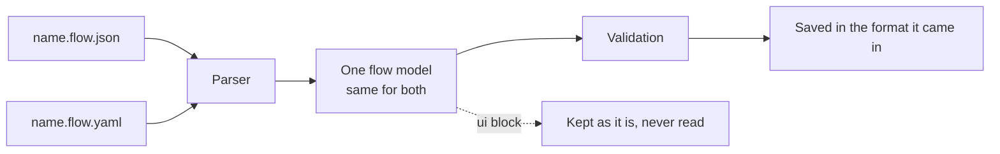
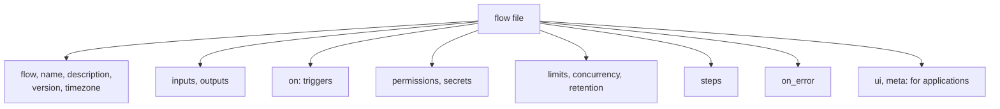

# The flow file

> **Draft for review.** Automation is partly built; what is and is not: [Automation](README.md).

## Formats

| Format | File name | Notes |
| --- | --- | --- |
| JSON | `<name>.flow.json` | UTF-8. Comments are not allowed |
| YAML | `<name>.flow.yaml` or `<name>.flow.yml` | Read as YAML 1.2: `on`, `yes`, `no` are plain words, not true and false. Comments are kept when Automation saves the text it was given |

Both formats have the same schema (`flows.schema`). Automation turns either into the same model, and
saves a flow in the format it was given. `flows.get` can return either form.

Rules for both:

- One flow per file. The file's `name` field must match the file name without the suffix.
- Unknown fields are an error (`unknown_field`), except inside `ui` and `meta`.
- At most 1 MB of text per file (*proposed*).
- YAML anchors and aliases are allowed; YAML tags (`!something`) are not.

## From text to a flow



## Where flows are kept

| Scope | Folder | Used for |
| --- | --- | --- |
| `project` | `<project>/.agents/flows/` | A project's flows: kept with the project, for example in git. The project is the Engine's current workspace (`workspace.get`) |
| `user` | `<Cluaiz folder>/flows/` (`~/.cluaiz/flows/`) | Your own flows, for every project |

A flow is named by `name` and `scope`. The same name may exist in both scopes; methods that take a
name without a scope use the project's flow first, then the user's.

Run records are kept apart from the flow files, in `<Cluaiz folder>/flows/runs/` (see
[Runs and records](runs.md)), so a project's folder holds only its flow files.

## Top-level fields



| Field | Type | Required | Default | Meaning |
| --- | --- | --- | --- | --- |
| `flow` | string | Yes | — | The format version. `cluaiz.flow/1` for this reference |
| `name` | string | Yes | — | 1–64 characters: lowercase letters, digits, `-`, `_`; starts with a letter or digit |
| `description` | string | No | — | What the flow does. Shown in lists, to the agent when the flow is a tool, and used by `flows.explain` |
| `version` | string | No | — | The author's own version text. Automation also records each file's hash per run |
| `timezone` | string | No | The computer's | IANA name (`Asia/Kolkata`). Used by `schedule`, `weekday`, `time_between`, `format_time` |
| `inputs` | object | No | `{}` | Input name → JSON Schema. See [Inputs](#inputs) |
| `outputs` | object | No | — | Output name → value (references allowed). What the run returns if it ends without `return` |
| `on` | list | No | `[]` | [Triggers](triggers.md). With none, the flow runs only when started (`manual` is always possible) |
| `permissions` | object | No | Computed at save | [Permissions](permissions.md) |
| `secrets` | list of strings | No | `[]` | Names of the secrets the flow reads (`env:NAME` in fields that take secrets) |
| `limits` | object | No | See [Limits](limits.md) | `timeout`, `max_steps`, `max_parallel`, `result_in_memory` |
| `concurrency` | string | No | `queue` | `queue`, `skip`, `replace`, `parallel`. See [Limits](limits.md#concurrency) |
| `retention` | object | No | Settings | `{ days, runs }`: how long this flow's runs are kept |
| `steps` | list | Yes | — | At least one step. See [Steps](steps/README.md) |
| `on_error` | list | No | `[]` | Steps run when the run fails. `error` holds the failure |
| `ui` | any | No | — | The application's own data. Kept exactly as given; never read or changed by Automation |
| `meta` | object | No | — | Tags, author, links, anything else. Not read by Automation; `flows.list` can filter by `meta.tags` |

## Inputs

`inputs` maps each input's name to a JSON Schema (draft 2020-12 keywords: `type`, `enum`, `default`,
`minimum`, `maxLength`, `items`, `properties`, `required`, `description`, `format`).

```yaml
inputs:
  repo: { type: string, description: "owner/name" }
  days: { type: integer, minimum: 1, maximum: 90, default: 7 }
  labels: { type: array, items: { type: string }, default: [] }
```

- A run's inputs are checked before the first step. A missing input with a `default` gets it; a
  missing input without one fails the run with kind `invalid_input`.
- Inputs not in `inputs` are refused (`invalid_input`), so a typing mistake is not silently ignored.
- When the flow is a tool (`tool` trigger), `inputs` is the tool's parameter schema; `description`
  of each input is what the calling model reads.
- A template's form in an application is built from `inputs`.

## Outputs

```yaml
outputs:
  summary: "${{ steps.short.output }}"
  count: "${{ steps.rows.output.total }}"
```

The values are resolved when the run ends without a `return` step. A `return` step's value replaces
them. A sub-flow (`run` step) and a flow used as a tool give these outputs to their caller.

## Versions of the format

`flow: cluaiz.flow/1` names the format. A later format (`cluaiz.flow/2`) will be read by versions of
Automation that know it; a version refuses a format it does not know (`unknown_version`), instead of guessing.
Within version 1, new optional fields may be added; existing fields keep their meaning.

## The `ui` field

Applications keep their own data here: positions on a canvas, colours, collapsed groups, comments.

```json
{
  "flow": "cluaiz.flow/1",
  "name": "issue-triage",
  "steps": [
    { "id": "label", "ask": "Bug, feature or question?", "with": "${{ trigger.body.title }}" },
    { "id": "post", "tool": "mcp:github/add_label", "with": { "label": "${{ steps.label.output }}" } }
  ],
  "ui": { "my-editor": { "positions": { "label": [120, 80], "post": [420, 80] } } }
}
```

Automation stores it as it is, returns it with the flow, and never reads it. An application should
keep its data under its own key, so two editors do not overwrite each other's.

## A complete file

```yaml
flow: cluaiz.flow/1
name: weekly-issues
description: Every Friday evening, a short report of the issues closed this week.
version: "1.2"
timezone: Asia/Kolkata
inputs:
  repo: { type: string, default: "my/repo" }
outputs:
  report: "${{ steps.report.output }}"
on:
  - schedule: "0 18 * * 5"
permissions:
  tools: ["mcp:github/list_issues", "mcp:notify/send"]
  models: ["*"]
limits: { timeout: 10m }
concurrency: skip
steps:
  - id: closed
    tool: mcp:github/list_issues
    with: { repo: "${{ inputs.repo }}", state: closed, closed_in_last_days: 7 }
  - id: report
    ask: "Write a short weekly report of these closed issues."
    with: { issues: "${{ steps.closed.output }}" }
  - tool: mcp:notify/send
    with: { text: "${{ steps.report.output }}" }
on_error:
  - tool: mcp:notify/send
    with: { text: "weekly-issues failed at ${{ error.step }}: ${{ error.message }}" }
meta: { tags: [github, reports] }
```
