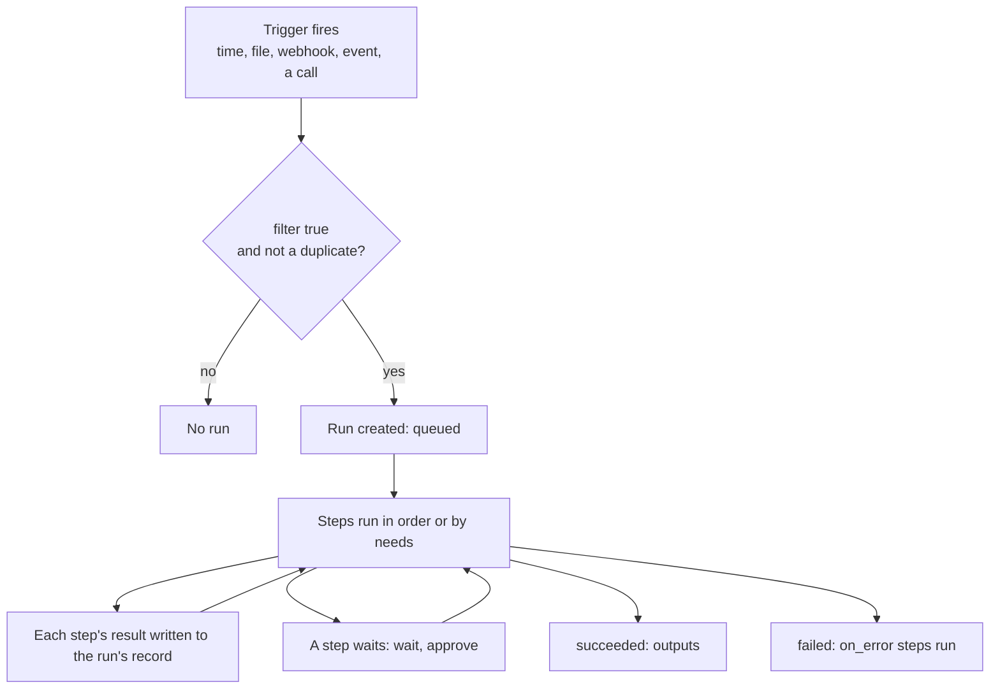

# Automation guide: your first flows

> **Draft for review.** Automation is partly built (see [Automation](README.md)). This page describes the whole design; names,
> fields and defaults may change before the first release that has them.

A flow is a list of steps that Cluaiz Automation runs for you: when something happens (a time, a
new file, a webhook, an event in the Engine), or when you start it. A step can run any installed
tool (MCP servers, plugins, skills), any Engine method, a model (installed or a provider's), a
person's approval, or your own code in WebAssembly.

Automation is not part of the Engine and not part of the API. It is a separate layer that uses
them: the Engine's methods, its models and the tools installed in it. See
[Where Automation sits](README.md#where-automation-sits).

```yaml
flow: cluaiz.flow/1
name: morning-news
on:
  - schedule: "0 9 * * *"
    timezone: Asia/Kolkata
steps:
  - id: news
    tool: mcp:web-search/search
    with: { query: "AI news today" }
  - id: short
    ask: "Summarise these results in five bullet points."
    with: { results: "${{ steps.news.output }}" }
  - id: send
    tool: mcp:telegram/send
    with: { text: "${{ steps.short.output }}" }
```

Every morning at 9: search, summarise with a model, send the summary.

## Contents

- [How a flow works](#how-a-flow-works)
- [Ways to build one](#ways-to-build-one)
- [The pieces](#the-pieces)
- [Data between steps](#data-between-steps)
- [Conditions](#conditions)
- [When things fail](#when-things-fail)
- [Permissions and security](#permissions-and-security)
- [Where flows are kept](#where-flows-are-kept)
- [Runs and their records](#runs-and-their-records)
- [What Automation does and what it leaves to applications](#what-automation-does-and-what-it-leaves-to-applications)
- [Not included](#not-included)

Every part in depth: [Automation](README.md). Quick overview of everything on one page:
[Automation reference](../reference/automation.md). The methods, one page each:
[Methods](methods/README.md). Webhooks:
[`POST /v1/hooks/{flow}`](webhooks.md). Examples, from one step to a large flow:
[Flow examples](examples.md).

Applications manage flows through Automation's methods (`flows.*`). They are called at the same
`POST /v1/cep` address as the Engine's methods, so they use the same authentication, scopes,
approvals, tasks and audit log. Only webhooks from outside services use their own route, because
those services cannot send JSON-RPC.

## How a flow works



1. A **trigger** fires: a schedule, a file, a webhook, an Engine event, a call from an app, or you
   start the flow yourself.
2. Automation checks the trigger's **filter** and starts a **run**.
3. The **steps** run in order, or as their `needs` say. Each step's result is written to the run's
   record before the next step starts.
4. The run ends with its outputs, or with an error that runs the flow's `on_error` steps.

If Automation stops during a run (a crash, a restart), the run continues from where it was when
Automation starts again: steps that finished are not run a second time.

## Ways to build one

All of these make the same file, so a flow made one way can be opened and changed in any other.

| Way | How |
| --- | --- |
| Describe it | "When a PDF arrives in Downloads, put a short summary in my notes." Automation drafts the flow, with a model, from the tools you have installed, checks it, runs a test, explains it in plain words and saves it when you agree (`flows.draft`) |
| A template | Pick a shared flow from the Cluaiz Tools registry and fill in its inputs |
| A file | Write JSON or YAML in `.agents/flows/` of a project or in the Cluaiz folder's `flows/` |
| The terminal | `cluaiz flow new`, `cluaiz flow run <name>`, `cluaiz flow logs <name>` |
| The coding agent | `/flow <name>`; flows can also be offered to the agent as tools |
| Code | Any language, through `POST /v1/cep` (`flows.*` methods) or the C library (`cep_call`) |
| MCP clients | Flows appear as tools; clients can also draft and save flows |
| An application's editor | The App, or any program, draws its own editor from `flows.nodes` and `flows.schema` |

## The pieces

### Triggers

| Trigger | Starts a run when |
| --- | --- |
| `manual` | You or a program start it |
| `schedule` | A time comes round (cron line with a timezone, or `every: 15m`) |
| `webhook` | An outside service sends a request to the flow's address, with its secret |
| `poll` | A tool, run every few minutes, returns something new (for services without webhooks) |
| `file` | A file appears or changes in a folder |
| `engine` | Something happens in the Engine: a chat finished, a model downloaded, a task done |
| `event` | Another flow sends an event |
| `tool` | The flow is called as a tool, by the agent, a chat or an MCP client |
| `startup` | Automation starts (with the Engine) |

A trigger can have a `filter` (a condition on what it brought) and a `dedupe` key (one run per
event, even if the event arrives twice).

### Steps

| Step | Does |
| --- | --- |
| `tool` | Runs an installed tool: `mcp:<server>/<tool>`, `plugin:<name>/<function>`, `skill:<name>` |
| `call` | Runs an Engine method, such as `fs.read`, `audio.run` or `notes.create`, or one of the Engine's own routes: `ingest`, `embeddings`, `speech`, `transcription` |
| `ask` | Asks a model: an instruction, the data it needs, optional tools, and optionally the JSON shape of the answer |
| `agent` | As `ask`, with several rounds of tool calls |
| `if` | Runs `then` or `else` |
| `switch` | Runs the first case whose condition holds |
| `each` | Runs steps for every item of a list, optionally several at a time |
| `parallel` | Runs named branches at the same time |
| `repeat` | Runs steps again until a condition holds, at most `max` times |
| `wait` | Waits for a time, a duration, an event or a webhook |
| `approve` | Asks a person yes or no |
| `set` | Keeps values for later steps |
| `run` | Runs another flow |
| `code` | Runs your WebAssembly module |
| `emit` | Sends an event other flows can start on |
| `return` | Ends the run with outputs |
| `fail` | Ends the run with an error |

Every step can also have `when` (run only if a condition holds), `needs` (wait for other steps),
`retry`, `timeout`, `on_error` and `approve_before`.

## Data between steps

Each step's result is `steps.<id>.output`. A later step uses it in `with`:

```yaml
- id: text
  call: ingest
  with: { source: "${{ trigger.path }}" }
- id: summary
  ask: "Summarise this document in five lines."
  with: { document: "${{ steps.text.output.processed_sources[0].chunks }}" }
```

What a run can read:

| Name | Holds |
| --- | --- |
| `inputs` | What the run was started with |
| `trigger` | What the trigger brought: a webhook's body, a file's path, an event |
| `steps.<id>.output` | A step's result (also `.status`, `.error`, `.ms`) |
| `vars` | Values kept with `set` |
| `item`, `index` | The current item inside `each` |
| `error` | The error, inside `on_error` |
| `run` | The run's id, start time and flow name |

Two rules keep data safe and memory small:

- **Data is passed as data.** A value from a webhook or a web page is never pasted into code or a
  command. A `code` step receives its input as JSON. `flows.validate` warns when a reference sits
  inside code or command text.
- **Large results are files.** A result above the size limit is written to the run's folder, and
  later steps get a reference to the file and read it as a stream. `each` can work in batches.

## Conditions

Conditions are written as JSON, one operator per object. Applications can draw and edit them
without parsing text, and they cannot loop, write files or reach the network, so they are quick and
safe.

```yaml
- id: big_order
  if:
    all:
      - gt: [{ var: steps.order.output.total }, 5000]
      - in: [{ var: steps.order.output.city }, ["Delhi", "Mumbai"]]
  then:
    - tool: mcp:notify/send
      with: { text: "Big order from ${{ steps.order.output.city }}" }
```

| Group | Operators |
| --- | --- |
| Compare | `eq`, `ne`, `gt`, `gte`, `lt`, `lte`, `between` |
| Logic | `all`, `any`, `not` |
| Text | `contains`, `starts_with`, `ends_with`, `matches` |
| Lists | `in`, `size`, `empty`, `some`, `every` |
| Presence and type | `exists`, `is` |
| Time | `before`, `after`, `within`, `weekday`, `time_between` |
| Change | `changed` (differs from the last run) |
| Numbers | `add`, `sub`, `mul`, `div`, `round`, `min`, `max` |

A judgement such as "is this mail urgent?" is an `ask` step that answers in a fixed shape; the
condition then reads that answer:

```yaml
- id: judge
  ask: "Is this mail urgent?"
  with: { mail: "${{ trigger.mail }}" }
  output_schema:
    type: object
    properties: { urgent: { type: boolean } }
    required: [urgent]
- id: alert
  when: { eq: [{ var: steps.judge.output.urgent }, true] }
  tool: mcp:notify/send
  with: { text: "Urgent mail: ${{ trigger.mail.subject }}" }
```

## When things fail

| Field | Effect |
| --- | --- |
| `retry` | Tries the step again: `max` times, waiting `delay` (fixed or growing), only for the error kinds in `on` |
| `timeout` | Stops the step after this long |
| `on_error` on a step | `stop` (the default), `continue`, or steps to run instead |
| `on_error` on the flow | Steps run when the whole run fails, for example a message to you |
| `idempotency_key` | A step with a key that already finished is not run again, so a mail is not sent twice |

`flows.rerun_from` runs a failed run again from the step that failed, with the record of the
earlier steps.

## Permissions and security

- **A flow does only what its `permissions` list:** tools, Engine methods, folders, network hosts
  and models. When you save a flow, Automation shows the list it needs and you confirm it.
- **Your own code runs in WebAssembly** with time and memory limits, and reaches only what its
  permissions grant. Nothing runs as JavaScript or Python inside Automation or the Engine.
- **Secrets are references** (`env:NAME`), read from the environment or `config/.env` when used,
  and masked in records and errors.
- **Webhooks need their secret.**
- **Deleting or overwriting asks first**, as everywhere in the Engine.
- **AI steps and outside content.** When a model step can read private data, receives outside
  content (a webhook, a web page, a mail) and can send data out, `flows.validate` warns, and the
  step asks for approval before it runs. A model can be steered by text hidden in outside content,
  so these three together are where data can leak.
- **Every run and step is in the audit log.**

## Where flows are kept

| Folder | For |
| --- | --- |
| `<project>/.agents/flows/` | A project's flows, kept and shared with the project (for example in git) |
| `flows/` in the Cluaiz folder (`~/.cluaiz/flows/`) | Your own flows |

Files are named `<name>.flow.json`, `<name>.flow.yaml` or `<name>.flow.yml`.

`.agents/workflows/*.md` are something else: instructions the coding agent reads and follows in
its own way. A flow is a fixed set of steps Automation runs.

## Runs and their records

Each run has a record: its trigger, inputs, every step's input, output, time and tokens, and how it
ended. `cluaiz flow logs <name>`, `flows.runs` and `flows.run_get` show them. Large results are
files in the run's folder. Old runs are removed after the retention period in settings.

## What Automation does and what it leaves to applications

```mermaid
flowchart LR
    subgraph Apps["Applications: App, editors, scripts, MCP clients"]
        UI["Canvas and layout<br/>their own choice"]
    end
    subgraph Auto["Cluaiz Automation"]
        CEP["flows.* methods"]
        RUN["Runner: triggers, steps, records"]
        WASM["WebAssembly sandbox: your code"]
        CEP --> RUN
    end
    subgraph Engine["Cluaiz Engine: used, not changed"]
        TOOLS["Installed tools: MCP, plugins, skills"]
        METHODS["CEP methods and Engine routes"]
        MODELS["Models: installed or a provider's"]
    end
    UI -- "flows.nodes, flows.schema, flows.save, flows.run" --> CEP
    RUN --> TOOLS
    RUN --> METHODS
    RUN --> MODELS
    RUN --> WASM
```



| Automation | Applications |
| --- | --- |
| Reads and checks flows, runs them, starts them on triggers, keeps their records | How a flow is drawn: canvas, layout, colours, grouping |
| Lists every node it can run, with input and output shapes (`flows.nodes`) | Which nodes they show and how |
| Publishes the flow file's JSON Schema (`flows.schema`) | Their own editing experience |
| Drafts, explains and proposes fixes with a model | Where they offer that |

A flow file has a `ui` field for the application's own data, such as where each step sits on a
canvas. Automation keeps it as it is and never reads it.

## Not included

- A canvas or drawing rules. That is the application's part.
- Ready-made connectors for each online service. Those come from MCP servers and plugins.
- A programming language. Logic is in steps; conditions only read values.
- Running flows across several machines.
