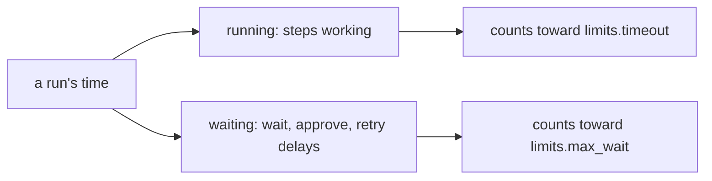
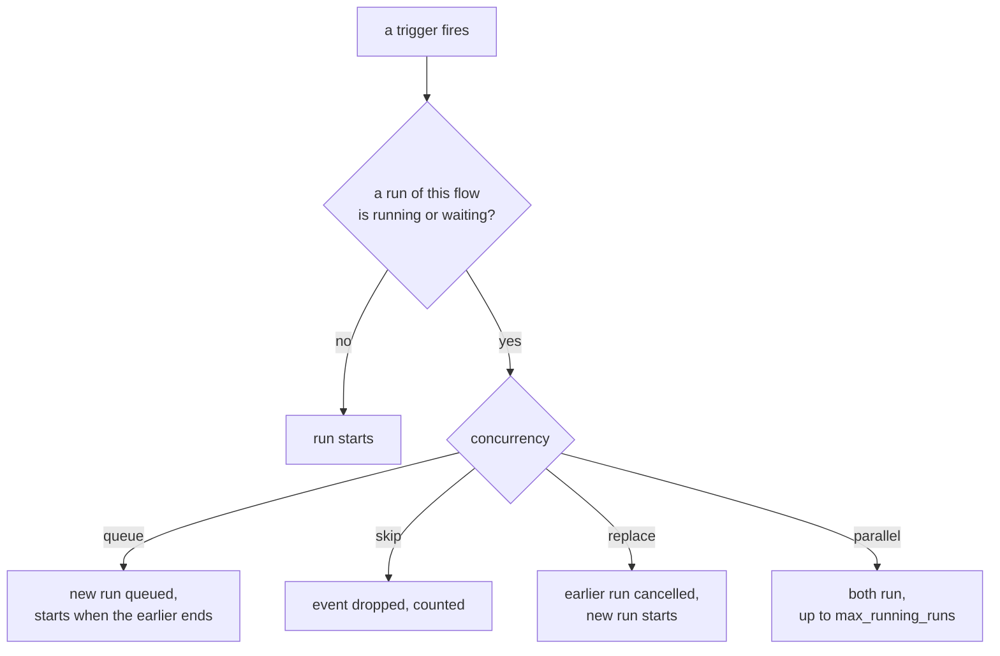

# Limits and concurrency

> **Draft for review.** Automation is partly built; what is and is not: [Automation](README.md). All defaults on
> this page are *proposed*.

## `limits`



```yaml
limits: { timeout: 30m, max_wait: 3d, max_steps: 5000, max_parallel: 8, result_in_memory: 4MB }
```

| Field | Default | Most | Meaning |
| --- | --- | --- | --- |
| `timeout` | `1h` | `7d` | Running time of the whole run (time spent waiting does not count). At the limit, steps still going are cancelled and the run fails with kind `limit` |
| `max_wait` | `7d` | `90d` | Total time a run may spend waiting (`wait`, `approve`, retries) |
| `max_steps` | `10000` | `1000000` | Steps run, counting each item of `each` and each round of `repeat` |
| `max_parallel` | `4` | `64` | Steps of this run doing work (`tool`, `call`, `ask`, `agent`, `code`) at the same time, across all its branches and items |
| `result_in_memory` | `1MB` | `16MB` | A value larger than this is kept as a file reference |

Automation's settings (`settings.json` → `automation`) cap these for every flow, and set:

| Setting | Default | Meaning |
| --- | --- | --- |
| `max_running_runs` | `16` | Runs of all flows at the same time; more wait in `queued` |
| `max_model_steps` | `1` | `ask`/`agent` steps on installed models at the same time (one model in memory serves them in turn); provider models are not counted |
| `run_retention_days` | `30` | Runs older than this are removed |
| `run_retention_count` | `200` | Per flow, at most this many runs are kept |
| `max_run_bytes` | `1GB` | Per run, files in its folder; more fails the run with kind `limit` |

## Concurrency



What happens when a trigger fires while a run of the same flow is still going (`running` or
`waiting`):

| `concurrency` | Effect |
| --- | --- |
| `queue` (default) | The new run waits (`queued`) and starts when the earlier one ends. At most 100 queued, then new events are dropped and counted |
| `skip` | The new event is dropped; the trigger's record counts it |
| `replace` | The running one is cancelled; the new one starts |
| `parallel` | Both run, up to `max_running_runs` |

`concurrency` can also be an object for a finer rule:

```yaml
concurrency: { mode: queue, key: "${{ trigger.body.customer }}", max: 2 }
```

`key` makes the rule apply per value: runs for different customers run in parallel; runs for the
same customer queue. `max` is how many may run together for the same key.

Manual runs (`flows.run`) follow the same rule unless `concurrency: parallel` is passed in the call.

## Durations and sizes

| Kind | Form | Examples |
| --- | --- | --- |
| Duration | A number and `ms`, `s`, `m`, `h`, `d` | `500ms`, `30s`, `10m`, `2h`, `7d`, `1h30m` |
| Size | A number and `B`, `KB`, `MB`, `GB` (1024-based) | `512KB`, `4MB` |
| Time | RFC 3339 | `2026-12-01T09:00:00+05:30` |

## Retention

Runs are removed after `run_retention_days`, or when a flow has more than `run_retention_count`
runs (oldest first). A flow's own `retention: { days, runs }` may keep fewer or more, within those
caps. Runs that are `running` or `waiting` are never removed. The values kept for
`changed`/`previous` and `idempotency_key` are kept apart and are not removed with runs.
