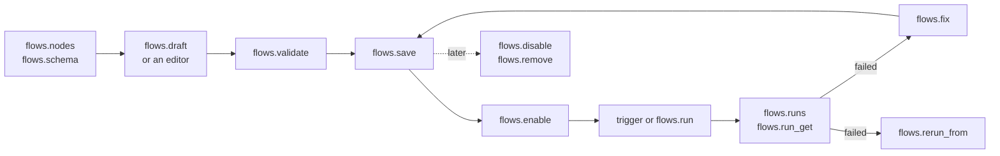

# Automation methods

> **Draft for review.** Every method below is built (not released). Names and fields may change before a release.

Applications save, check, run and read flows through these methods. They are Automation's methods, not the Engine's, but they are called at the same `POST /v1/cep` address in the same JSON-RPC form, so they use the same authentication, scopes, approvals, tasks and audit log. The flow file and how runs behave: [Automation](../README.md). Outside services start flows through the [webhook route](../webhooks.md), which is not JSON-RPC.

| Method | Scope | Runs as | Summary |
|---|---|---|---|
| [`flows.disable`](flows.disable.md) | write | sync | Turns a flow's triggers off; runs in progress go on unless cancelled |
| [`flows.draft`](flows.draft.md) | exec | task | Writes a flow from a description, using only what is installed; checks it and can test it; does not save |
| [`flows.enable`](flows.enable.md) | write | sync | Turns a flow's triggers on; confirms new permissions of a changed file |
| [`flows.explain`](flows.explain.md) | read | sync | A flow in plain words: what starts it, what each step does, what it may touch |
| [`flows.fix`](flows.fix.md) | exec | task | Proposes a change to a flow from a failed run or from validation problems; does not save |
| [`flows.get`](flows.get.md) | read | sync | One flow: its summary, its file as text and as JSON, and its triggers' state |
| [`flows.list`](flows.list.md) | read | sync | The flows of the project and the user, with their state and last run |
| [`flows.nodes`](flows.nodes.md) | read | sync | Everything a step can run here: installed tools and CEP methods with their input and output schemas; plus step kinds, triggers and operators |
| [`flows.remove`](flows.remove.md) | write | sync | Removes a flow file, and its runs unless kept |
| [`flows.rerun_from`](flows.rerun_from.md) | exec | task | Starts a new run that reuses the outputs before one step of an earlier run and runs from that step |
| [`flows.run`](flows.run.md) | exec | task | Starts a run of a flow (a task): by hand, as a test with sample data, or without side effects |
| [`flows.run_get`](flows.run_get.md) | read | sync | One run with its trigger data and every step's record: input, output, attempts, tokens |
| [`flows.runs`](flows.runs.md) | read | sync | Runs of one flow or of all flows, newest first, page by page |
| [`flows.save`](flows.save.md) | write | sync | Saves a new flow, or replaces one; asks the owner to confirm the permissions it needs |
| [`flows.schema`](flows.schema.md) | read | sync | The JSON Schema of the flow file, for editors, applications and models |
| [`flows.validate`](flows.validate.md) | read | sync | Checks a flow without saving it: problems with their place in the file, the permissions it needs, and the flow with defaults filled in |

## Which method for which job

| Job | Methods |
|---|---|
| Build an editor or a node palette | `flows.schema`, `flows.nodes`, `flows.validate` |
| Build from words | `flows.draft`, then `flows.save` |
| Keep flows | `flows.save`, `flows.get`, `flows.list`, `flows.remove` |
| Turn triggers on and off | `flows.enable`, `flows.disable` |
| Run and test | `flows.run` (with `dry_run`, `trigger`, `mocks`), `tasks.get`, `tasks.cancel` |
| See what happened | `flows.runs`, `flows.run_get` |
| After a failure | `flows.fix`, `flows.rerun_from` |
| Explain to a person | `flows.explain` |

How to call CEP methods (envelope, tokens, tasks): [CEP reference](../../api/cep/README.md). Folder: `docs/automation/methods/`.
