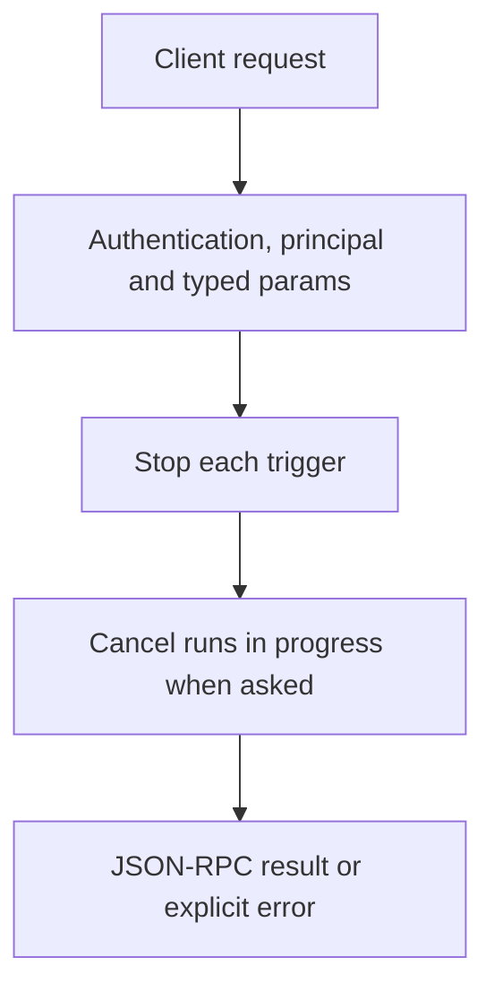

# flows.disable

> **Built in the second release of Automation (draft).** Names and fields may still change before a release that has them. See [Automation](../README.md).

Stops listening for the flow's triggers. The flow can still be run by hand. Runs in progress continue unless `cancel_running` is true.

## Endpoint, execution and permissions

| Property | Contract |
|---|---|
| Wire endpoint | `POST /v1/cep`; logical method `flows.disable` |
| Execution | Synchronous: the result is in the JSON-RPC `result` |
| Required scope | `write`; owner principal required |
| MCP facade | Not exposed to MCP clients |
| Called from a flow (`call` step) | No (`not_callable`) |
| Side effects | Changes state as described below |

Send a Bearer token when API authentication is enabled. Authentication failures are HTTP 401; method errors are JSON-RPC error objects with HTTP 200. See [the common CEP contract](../../api/cep/README.md).

## How it works

1. Stop each trigger
2. Cancel runs in progress when asked



## Parameters, defaults and value effects

| Parameter | Type | Required | Meaning, default and constraints |
|---|---|---|---|
| `name` | string | Yes | The flow's name |
| `scope` | "project" \| "user" \| null | No | Which flow of that name. Absent: the project's, then the user's |
| `cancel_running` | boolean \| null | No | Also cancel runs in progress (default false) |
| `triggers` | string[] \| null | No | Only these trigger ids (default all) |

Unknown parameters are rejected (`-32602`). `params._meta` is protocol metadata (such as an approval id), not an option of this method.

## Request examples

Examples describe the contract. Replace names, ids and paths with your own.

### 1. Disable

```json
{
  "jsonrpc": "2.0",
  "id": 1,
  "method": "flows.disable",
  "params": {
    "name": "weekly-issues"
  }
}
```

### 2. Disable and stop everything

```json
{
  "jsonrpc": "2.0",
  "id": 2,
  "method": "flows.disable",
  "params": {
    "name": "support-reply",
    "cancel_running": true
  }
}
```

## Response and field meanings

An illustrative answer; ids, times and contents will differ:

```json
{
  "id": 1,
  "jsonrpc": "2.0",
  "result": {
    "flow": {
      "name": "weekly-issues",
      "scope": "user",
      "path": "~/.cluaiz/flows/weekly-issues.flow.yaml",
      "format": "yaml",
      "description": "Every Friday evening, a short report of the issues closed this week.",
      "enabled": false,
      "triggers": [
        {
          "id": "schedule_0",
          "kind": "schedule",
          "status": "active",
          "next_at": "2026-11-13T18:00:00+05:30"
        }
      ],
      "hash": "sha256:4b1e9c…",
      "updated_at": "2026-11-10T17:40:02+05:30",
      "last_run": {
        "run_id": "run_8f2c51d0",
        "status": "succeeded",
        "finished_at": "2026-11-06T18:00:41+05:30"
      },
      "warnings": 0,
      "tags": [
        "github",
        "reports"
      ]
    },
    "runs_cancelled": 0
  }
}
```

| Field | Meaning |
|---|---|
| `flow` | The summary, `enabled: false` |
| `runs_cancelled` | Runs cancelled |

## Errors and recovery

| Code / boundary | Meaning | Recovery |
|---|---|---|
| HTTP 401 | Missing or wrong token while authentication is on | Send the configured token |
| `-32602` / `invalid_params` | Missing required fields, wrong types or unknown fields | Correct the request; do not retry it unchanged |
| `-32002` / `forbidden` | The caller lacks the scope, owner role or roots; `data.needs` says which | Use an authorized caller |
| `-32004` / `flow_not_found` | No flow with this name in the scope (or in either scope when `scope` is absent) | List flows with `flows.list`; check `scope` |

### Invalid-field example

Deliberately invalid: the extra field must be removed.

```text
{
  "jsonrpc": "2.0",
  "id": 90,
  "method": "flows.disable",
  "params": {
    "name": "weekly-issues",
    "__unknown_option": true
  }
}
```

The answer is `{"jsonrpc":"2.0","id":90,"error":{"code":-32602,"message":"...","data":{"type":"invalid_params","errors":[...]}}}`. Use the code and `data`, not the message text.

## cURL

Save one request above as `request.json`:

```bash
curl --fail-with-body http://127.0.0.1:8000/v1/cep \
  -H "Content-Type: application/json" \
  -H "Authorization: Bearer $CLUAIZ_TOKEN" \
  --data-binary @request.json
```

## Python

```python
import json
import os
import requests

payload = json.loads(r'''{
  "id": 1,
  "jsonrpc": "2.0",
  "method": "flows.disable",
  "params": {
    "name": "weekly-issues"
  }
}''')
response = requests.post(
    "http://127.0.0.1:8000/v1/cep",
    headers={"Authorization": "Bearer " + os.environ["CLUAIZ_TOKEN"]},
    json=payload, timeout=60,
)
response.raise_for_status()
reply = response.json()
if "error" in reply:
    raise RuntimeError(json.dumps(reply["error"], ensure_ascii=False))
print(reply["result"])
```

## JavaScript / Node.js

Use an owner token only in a trusted client.

```javascript
const payload = {
  "id": 1,
  "jsonrpc": "2.0",
  "method": "flows.disable",
  "params": {
    "name": "weekly-issues"
  }
};
const response = await fetch("http://127.0.0.1:8000/v1/cep", {
  method: "POST",
  headers: { "content-type": "application/json", authorization: `Bearer ${process.env.CLUAIZ_TOKEN}` },
  body: JSON.stringify(payload),
});
const raw = await response.text();
if (!response.ok) throw new Error(`HTTP ${response.status}: ${raw}`);
const reply = JSON.parse(raw);
if (reply.error) throw new Error(JSON.stringify(reply.error));
console.log(reply.result);
```

## Limits, state and related operations

Owner only. Disabling twice changes nothing. Webhook calls to a disabled flow get `404`.

- [`flows.enable`](flows.enable.md): the opposite
- [Automation](../README.md)

## Implementation reference

- Code: `automation/host/src/methods/switch.rs` (the method) and `automation/host/src/triggers/` (what listens).
