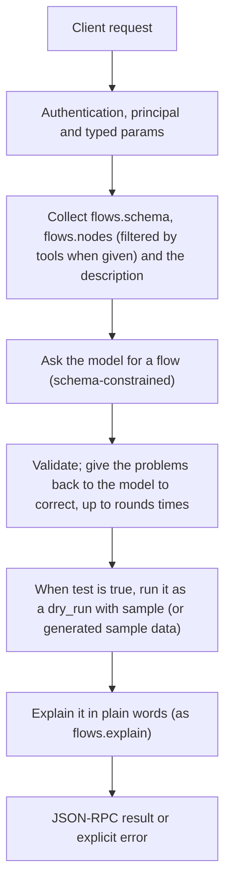

# flows.draft

> **Built in the fourth part of Automation (draft).** Names and fields may still change before a release that has them. See [Automation](../README.md).

The plain-language way to build a flow. A model gets the description, the format in short (every step kind, trigger and operator with its fields, from the same tables the checker uses), the nodes installed on this Engine (`flows.nodes`) and an example, and writes a flow. Its answer is held to the flow's outer shape while it is written (on an installed model as a grammar; a provider that refuses the schema, or answers it with empty objects, is asked again without one), so even a small model writes one JSON object. Automation validates it, gives the problems back to the model to correct (up to `rounds`), optionally runs it once as a `dry_run`, and returns the flow with an explanation. Nothing is saved; save it with `flows.save` after the person agrees.

## Endpoint, execution and permissions

| Property | Contract |
|---|---|
| Wire endpoint | `POST /v1/cep`; logical method `flows.draft` |
| Execution | A CEP task: the answer is a task handle; `tasks.result` gives the result |
| Required scope | `exec` |
| MCP facade | Not exposed to MCP clients |
| Called from a flow (`call` step) | No (`not_callable`) |
| Side effects | Changes state as described below |

Send a Bearer token when API authentication is enabled. Authentication failures are HTTP 401; method errors are JSON-RPC error objects with HTTP 200. See [the common CEP contract](../../api/cep/README.md).

## How it works

1. Collect `flows.schema`, `flows.nodes` (filtered by `tools` when given) and the description
2. Ask the model for a flow (schema-constrained)
3. Validate; give the problems back to the model to correct, up to `rounds` times
4. When `test` is true, run it as a `dry_run` with `sample` (or generated sample data)
5. Explain it in plain words (as `flows.explain`)



## Parameters, defaults and value effects

| Parameter | Type | Required | Meaning, default and constraints |
|---|---|---|---|
| `request` | string | Yes | What the flow should do, in plain words, in any language |
| `model` | string \| null | No | The model that writes the flow; default the default chat model |
| `tools` | string[] \| null | No | Only these nodes may be used (default every installed node); patterns such as `fs.*` and `mcp:github/*` |
| `flow` | object \| null | No | An existing flow to change instead of writing a new one; `request` says what to change |
| `format` | "yaml" \| "json" \| null | No | The format of the returned `text` (default yaml) |
| `test` | boolean \| null | No | Run it once as a dry run (default true) |
| `sample` | object \| null | No | Sample trigger data for the test |
| `rounds` | integer \| null | No | Correction rounds after validation, 0–5 (default 3) |
| `language` | string \| null | No | Language of the explanation (default: the request's; the model writes it) |

Unknown parameters are rejected (`-32602`). `params._meta` is protocol metadata (such as an approval id), not an option of this method.

## Request examples

Examples describe the contract. Replace names, ids and paths with your own.

### 1. From a description

```json
{
  "jsonrpc": "2.0",
  "id": 1,
  "method": "flows.draft",
  "params": {
    "request": "When a PDF arrives in Downloads, put a five-line summary in my Notes folder"
  }
}
```

### 2. Change an existing flow

```json
{
  "jsonrpc": "2.0",
  "id": 2,
  "method": "flows.draft",
  "params": {
    "request": "Also send the summary to Telegram",
    "flow": {
      "flow": "cluaiz.flow/1",
      "name": "weekly-issues",
      "on": [
        {
          "schedule": "0 18 * * 5"
        }
      ],
      "steps": [
        {
          "id": "closed",
          "tool": "mcp:github/list_issues",
          "with": {
            "repo": "my/repo",
            "state": "closed",
            "closed_in_last_days": 7
          }
        },
        {
          "id": "report",
          "ask": "Write a short weekly report of these closed issues.",
          "with": {
            "issues": "${{ steps.closed.output }}"
          }
        },
        {
          "tool": "mcp:notify/send",
          "with": {
            "text": "${{ steps.report.output }}"
          }
        }
      ]
    }
  }
}
```

### 3. Only with some tools, no test

```json
{
  "jsonrpc": "2.0",
  "id": 3,
  "method": "flows.draft",
  "params": {
    "request": "Every morning at 9 send me the weather for Delhi",
    "tools": [
      "mcp:weather/today",
      "mcp:telegram/send"
    ],
    "test": false
  }
}
```

## Response and field meanings

The call answers at once with a task handle:

```json
{
  "id": 1,
  "jsonrpc": "2.0",
  "result": {
    "task": {
      "task_id": "task_77e1…",
      "method": "flows.draft",
      "status": "working",
      "created_at": "2026-11-10T18:02:11Z",
      "last_updated_at": "2026-11-10T18:02:11Z",
      "ttl_ms": 3600000,
      "poll_ms": 500
    }
  }
}
```

When the task ends, `tasks.result` gives:

```json
{
  "id": 2,
  "jsonrpc": "2.0",
  "result": {
    "flow": {
      "flow": "cluaiz.flow/1",
      "name": "pdf-to-notes",
      "…": {}
    },
    "text": "flow: cluaiz.flow/1\nname: pdf-to-notes\n…",
    "format": "yaml",
    "explanation": {
      "summary": "When a PDF appears in Downloads → read its text → a five-line summary → saved as a note in Notes.",
      "steps": [
        "…"
      ]
    },
    "problems": [],
    "permissions_needed": {
      "methods": [
        "ingest",
        "fs.write"
      ],
      "folders": [
        "~/Downloads",
        "~/Documents/Notes"
      ],
      "models": [
        "*"
      ]
    },
    "missing": [],
    "test_run_id": "run_d2e0aa41",
    "model": "qwen3-4b"
  }
}
```

| Field | Meaning |
|---|---|
| `task` | A CEP task; `tasks.result` gives the fields below |
| `flow`, `text`, `format` | The drafted flow as JSON and as text |
| `explanation` | As `flows.explain` |
| `problems` | Problems left after the correction rounds (none when valid) |
| `permissions_needed` | What `flows.save` will ask the owner to confirm |
| `missing` | Tools or methods the flow names that are not installed: `[{ need, path, suggestions }]`. `suggestions` is empty in this release (registry search comes later). A draft whose only errors are these is returned, with them in `problems` |
| `test_run_id` | The dry run, for `flows.run_get` (`null` when there was none) |
| `test` | How the dry run ended: `{ status, error, steps_done }`; `{ skipped }` when the caller is not the owner |
| `model` | The model that wrote it |

## Errors and recovery

| Code / boundary | Meaning | Recovery |
|---|---|---|
| HTTP 401 | Missing or wrong token while authentication is on | Send the configured token |
| `-32602` / `invalid_params` | Missing required fields, wrong types or unknown fields | Correct the request; do not retry it unchanged |
| `-32002` / `forbidden` | The caller lacks the scope, owner role or roots; `data.needs` says which | Use an authorized caller |
| `-32004` / `model_not_found` | No such model, or no default chat model | Install or choose one |
| `-32010` / `draft_failed` | The model gave no valid flow after `rounds`; `data.problems` and `data.text` hold the last attempt | Try a clearer request, a larger model, or edit the text by hand |
| `-32010` / `model_unavailable` | The model did not answer (a provider error, a rate limit) | Try again, or choose another `model` |

### Invalid-field example

Deliberately invalid: the extra field must be removed.

```text
{
  "jsonrpc": "2.0",
  "id": 90,
  "method": "flows.draft",
  "params": {
    "request": "When a PDF arrives in Downloads, put a five-line summary in my Notes folder",
    "__unknown_option": true
  }
}
```

The answer is `{"jsonrpc":"2.0","id":90,"error":{"code":-32602,"message":"...","data":{"type":"invalid_params","errors":[...]}}}`. Use the code and `data`, not the message text.

## cURL

Save one request above as `request.json`:

```bash
curl --fail-with-body http://127.0.0.1:8000/v1/cep \
  -H "Content-Type: application/json" \
  -H "Authorization: Bearer $CLUAIZ_TOKEN" \
  --data-binary @request.json
```

## Python

```python
import json
import os
import requests

payload = json.loads(r'''{
  "id": 1,
  "jsonrpc": "2.0",
  "method": "flows.draft",
  "params": {
    "request": "When a PDF arrives in Downloads, put a five-line summary in my Notes folder"
  }
}''')
response = requests.post(
    "http://127.0.0.1:8000/v1/cep",
    headers={"Authorization": "Bearer " + os.environ["CLUAIZ_TOKEN"]},
    json=payload, timeout=60,
)
response.raise_for_status()
reply = response.json()
if "error" in reply:
    raise RuntimeError(json.dumps(reply["error"], ensure_ascii=False))
print(reply["result"])
```

## JavaScript / Node.js

Use an owner token only in a trusted client.

```javascript
const payload = {
  "id": 1,
  "jsonrpc": "2.0",
  "method": "flows.draft",
  "params": {
    "request": "When a PDF arrives in Downloads, put a five-line summary in my Notes folder"
  }
};
const response = await fetch("http://127.0.0.1:8000/v1/cep", {
  method: "POST",
  headers: { "content-type": "application/json", authorization: `Bearer ${process.env.CLUAIZ_TOKEN}` },
  body: JSON.stringify(payload),
});
const raw = await response.text();
if (!response.ok) throw new Error(`HTTP ${response.status}: ${raw}`);
const reply = JSON.parse(raw);
if (reply.error) throw new Error(JSON.stringify(reply.error));
console.log(reply.result);
```

A task: poll `tasks.get` (with `after` for events) every `poll_ms`, or call `tasks.result` with `wait_ms`.

## Limits, state and related operations

Needs `exec` (a model runs). The model sees node names, descriptions and schemas, never secrets or file contents. The test is a dry run: nothing is written or sent, and reads go only as far as the flow's own permissions. It runs only when the caller is the owner (those permissions are not confirmed yet), waits at most two minutes, and is recorded under the flow's name like any run (`trigger.by: draft`). The task is kept one hour.

- [`flows.save`](flows.save.md): save the draft
- [`flows.explain`](flows.explain.md): explain any flow
- [`flows.nodes`](flows.nodes.md): what the model may use
- [Automation](../README.md)

## Implementation reference

- Code: `automation/host/src/methods/drafting.rs` (the method) and `automation/core/src/ease/draft.rs` (what the model is given and how its answer is read).
