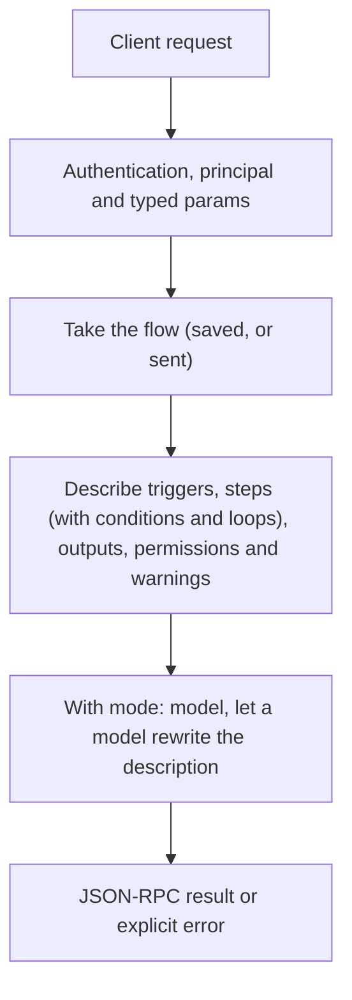

# flows.explain

> **Built in the fourth part of Automation (draft).** Names and fields may still change before a release that has them. See [Automation](../README.md).

Describes a flow for a person. `plain` (default) builds the text from the flow itself: fast, the same every time, no model. `model` asks a model to write it more naturally, in any language.

## Endpoint, execution and permissions

| Property | Contract |
|---|---|
| Wire endpoint | `POST /v1/cep`; logical method `flows.explain` |
| Execution | Synchronous: the result is in the JSON-RPC `result` |
| Required scope | `read` |
| MCP facade | Listed for MCP clients (read-only) |
| Called from a flow (`call` step) | Yes |
| Side effects | None (read-only) |

Send a Bearer token when API authentication is enabled. Authentication failures are HTTP 401; method errors are JSON-RPC error objects with HTTP 200. See [the common CEP contract](../../api/cep/README.md).

## How it works

1. Take the flow (saved, or sent)
2. Describe triggers, steps (with conditions and loops), outputs, permissions and warnings
3. With `mode: model`, let a model rewrite the description



## Parameters, defaults and value effects

| Parameter | Type | Required | Meaning, default and constraints |
|---|---|---|---|
| `name` | string \| null | No | A saved flow |
| `scope` | "project" \| "user" \| null | No | Which flow of that name. Absent: the project's, then the user's |
| `flow` | object \| null | No | The flow as JSON. Send `flow`, or `text` with `format` |
| `mode` | "plain" \| "model" \| null | No | How to write it (default plain) |
| `language` | string \| null | No | For `mode: model`: the language to write in (default English) |
| `text` | string \| null | No | The flow as JSON or YAML text, with `format` |
| `format` | "json" \| "yaml" \| null | No | The format of `text` |
| `model` | string \| null | No | For `mode: model`: the model (default the default chat model) |

Unknown parameters are rejected (`-32602`). `params._meta` is protocol metadata (such as an approval id), not an option of this method.

## Request examples

Examples describe the contract. Replace names, ids and paths with your own.

### 1. A saved flow

```json
{
  "jsonrpc": "2.0",
  "id": 1,
  "method": "flows.explain",
  "params": {
    "name": "weekly-issues"
  }
}
```

### 2. A draft, in Hindi, by a model

```json
{
  "jsonrpc": "2.0",
  "id": 2,
  "method": "flows.explain",
  "params": {
    "flow": {
      "flow": "cluaiz.flow/1",
      "name": "weekly-issues",
      "on": [
        {
          "schedule": "0 18 * * 5"
        }
      ],
      "steps": [
        {
          "id": "closed",
          "tool": "mcp:github/list_issues",
          "with": {
            "repo": "my/repo",
            "state": "closed",
            "closed_in_last_days": 7
          }
        },
        {
          "id": "report",
          "ask": "Write a short weekly report of these closed issues.",
          "with": {
            "issues": "${{ steps.closed.output }}"
          }
        },
        {
          "tool": "mcp:notify/send",
          "with": {
            "text": "${{ steps.report.output }}"
          }
        }
      ]
    },
    "mode": "model",
    "language": "hi"
  }
}
```

## Response and field meanings

An illustrative answer; ids, times and contents will differ:

```json
{
  "id": 1,
  "jsonrpc": "2.0",
  "result": {
    "summary": "Every Friday at 18:00 → list the issues closed in the last 7 days → write a short report with a model → send it with notify.",
    "triggers": [
      "Every Friday at 18:00 (Asia/Kolkata)"
    ],
    "steps": [
      {
        "id": "closed",
        "text": "List closed issues of my/repo from the last 7 days (github)"
      },
      {
        "id": "report",
        "text": "A model writes a short weekly report of them"
      },
      {
        "id": "_2",
        "text": "Send the report (notify)"
      }
    ],
    "touches": [
      "Reads: GitHub issues",
      "Sends: a notification",
      "Models: any"
    ],
    "warnings": []
  }
}
```

| Field | Meaning |
|---|---|
| `summary` | One line |
| `triggers` | Each trigger in words |
| `steps[]` | Each step in words, in the file's order: `{ id, text, depth, list }`. `depth` is how far it is nested (0 at the top), `list` the list it is in (`steps`, `then`, `else`, `do`, a branch name, `on_error`) |
| `touches` | What it reads, writes, sends, and which models |
| `warnings` | The validation warnings, in words, and the tools or methods the flow names that are not installed |
| `model` | With `mode: model`: the model that wrote it |

## Errors and recovery

| Code / boundary | Meaning | Recovery |
|---|---|---|
| HTTP 401 | Missing or wrong token while authentication is on | Send the configured token |
| `-32602` / `invalid_params` | Missing required fields, wrong types or unknown fields | Correct the request; do not retry it unchanged |
| `-32002` / `forbidden` | The caller lacks the scope, owner role or roots; `data.needs` says which | Use an authorized caller |
| `-32004` / `flow_not_found` | No flow with this name in the scope (or in either scope when `scope` is absent) | List flows with `flows.list`; check `scope` |
| `-32602` / `invalid_flow` | The flow has errors; `data.problems` lists them (see Validation). A tool or method that is not installed is not one: it is said in `warnings` | Fix each problem at its `path`; `flows.validate` checks without saving |
| `-32004` / `model_not_found` | `mode: model` and no such model, or no default chat model | Install or choose one |
| `-32010` / `model_unavailable` | `mode: model` and the model did not answer | Try again, or use `mode: plain` |

### Invalid-field example

Deliberately invalid: the extra field must be removed.

```text
{
  "jsonrpc": "2.0",
  "id": 90,
  "method": "flows.explain",
  "params": {
    "name": "weekly-issues",
    "__unknown_option": true
  }
}
```

The answer is `{"jsonrpc":"2.0","id":90,"error":{"code":-32602,"message":"...","data":{"type":"invalid_params","errors":[...]}}}`. Use the code and `data`, not the message text.

## cURL

Save one request above as `request.json`:

```bash
curl --fail-with-body http://127.0.0.1:8000/v1/cep \
  -H "Content-Type: application/json" \
  -H "Authorization: Bearer $CLUAIZ_TOKEN" \
  --data-binary @request.json
```

## Python

```python
import json
import os
import requests

payload = json.loads(r'''{
  "id": 1,
  "jsonrpc": "2.0",
  "method": "flows.explain",
  "params": {
    "name": "weekly-issues"
  }
}''')
response = requests.post(
    "http://127.0.0.1:8000/v1/cep",
    headers={"Authorization": "Bearer " + os.environ["CLUAIZ_TOKEN"]},
    json=payload, timeout=60,
)
response.raise_for_status()
reply = response.json()
if "error" in reply:
    raise RuntimeError(json.dumps(reply["error"], ensure_ascii=False))
print(reply["result"])
```

## JavaScript / Node.js

Use an owner token only in a trusted client.

```javascript
const payload = {
  "id": 1,
  "jsonrpc": "2.0",
  "method": "flows.explain",
  "params": {
    "name": "weekly-issues"
  }
};
const response = await fetch("http://127.0.0.1:8000/v1/cep", {
  method: "POST",
  headers: { "content-type": "application/json", authorization: `Bearer ${process.env.CLUAIZ_TOKEN}` },
  body: JSON.stringify(payload),
});
const raw = await response.text();
if (!response.ok) throw new Error(`HTTP ${response.status}: ${raw}`);
const reply = JSON.parse(raw);
if (reply.error) throw new Error(JSON.stringify(reply.error));
console.log(reply.result);
```

## Limits, state and related operations

`plain` is read-only and needs no model: the same flow always gets the same words, in English. `model` gives the plain explanation to a model (the default chat model, or `model`) to write again in `language`; it keeps the ids, and a field the model leaves out keeps the plain text. `model` needs `exec` in addition.

- [`flows.draft`](flows.draft.md): uses it for its explanation
- [Automation](../README.md)

## Implementation reference

- Code: `automation/host/src/methods/ease.rs` (the method) and `automation/core/src/ease/explain.rs` (the plain text).
