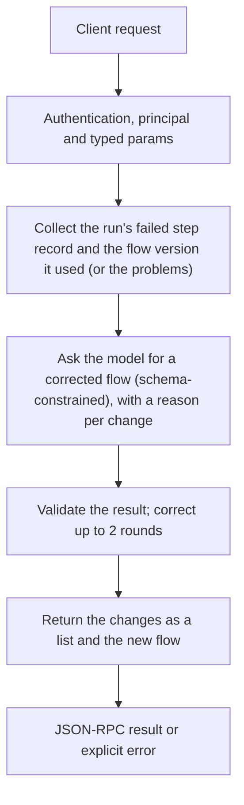

# flows.fix

> **Built in the fourth part of Automation (draft).** Names and fields may still change before a release that has them. See [Automation](../README.md).

A model reads the failed run (the step, its input, its error, the attempts) or the validation problems, and the flow, and proposes a corrected flow with each change explained. Nothing is saved; show the changes, then save with `flows.save`.

## Endpoint, execution and permissions

| Property | Contract |
|---|---|
| Wire endpoint | `POST /v1/cep`; logical method `flows.fix` |
| Execution | A CEP task: the answer is a task handle; `tasks.result` gives the result |
| Required scope | `exec` |
| MCP facade | Not exposed to MCP clients |
| Called from a flow (`call` step) | No (`not_callable`) |
| Side effects | Changes state as described below |

Send a Bearer token when API authentication is enabled. Authentication failures are HTTP 401; method errors are JSON-RPC error objects with HTTP 200. See [the common CEP contract](../../api/cep/README.md).

## How it works

1. Collect the run's failed step record and the flow version it used (or the problems)
2. Ask the model for a corrected flow (schema-constrained), with a reason per change
3. Validate the result; correct up to 2 rounds
4. Return the changes as a list and the new flow



## Parameters, defaults and value effects

| Parameter | Type | Required | Meaning, default and constraints |
|---|---|---|---|
| `run_id` | string \| null | No | A failed run |
| `flow` | object \| null | No | A flow with problems (instead of `run_id`) |
| `note` | string \| null | No | What the person knows about the failure |
| `model` | string \| null | No | Default: the default chat model |

Unknown parameters are rejected (`-32602`). `params._meta` is protocol metadata (such as an approval id), not an option of this method.

## Request examples

Examples describe the contract. Replace names, ids and paths with your own.

### 1. From a failed run

```json
{
  "jsonrpc": "2.0",
  "id": 1,
  "method": "flows.fix",
  "params": {
    "run_id": "run_5b07e2c9"
  }
}
```

### 2. With a hint

```json
{
  "jsonrpc": "2.0",
  "id": 2,
  "method": "flows.fix",
  "params": {
    "run_id": "run_5b07e2c9",
    "note": "The repo was renamed to my/new-repo"
  }
}
```

## Response and field meanings

The call answers at once with a task handle:

```json
{
  "id": 1,
  "jsonrpc": "2.0",
  "result": {
    "task": {
      "task_id": "task_77e1…",
      "method": "flows.fix",
      "status": "working",
      "created_at": "2026-11-10T18:02:11Z",
      "last_updated_at": "2026-11-10T18:02:11Z",
      "ttl_ms": 3600000,
      "poll_ms": 500
    }
  }
}
```

When the task ends, `tasks.result` gives:

```json
{
  "id": 2,
  "jsonrpc": "2.0",
  "result": {
    "diagnosis": "mcp:github/list_issues answered 404: the repository my/repo does not exist.",
    "changes": [
      {
        "path": "/inputs/repo/default",
        "before": "my/repo",
        "after": "my/new-repo",
        "why": "The repository was renamed"
      }
    ],
    "flow": {
      "…": {}
    },
    "problems": [],
    "cause_outside_flow": false
  }
}
```

| Field | Meaning |
|---|---|
| `diagnosis` | What went wrong, in plain words |
| `changes[]` | Each change: JSON Pointer `path`, `before`, `after`, `why`. Automation works them out from the two flows; `why` is the model's reason for that part (`null` when it gave none). A list whose length changed is one change |
| `flow` | The corrected flow |
| `problems` | Validation problems left |
| `cause_outside_flow` | `true` when nothing in the flow can fix it (a key, a tool down, a full disk); `changes` is then empty, `flow` is the flow as it was, and `diagnosis` says what to do |
| `model` | The model that wrote it (`null` when no model was needed) |

## Errors and recovery

| Code / boundary | Meaning | Recovery |
|---|---|---|
| HTTP 401 | Missing or wrong token while authentication is on | Send the configured token |
| `-32602` / `invalid_params` | Missing required fields, wrong types or unknown fields | Correct the request; do not retry it unchanged |
| `-32002` / `forbidden` | The caller lacks the scope, owner role or roots; `data.needs` says which | Use an authorized caller |
| `-32004` / `run_not_found` | No run with this id (it may have been removed by retention) | List runs with `flows.runs` |
| `-32005` / `run_not_failed` | The run did not fail | Use a failed run |
| `-32004` / `model_not_found` | No model to write the fix | Install or choose one |
| `-32010` / `fix_failed` | The model gave no corrected flow; `data.text` holds its last answer | Try a larger model, or edit the flow by hand |
| `-32010` / `model_unavailable` | The model did not answer | Try again |

### Invalid-field example

Deliberately invalid: the extra field must be removed.

```text
{
  "jsonrpc": "2.0",
  "id": 90,
  "method": "flows.fix",
  "params": {
    "run_id": "run_5b07e2c9",
    "__unknown_option": true
  }
}
```

The answer is `{"jsonrpc":"2.0","id":90,"error":{"code":-32602,"message":"...","data":{"type":"invalid_params","errors":[...]}}}`. Use the code and `data`, not the message text.

## cURL

Save one request above as `request.json`:

```bash
curl --fail-with-body http://127.0.0.1:8000/v1/cep \
  -H "Content-Type: application/json" \
  -H "Authorization: Bearer $CLUAIZ_TOKEN" \
  --data-binary @request.json
```

## Python

```python
import json
import os
import requests

payload = json.loads(r'''{
  "id": 1,
  "jsonrpc": "2.0",
  "method": "flows.fix",
  "params": {
    "run_id": "run_5b07e2c9"
  }
}''')
response = requests.post(
    "http://127.0.0.1:8000/v1/cep",
    headers={"Authorization": "Bearer " + os.environ["CLUAIZ_TOKEN"]},
    json=payload, timeout=60,
)
response.raise_for_status()
reply = response.json()
if "error" in reply:
    raise RuntimeError(json.dumps(reply["error"], ensure_ascii=False))
print(reply["result"])
```

## JavaScript / Node.js

Use an owner token only in a trusted client.

```javascript
const payload = {
  "id": 1,
  "jsonrpc": "2.0",
  "method": "flows.fix",
  "params": {
    "run_id": "run_5b07e2c9"
  }
};
const response = await fetch("http://127.0.0.1:8000/v1/cep", {
  method: "POST",
  headers: { "content-type": "application/json", authorization: `Bearer ${process.env.CLUAIZ_TOKEN}` },
  body: JSON.stringify(payload),
});
const raw = await response.text();
if (!response.ok) throw new Error(`HTTP ${response.status}: ${raw}`);
const reply = JSON.parse(raw);
if (reply.error) throw new Error(JSON.stringify(reply.error));
console.log(reply.result);
```

A task: poll `tasks.get` (with `after` for events) every `poll_ms`, or call `tasks.result` with `wait_ms`.

## Limits, state and related operations

Needs `exec`. The model sees the flow as the run had it, the failed steps' input (shortened to 4000 characters), error and attempts, the trigger data, and the `note`, with secrets masked as in every run record. A `flow` sent without problems gets an answer at once, with no model. The corrected flow keeps the flow's name. The task is kept one hour.

- [`flows.rerun_from`](flows.rerun_from.md): run again from the failed step after saving
- [`flows.save`](flows.save.md): save the fix
- [Automation](../README.md)

## Implementation reference

- Code: `automation/host/src/methods/drafting.rs` (the method) and `automation/core/src/ease/draft.rs` (the changes between two flows).
