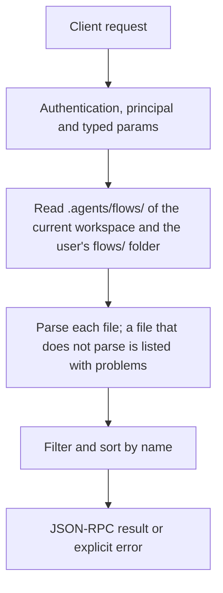

# flows.list

> **Built in the first release of Automation (draft).** Names and fields may still change before a release that has them. See [Automation](../README.md).

Lists saved flows. Each entry is a summary: where the file is, whether it is enabled, its triggers, its last run and how many warnings it has.

## Endpoint, execution and permissions

| Property | Contract |
|---|---|
| Wire endpoint | `POST /v1/cep`; logical method `flows.list` |
| Execution | Synchronous: the result is in the JSON-RPC `result` |
| Required scope | `read` |
| MCP facade | Listed for MCP clients (read-only) |
| Called from a flow (`call` step) | Yes |
| Side effects | None (read-only) |

Send a Bearer token when API authentication is enabled. Authentication failures are HTTP 401; method errors are JSON-RPC error objects with HTTP 200. See [the common CEP contract](../../api/cep/README.md).

## How it works

1. Read `.agents/flows/` of the current workspace and the user's `flows/` folder
2. Parse each file; a file that does not parse is listed with `problems`
3. Filter and sort by name



## Parameters, defaults and value effects

| Parameter | Type | Required | Meaning, default and constraints |
|---|---|---|---|
| `scope` | "project" \| "user" \| "all" \| null | No | Which folders (default all) |
| `query` | string \| null | No | Words matched against names and descriptions |
| `enabled` | boolean \| null | No | Only enabled, or only disabled flows |
| `tag` | string \| null | No | Only flows with this `meta.tags` entry |

Unknown parameters are rejected (`-32602`). `params._meta` is protocol metadata (such as an approval id), not an option of this method.

## Request examples

Examples describe the contract. Replace names, ids and paths with your own.

### 1. Every flow

```json
{
  "jsonrpc": "2.0",
  "id": 1,
  "method": "flows.list",
  "params": {}
}
```

### 2. Enabled user flows

```json
{
  "jsonrpc": "2.0",
  "id": 2,
  "method": "flows.list",
  "params": {
    "scope": "user",
    "enabled": true
  }
}
```

### 3. By tag

```json
{
  "jsonrpc": "2.0",
  "id": 3,
  "method": "flows.list",
  "params": {
    "tag": "reports"
  }
}
```

## Response and field meanings

An illustrative answer; ids, times and contents will differ:

```json
{
  "id": 1,
  "jsonrpc": "2.0",
  "result": {
    "flows": [
      {
        "name": "weekly-issues",
        "scope": "user",
        "path": "~/.cluaiz/flows/weekly-issues.flow.yaml",
        "format": "yaml",
        "description": "Every Friday evening, a short report of the issues closed this week.",
        "enabled": true,
        "triggers": [
          {
            "id": "schedule_0",
            "kind": "schedule",
            "status": "active",
            "next_at": "2026-11-13T18:00:00+05:30"
          }
        ],
        "hash": "sha256:4b1e9c…",
        "updated_at": "2026-11-10T17:40:02+05:30",
        "last_run": {
          "run_id": "run_8f2c51d0",
          "status": "succeeded",
          "finished_at": "2026-11-06T18:00:41+05:30"
        },
        "warnings": 0,
        "tags": [
          "github",
          "reports"
        ]
      },
      {
        "name": "broken-flow",
        "scope": "project",
        "path": "/project/.agents/flows/broken-flow.flow.json",
        "format": "json",
        "enabled": false,
        "problems": [
          {
            "severity": "error",
            "code": "parse_error",
            "path": "",
            "line": 7,
            "column": 3,
            "message": "expected `,` or `}`"
          }
        ]
      }
    ]
  }
}
```

| Field | Meaning |
|---|---|
| `flows[].name`, `scope`, `path`, `format` | Which file |
| `flows[].description`, `tags` | From the file |
| `flows[].enabled` | Whether its triggers are on |
| `flows[].triggers[]` | `id`, `kind`, `status`, `next_at` |
| `flows[].hash`, `updated_at` | The file's hash and time |
| `flows[].last_run` | `run_id`, `status`, `finished_at`, or `null` |
| `flows[].warnings` | Number of warnings |
| `flows[].problems` | Only for a file with errors: why it cannot run |

## Errors and recovery

| Code / boundary | Meaning | Recovery |
|---|---|---|
| HTTP 401 | Missing or wrong token while authentication is on | Send the configured token |
| `-32602` / `invalid_params` | Missing required fields, wrong types or unknown fields | Correct the request; do not retry it unchanged |
| `-32002` / `forbidden` | The caller lacks the scope, owner role or roots; `data.needs` says which | Use an authorized caller |

### Invalid-field example

Deliberately invalid: the extra field must be removed.

```text
{
  "jsonrpc": "2.0",
  "id": 90,
  "method": "flows.list",
  "params": {
    "__unknown_option": true
  }
}
```

The answer is `{"jsonrpc":"2.0","id":90,"error":{"code":-32602,"message":"...","data":{"type":"invalid_params","errors":[...]}}}`. Use the code and `data`, not the message text.

## cURL

Save one request above as `request.json`:

```bash
curl --fail-with-body http://127.0.0.1:8000/v1/cep \
  -H "Content-Type: application/json" \
  -H "Authorization: Bearer $CLUAIZ_TOKEN" \
  --data-binary @request.json
```

## Python

```python
import json
import os
import requests

payload = json.loads(r'''{
  "id": 1,
  "jsonrpc": "2.0",
  "method": "flows.list",
  "params": {}
}''')
response = requests.post(
    "http://127.0.0.1:8000/v1/cep",
    headers={"Authorization": "Bearer " + os.environ["CLUAIZ_TOKEN"]},
    json=payload, timeout=60,
)
response.raise_for_status()
reply = response.json()
if "error" in reply:
    raise RuntimeError(json.dumps(reply["error"], ensure_ascii=False))
print(reply["result"])
```

## JavaScript / Node.js

Use an owner token only in a trusted client.

```javascript
const payload = {
  "id": 1,
  "jsonrpc": "2.0",
  "method": "flows.list",
  "params": {}
};
const response = await fetch("http://127.0.0.1:8000/v1/cep", {
  method: "POST",
  headers: { "content-type": "application/json", authorization: `Bearer ${process.env.CLUAIZ_TOKEN}` },
  body: JSON.stringify(payload),
});
const raw = await response.text();
if (!response.ok) throw new Error(`HTTP ${response.status}: ${raw}`);
const reply = JSON.parse(raw);
if (reply.error) throw new Error(JSON.stringify(reply.error));
console.log(reply.result);
```

## Limits, state and related operations

Read-only. Files with errors are listed (not hidden), so they can be fixed.

- [`flows.get`](flows.get.md): one flow in full
- [`flows.runs`](flows.runs.md): runs of a flow
- [Automation](../README.md)

## Implementation reference

- Code: `automation/host/src/methods/files.rs` (the method) and `automation/core` (the format, checks and runner).
