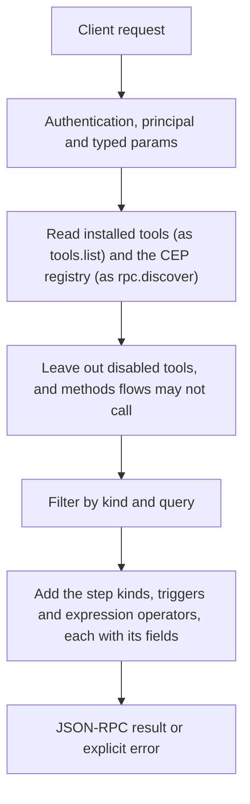

# flows.nodes

> **Built in the fourth part of Automation (draft).** Names and fields may still change before a release that has them. See [Automation](../README.md).

The palette for building flows on this Engine. Every enabled installed tool (MCP servers, plugins, skills) and every CEP method a flow may call is listed with its input schema, its output schema when known, and what it needs. Methods that flows may not call (`not_callable`, owner-only and admin methods) are left out. The Engine routes (`ingest`, `embeddings`, `speech`, `transcription`) are listed once `call` steps can run them. Applications draw their node lists from it; `flows.draft` gives it to the model so it only uses what exists.

## Endpoint, execution and permissions

| Property | Contract |
|---|---|
| Wire endpoint | `POST /v1/cep`; logical method `flows.nodes` |
| Execution | Synchronous: the result is in the JSON-RPC `result` |
| Required scope | `read` |
| MCP facade | Listed for MCP clients (read-only) |
| Called from a flow (`call` step) | Yes |
| Side effects | None (read-only) |

Send a Bearer token when API authentication is enabled. Authentication failures are HTTP 401; method errors are JSON-RPC error objects with HTTP 200. See [the common CEP contract](../../api/cep/README.md).

## How it works

1. Read installed tools (as `tools.list`) and the CEP registry (as `rpc.discover`)
2. Leave out disabled tools, and methods flows may not call
3. Filter by `kind` and `query`
4. Add the step kinds, triggers and expression operators, each with its fields



## Parameters, defaults and value effects

| Parameter | Type | Required | Meaning, default and constraints |
|---|---|---|---|
| `kind` | "tool" \| "call" \| "all" \| null | No | Only tools, only methods, or both (default) |
| `query` | string \| null | No | Words matched against names, titles and descriptions; every word must match (case is ignored) |
| `schemas` | boolean \| null | No | Include input and output schemas (default true); false makes a short list |
| `catalog` | boolean \| null | No | Include `steps`, `triggers` and `operators` (default true) |

Unknown parameters are rejected (`-32602`). `params._meta` is protocol metadata (such as an approval id), not an option of this method.

## Request examples

Examples describe the contract. Replace names, ids and paths with your own.

### 1. Everything

The whole palette.

```json
{
  "jsonrpc": "2.0",
  "id": 1,
  "method": "flows.nodes",
  "params": {}
}
```

### 2. Find tools

A search, as an editor's search box would send.

```json
{
  "jsonrpc": "2.0",
  "id": 2,
  "method": "flows.nodes",
  "params": {
    "kind": "tool",
    "query": "github",
    "catalog": false
  }
}
```

### 3. Short list

Names and descriptions only.

```json
{
  "jsonrpc": "2.0",
  "id": 3,
  "method": "flows.nodes",
  "params": {
    "schemas": false,
    "catalog": false
  }
}
```

## Response and field meanings

An illustrative answer; ids, times and contents will differ:

```json
{
  "id": 1,
  "jsonrpc": "2.0",
  "result": {
    "nodes": [
      {
        "ref": "mcp:github/create_issue",
        "step": "tool",
        "source": "mcp",
        "title": "Create issue",
        "description": "Creates an issue in a repository",
        "input_schema": {
          "type": "object",
          "required": [
            "repo",
            "title"
          ],
          "properties": {
            "repo": {
              "type": "string"
            },
            "title": {
              "type": "string"
            },
            "body": {
              "type": "string"
            }
          }
        },
        "output_schema": null,
        "sends": true,
        "destructive": false,
        "needs_approval": false
      },
      {
        "ref": "fs.write",
        "step": "call",
        "source": "method",
        "title": "fs.write",
        "description": "Writes a file inside the caller's roots",
        "input_schema": {
          "type": "object",
          "…": {}
        },
        "output_schema": {
          "type": "object",
          "…": {}
        },
        "scope": "write",
        "sends": false,
        "destructive": true,
        "needs_approval": false
      }
    ],
    "steps": [
      {
        "kind": "ask",
        "fields": [
          "ask",
          "with",
          "model",
          "output_schema",
          "…"
        ],
        "description": "One answer from a model"
      }
    ],
    "triggers": [
      {
        "kind": "schedule",
        "fields": [
          "schedule",
          "timezone",
          "catch_up",
          "jitter"
        ]
      }
    ],
    "operators": [
      {
        "name": "gt",
        "group": "comparison",
        "arguments": 2,
        "returns": "bool"
      }
    ]
  }
}
```

| Field | Meaning |
|---|---|
| `nodes[].ref` | What a `tool` or `call` step writes: `mcp:<server>/<tool>`, `plugin:<name>/<fn>`, `skill:<name>`, or a method name |
| `nodes[].step` | `tool` or `call`: the step kind that runs it |
| `nodes[].source` | `mcp`, `plugin`, `skill`, `method` |
| `nodes[].title` | The tool's own title, else its name |
| `nodes[].input_schema` | What `with` must match |
| `nodes[].output_schema` | The output's shape, when the node declares it; `null` when unknown |
| `nodes[].sends` | It sends data outside this computer or reaches the network (by its declaration: `x-cluaiz-sends` or the MCP `openWorldHint`); used for the outside-content warning |
| `nodes[].destructive`, `needs_approval` | Whether it deletes or overwrites (the MCP `destructiveHint`, a method's own mark), and whether the owner set the tool to ask first (`security_mode: require_approval`) |
| `nodes[].scope` | For methods: the CEP scope it needs |
| `steps`, `triggers`, `operators` | Every step kind, trigger kind and expression operator with its fields; see the reference pages |
| `steps[].built`, `triggers[].built` | Whether this release runs it |
| `triggers[].common` | The fields every trigger may have (`id`, `filter`, `dedupe`, …) |
| `operators[].arguments`, `returns` | How many arguments (`2`, `1-2`, `0+`), and `bool` or `value` |

## Errors and recovery

| Code / boundary | Meaning | Recovery |
|---|---|---|
| HTTP 401 | Missing or wrong token while authentication is on | Send the configured token |
| `-32602` / `invalid_params` | Missing required fields, wrong types or unknown fields | Correct the request; do not retry it unchanged |
| `-32002` / `forbidden` | The caller lacks the scope, owner role or roots; `data.needs` says which | Use an authorized caller |

### Invalid-field example

Deliberately invalid: the extra field must be removed.

```text
{
  "jsonrpc": "2.0",
  "id": 90,
  "method": "flows.nodes",
  "params": {
    "__unknown_option": true
  }
}
```

The answer is `{"jsonrpc":"2.0","id":90,"error":{"code":-32602,"message":"...","data":{"type":"invalid_params","errors":[...]}}}`. Use the code and `data`, not the message text.

## cURL

Save one request above as `request.json`:

```bash
curl --fail-with-body http://127.0.0.1:8000/v1/cep \
  -H "Content-Type: application/json" \
  -H "Authorization: Bearer $CLUAIZ_TOKEN" \
  --data-binary @request.json
```

## Python

```python
import json
import os
import requests

payload = json.loads(r'''{
  "id": 1,
  "jsonrpc": "2.0",
  "method": "flows.nodes",
  "params": {}
}''')
response = requests.post(
    "http://127.0.0.1:8000/v1/cep",
    headers={"Authorization": "Bearer " + os.environ["CLUAIZ_TOKEN"]},
    json=payload, timeout=60,
)
response.raise_for_status()
reply = response.json()
if "error" in reply:
    raise RuntimeError(json.dumps(reply["error"], ensure_ascii=False))
print(reply["result"])
```

## JavaScript / Node.js

Use an owner token only in a trusted client.

```javascript
const payload = {
  "id": 1,
  "jsonrpc": "2.0",
  "method": "flows.nodes",
  "params": {}
};
const response = await fetch("http://127.0.0.1:8000/v1/cep", {
  method: "POST",
  headers: { "content-type": "application/json", authorization: `Bearer ${process.env.CLUAIZ_TOKEN}` },
  body: JSON.stringify(payload),
});
const raw = await response.text();
if (!response.ok) throw new Error(`HTTP ${response.status}: ${raw}`);
const reply = JSON.parse(raw);
if (reply.error) throw new Error(JSON.stringify(reply.error));
console.log(reply.result);
```

## Limits, state and related operations

Read-only. The list changes when tools are installed or removed; `tool.installed` and `tool.removed` events tell an application to read it again.

- [`tools.list`](../../api/cep/agents-tools/tools/tools.list.md): installed tools in full
- [`rpc.discover`](../../api/cep/system/rpc/rpc.discover.md): every CEP method
- [`flows.schema`](flows.schema.md): the file schema
- [Automation](../README.md)

## Implementation reference

- Code: `automation/host/src/methods/ease.rs` (the method), `automation/host/src/catalog.rs` (the nodes) and `automation/core/src/ease/mod.rs` (steps, triggers, operators).
