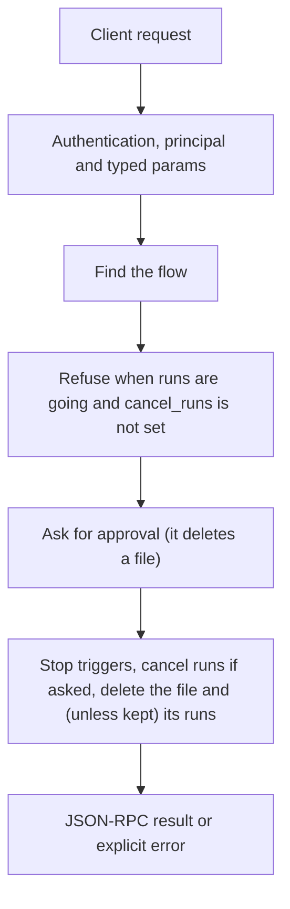

# flows.remove

> **Built in the first release of Automation (draft).** Names and fields may still change before a release that has them. See [Automation](../README.md).

Deletes a flow file after the owner's approval. Its triggers stop at once. Its run records are removed too, unless `keep_runs` is true. A flow with a run in progress is not removed unless `cancel_runs` is true.

## Endpoint, execution and permissions

| Property | Contract |
|---|---|
| Wire endpoint | `POST /v1/cep`; logical method `flows.remove` |
| Execution | Synchronous: the result is in the JSON-RPC `result` |
| Required scope | `write`; owner principal required |
| MCP facade | Not exposed to MCP clients |
| Called from a flow (`call` step) | No (`not_callable`) |
| Side effects | Deletes or replaces files; asks for approval |

Send a Bearer token when API authentication is enabled. Authentication failures are HTTP 401; method errors are JSON-RPC error objects with HTTP 200. See [the common CEP contract](../../api/cep/README.md).

## How it works

1. Find the flow
2. Refuse when runs are going and `cancel_runs` is not set
3. Ask for approval (it deletes a file)
4. Stop triggers, cancel runs if asked, delete the file and (unless kept) its runs



## Parameters, defaults and value effects

| Parameter | Type | Required | Meaning, default and constraints |
|---|---|---|---|
| `name` | string | Yes | The flow's name |
| `scope` | "project" \| "user" \| null | No | Which flow of that name. Absent: the project's, then the user's |
| `keep_runs` | boolean \| null | No | Keep the run records (default false) |
| `cancel_runs` | boolean \| null | No | Cancel runs in progress first (default false) |

Unknown parameters are rejected (`-32602`). `params._meta` is protocol metadata (such as an approval id), not an option of this method.

## Request examples

Examples describe the contract. Replace names, ids and paths with your own.

### 1. Remove a flow

Asks for approval.

```json
{
  "jsonrpc": "2.0",
  "id": 1,
  "method": "flows.remove",
  "params": {
    "name": "water-reminder",
    "scope": "user"
  }
}
```

### 2. Remove, keep its history

```json
{
  "jsonrpc": "2.0",
  "id": 2,
  "method": "flows.remove",
  "params": {
    "name": "weekly-issues",
    "scope": "user",
    "keep_runs": true
  }
}
```

## Response and field meanings

An illustrative answer; ids, times and contents will differ:

```json
{
  "id": 1,
  "jsonrpc": "2.0",
  "result": {
    "removed": "water-reminder",
    "scope": "user",
    "runs_removed": 12,
    "runs_cancelled": 0
  }
}
```

| Field | Meaning |
|---|---|
| `removed`, `scope` | The flow removed |
| `runs_removed` | Run records deleted |
| `runs_cancelled` | Runs cancelled first |

## Errors and recovery

| Code / boundary | Meaning | Recovery |
|---|---|---|
| HTTP 401 | Missing or wrong token while authentication is on | Send the configured token |
| `-32602` / `invalid_params` | Missing required fields, wrong types or unknown fields | Correct the request; do not retry it unchanged |
| `-32002` / `forbidden` | The caller lacks the scope, owner role or roots; `data.needs` says which | Use an authorized caller |
| `-32004` / `flow_not_found` | No flow with this name in the scope (or in either scope when `scope` is absent) | List flows with `flows.list`; check `scope` |
| `-32005` / `flow_running` | Runs are going; `data.runs` lists them | Wait, cancel them, or send `cancel_runs: true` |
| `-32003` / `approval_required` | Deleting a file needs the owner's approval | Approve, then retry with `params._meta.approval` |

### Invalid-field example

Deliberately invalid: the extra field must be removed.

```text
{
  "jsonrpc": "2.0",
  "id": 90,
  "method": "flows.remove",
  "params": {
    "name": "water-reminder",
    "scope": "user",
    "__unknown_option": true
  }
}
```

The answer is `{"jsonrpc":"2.0","id":90,"error":{"code":-32602,"message":"...","data":{"type":"invalid_params","errors":[...]}}}`. Use the code and `data`, not the message text.

## cURL

Save one request above as `request.json`:

```bash
curl --fail-with-body http://127.0.0.1:8000/v1/cep \
  -H "Content-Type: application/json" \
  -H "Authorization: Bearer $CLUAIZ_TOKEN" \
  --data-binary @request.json
```

## Python

```python
import json
import os
import requests

payload = json.loads(r'''{
  "id": 1,
  "jsonrpc": "2.0",
  "method": "flows.remove",
  "params": {
    "name": "water-reminder",
    "scope": "user"
  }
}''')
response = requests.post(
    "http://127.0.0.1:8000/v1/cep",
    headers={"Authorization": "Bearer " + os.environ["CLUAIZ_TOKEN"]},
    json=payload, timeout=60,
)
response.raise_for_status()
reply = response.json()
if "error" in reply:
    raise RuntimeError(json.dumps(reply["error"], ensure_ascii=False))
print(reply["result"])
```

## JavaScript / Node.js

Use an owner token only in a trusted client.

```javascript
const payload = {
  "id": 1,
  "jsonrpc": "2.0",
  "method": "flows.remove",
  "params": {
    "name": "water-reminder",
    "scope": "user"
  }
};
const response = await fetch("http://127.0.0.1:8000/v1/cep", {
  method: "POST",
  headers: { "content-type": "application/json", authorization: `Bearer ${process.env.CLUAIZ_TOKEN}` },
  body: JSON.stringify(payload),
});
const raw = await response.text();
if (!response.ok) throw new Error(`HTTP ${response.status}: ${raw}`);
const reply = JSON.parse(raw);
if (reply.error) throw new Error(JSON.stringify(reply.error));
console.log(reply.result);
```

## Limits, state and related operations

Owner only. Other flows that `run` this one fail with `unknown_flow` from then on; `flows.list` shows their problem.

- [`flows.disable`](flows.disable.md): stop triggers without deleting
- [Automation](../README.md)

## Implementation reference

- Code: `automation/host/src/methods/files.rs` (the method) and `automation/core` (the format, checks and runner).
