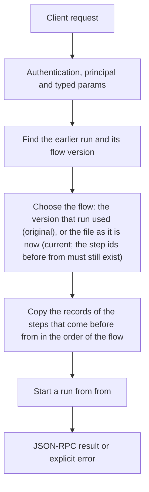

# flows.rerun_from

> **Built in the third release of Automation (draft).** Names and fields may still change before a release that has them. See [Automation](../README.md).

After a failure, fix the cause (a tool's settings, a key, the flow file) and run again from the step that failed, without repeating the steps before it. The new run has its own id and record, with `rerun_of` pointing to the old one. Steps before `from` are copied (status `reused`); `from` and everything after it run.

## Endpoint, execution and permissions

| Property | Contract |
|---|---|
| Wire endpoint | `POST /v1/cep`; logical method `flows.rerun_from` |
| Execution | A CEP task: the answer is a task handle; `tasks.result` gives the result |
| Required scope | `exec` |
| MCP facade | Not exposed to MCP clients |
| Called from a flow (`call` step) | No (`not_callable`) |
| Side effects | Changes state as described below |

Send a Bearer token when API authentication is enabled. Authentication failures are HTTP 401; method errors are JSON-RPC error objects with HTTP 200. See [the common CEP contract](../../api/cep/README.md).

## How it works

1. Find the earlier run and its flow version
2. Choose the flow: the version that run used (`original`), or the file as it is now (`current`; the step ids before `from` must still exist)
3. Copy the records of the steps that come before `from` in the order of the flow
4. Start a run from `from`



## Parameters, defaults and value effects

| Parameter | Type | Required | Meaning, default and constraints |
|---|---|---|---|
| `run_id` | string | Yes | The earlier run (any status but running or waiting) |
| `from` | string | Yes | The step id to start from |
| `flow_version` | "original" \| "current" \| null | No | Which flow to run (default `current`) |
| `inputs` | object \| null | No | Replace the run's inputs |

Unknown parameters are rejected (`-32602`). `params._meta` is protocol metadata (such as an approval id), not an option of this method.

## Request examples

Examples describe the contract. Replace names, ids and paths with your own.

### 1. From the failed step

```json
{
  "jsonrpc": "2.0",
  "id": 1,
  "method": "flows.rerun_from",
  "params": {
    "run_id": "run_8f2c51d0",
    "from": "report"
  }
}
```

### 2. With the version that failed

To check that the failure was outside the flow.

```json
{
  "jsonrpc": "2.0",
  "id": 2,
  "method": "flows.rerun_from",
  "params": {
    "run_id": "run_8f2c51d0",
    "from": "report",
    "flow_version": "original"
  }
}
```

## Response and field meanings

The call answers at once with a task handle:

```json
{
  "id": 1,
  "jsonrpc": "2.0",
  "result": {
    "task": {
      "task_id": "task_77e1…",
      "method": "flows.rerun_from",
      "status": "working",
      "created_at": "2026-11-10T18:02:11Z",
      "last_updated_at": "2026-11-10T18:02:11Z",
      "ttl_ms": 3600000,
      "poll_ms": 500
    },
    "run_id": "run_c0a91e3f",
    "status": "running"
  }
}
```

| Field | Meaning |
|---|---|
| `task`, `run_id`, `status` | As `flows.run` |
| `tasks.result` | The new run object, with `rerun_of: { run_id, from_step }` |

## Errors and recovery

| Code / boundary | Meaning | Recovery |
|---|---|---|
| HTTP 401 | Missing or wrong token while authentication is on | Send the configured token |
| `-32602` / `invalid_params` | Missing required fields, wrong types or unknown fields | Correct the request; do not retry it unchanged |
| `-32002` / `forbidden` | The caller lacks the scope, owner role or roots; `data.needs` says which | Use an authorized caller |
| `-32004` / `run_not_found` | No run with this id (it may have been removed by retention) | List runs with `flows.runs` |
| `-32004` / `step_not_found` | `from` is not a step of the chosen flow version | Pick an id from `flows.run_get` |
| `-32005` / `run_running` | The earlier run is still running or waiting | Cancel it or wait |
| `-32005` / `steps_changed` | With `current`, steps before `from` were removed or renamed in the file | Use `flow_version: original`, or start a new run |

### Invalid-field example

Deliberately invalid: the extra field must be removed.

```text
{
  "jsonrpc": "2.0",
  "id": 90,
  "method": "flows.rerun_from",
  "params": {
    "run_id": "run_8f2c51d0",
    "from": "report",
    "__unknown_option": true
  }
}
```

The answer is `{"jsonrpc":"2.0","id":90,"error":{"code":-32602,"message":"...","data":{"type":"invalid_params","errors":[...]}}}`. Use the code and `data`, not the message text.

## cURL

Save one request above as `request.json`:

```bash
curl --fail-with-body http://127.0.0.1:8000/v1/cep \
  -H "Content-Type: application/json" \
  -H "Authorization: Bearer $CLUAIZ_TOKEN" \
  --data-binary @request.json
```

## Python

```python
import json
import os
import requests

payload = json.loads(r'''{
  "id": 1,
  "jsonrpc": "2.0",
  "method": "flows.rerun_from",
  "params": {
    "run_id": "run_8f2c51d0",
    "from": "report"
  }
}''')
response = requests.post(
    "http://127.0.0.1:8000/v1/cep",
    headers={"Authorization": "Bearer " + os.environ["CLUAIZ_TOKEN"]},
    json=payload, timeout=60,
)
response.raise_for_status()
reply = response.json()
if "error" in reply:
    raise RuntimeError(json.dumps(reply["error"], ensure_ascii=False))
print(reply["result"])
```

## JavaScript / Node.js

Use an owner token only in a trusted client.

```javascript
const payload = {
  "id": 1,
  "jsonrpc": "2.0",
  "method": "flows.rerun_from",
  "params": {
    "run_id": "run_8f2c51d0",
    "from": "report"
  }
};
const response = await fetch("http://127.0.0.1:8000/v1/cep", {
  method: "POST",
  headers: { "content-type": "application/json", authorization: `Bearer ${process.env.CLUAIZ_TOKEN}` },
  body: JSON.stringify(payload),
});
const raw = await response.text();
if (!response.ok) throw new Error(`HTTP ${response.status}: ${raw}`);
const reply = JSON.parse(raw);
if (reply.error) throw new Error(JSON.stringify(reply.error));
console.log(reply.result);
```

A task: poll `tasks.get` (with `after` for events) every `poll_ms`, or call `tasks.result` with `wait_ms`.

## Limits, state and related operations

Needs `exec`. Steps with an `idempotency_key` that succeeded before are not repeated even if they come after `from`.

- [`flows.run_get`](flows.run_get.md): find the failed step
- [`flows.fix`](flows.fix.md): a proposed change
- [Automation](../README.md)

## Implementation reference

- Code: `automation/host/src/methods/runs.rs` (the method) and `Runner::rerun` in `automation/core/src/run/mod.rs`.
