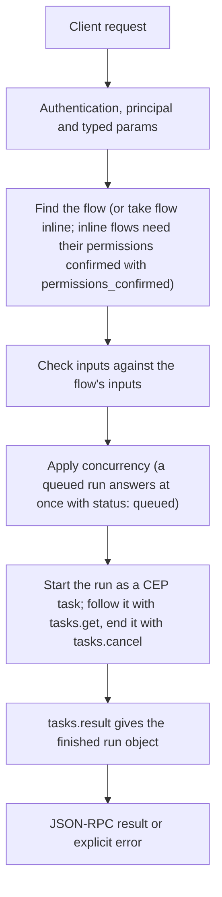

# flows.run

> **Built in the first release of Automation (draft).** Names and fields may still change before a release that has them. See [Automation](../README.md).

Starts one run and answers at once with a task handle and the run id. The run goes as if a trigger had fired. `dry_run` runs the flow without side effects: steps that write, delete, send or run programs are not called, and get the output given in `mocks` (or `null`); steps that only read and model steps run for real unless mocked. Use it to test a flow with sample `trigger` data before enabling it.

## Endpoint, execution and permissions

| Property | Contract |
|---|---|
| Wire endpoint | `POST /v1/cep`; logical method `flows.run` |
| Execution | A CEP task: the answer is a task handle; `tasks.result` gives the result |
| Required scope | `exec` |
| MCP facade | Not exposed to MCP clients |
| Called from a flow (`call` step) | No (`not_callable`) |
| Side effects | Changes state as described below |

Send a Bearer token when API authentication is enabled. Authentication failures are HTTP 401; method errors are JSON-RPC error objects with HTTP 200. See [the common CEP contract](../../api/cep/README.md).

## How it works

1. Find the flow (or take `flow` inline; inline flows need their `permissions` confirmed with `permissions_confirmed`)
2. Check `inputs` against the flow's `inputs`
3. Apply `concurrency` (a queued run answers at once with `status: queued`)
4. Start the run as a CEP task; follow it with `tasks.get`, end it with `tasks.cancel`
5. `tasks.result` gives the finished run object



## Parameters, defaults and value effects

| Parameter | Type | Required | Meaning, default and constraints |
|---|---|---|---|
| `name` | string \| null | No | The saved flow to run |
| `scope` | "project" \| "user" \| null | No | Which flow of that name. Absent: the project's, then the user's |
| `flow` | object \| null | No | An unsaved flow to run instead (testing from an editor) |
| `inputs` | object \| null | No | The run's inputs, checked against the flow's `inputs` |
| `trigger` | object \| null | No | Sample trigger data (such as a webhook body) for a test; default `{ kind: "manual" }` |
| `dry_run` | boolean \| null | No | No side effects (default false) |
| `mocks` | object \| null | No | Step id → output to use instead of running that step |
| `permissions_confirmed` | boolean \| null | No | For an inline `flow`: the owner accepts its permissions |
| `stream` | boolean \| null | No | Report `step.output_delta` events for model steps (default false) |
| `concurrency` | "parallel" \| null | No | `parallel` runs even if another run of this flow is going |

Unknown parameters are rejected (`-32602`). `params._meta` is protocol metadata (such as an approval id), not an option of this method.

## Request examples

Examples describe the contract. Replace names, ids and paths with your own.

### 1. Run a saved flow

```json
{
  "jsonrpc": "2.0",
  "id": 1,
  "method": "flows.run",
  "params": {
    "name": "weekly-issues",
    "scope": "user"
  }
}
```

### 2. Test with a sample webhook body, without side effects

Model steps run; the order lookup uses the mock; the reply is not sent.

```json
{
  "jsonrpc": "2.0",
  "id": 2,
  "method": "flows.run",
  "params": {
    "name": "support-reply",
    "dry_run": true,
    "trigger": {
      "kind": "webhook",
      "body": {
        "message": "Where is my order 1042?",
        "order_id": "1042",
        "customer": "c_77"
      }
    },
    "mocks": {
      "order": {
        "state": "shipped",
        "eta": "2026-11-12"
      }
    }
  }
}
```

### 3. Run with inputs

```json
{
  "jsonrpc": "2.0",
  "id": 3,
  "method": "flows.run",
  "params": {
    "name": "translate-sheet",
    "inputs": {
      "sheet": "Prices",
      "language": "Hindi"
    }
  }
}
```

## Response and field meanings

The call answers at once with a task handle:

```json
{
  "id": 1,
  "jsonrpc": "2.0",
  "result": {
    "task": {
      "task_id": "task_77e1…",
      "method": "flows.run",
      "status": "working",
      "created_at": "2026-11-10T18:02:11Z",
      "last_updated_at": "2026-11-10T18:02:11Z",
      "ttl_ms": 3600000,
      "poll_ms": 500
    },
    "run_id": "run_8f2c51d0",
    "status": "running"
  }
}
```

| Field | Meaning |
|---|---|
| `task` | The CEP task (see Long work: tasks in the CEP reference) |
| `run_id` | The run, for `flows.run_get` |
| `status` | `running`, or `queued` when `concurrency` made it wait |
| `tasks.result` | `{ run }`: the run object when it ended; see Runs and records |

## Errors and recovery

| Code / boundary | Meaning | Recovery |
|---|---|---|
| HTTP 401 | Missing or wrong token while authentication is on | Send the configured token |
| `-32602` / `invalid_params` | Missing required fields, wrong types or unknown fields | Correct the request; do not retry it unchanged |
| `-32002` / `forbidden` | The caller lacks the scope, owner role or roots; `data.needs` says which | Use an authorized caller |
| `-32004` / `flow_not_found` | No flow with this name in the scope (or in either scope when `scope` is absent) | List flows with `flows.list`; check `scope` |
| `-32602` / `invalid_flow` | The flow has errors; `data.problems` lists them (see Validation) | Fix each problem at its `path`; `flows.validate` checks without saving |
| `-32602` / `invalid_input` | The inputs do not match the flow's `inputs`; `data.errors` | Correct the inputs |
| `-32005` / `skipped` | `concurrency: skip` and a run is going | Wait, or pass `concurrency: parallel` |
| `-32005` / `permissions_unconfirmed` | An inline flow's permissions are not confirmed | Send `permissions_confirmed: true` after showing them |

### Invalid-field example

Deliberately invalid: the extra field must be removed.

```text
{
  "jsonrpc": "2.0",
  "id": 90,
  "method": "flows.run",
  "params": {
    "name": "weekly-issues",
    "scope": "user",
    "__unknown_option": true
  }
}
```

The answer is `{"jsonrpc":"2.0","id":90,"error":{"code":-32602,"message":"...","data":{"type":"invalid_params","errors":[...]}}}`. Use the code and `data`, not the message text.

## cURL

Save one request above as `request.json`:

```bash
curl --fail-with-body http://127.0.0.1:8000/v1/cep \
  -H "Content-Type: application/json" \
  -H "Authorization: Bearer $CLUAIZ_TOKEN" \
  --data-binary @request.json
```

## Python

```python
import json
import os
import requests

payload = json.loads(r'''{
  "id": 1,
  "jsonrpc": "2.0",
  "method": "flows.run",
  "params": {
    "name": "weekly-issues",
    "scope": "user"
  }
}''')
response = requests.post(
    "http://127.0.0.1:8000/v1/cep",
    headers={"Authorization": "Bearer " + os.environ["CLUAIZ_TOKEN"]},
    json=payload, timeout=60,
)
response.raise_for_status()
reply = response.json()
if "error" in reply:
    raise RuntimeError(json.dumps(reply["error"], ensure_ascii=False))
print(reply["result"])
```

## JavaScript / Node.js

Use an owner token only in a trusted client.

```javascript
const payload = {
  "id": 1,
  "jsonrpc": "2.0",
  "method": "flows.run",
  "params": {
    "name": "weekly-issues",
    "scope": "user"
  }
};
const response = await fetch("http://127.0.0.1:8000/v1/cep", {
  method: "POST",
  headers: { "content-type": "application/json", authorization: `Bearer ${process.env.CLUAIZ_TOKEN}` },
  body: JSON.stringify(payload),
});
const raw = await response.text();
if (!response.ok) throw new Error(`HTTP ${response.status}: ${raw}`);
const reply = JSON.parse(raw);
if (reply.error) throw new Error(JSON.stringify(reply.error));
console.log(reply.result);
```

A task: poll `tasks.get` (with `after` for events) every `poll_ms`, or call `tasks.result` with `wait_ms`.

## Limits, state and related operations

Needs `exec`. Not available to MCP clients directly; a flow with a `tool` trigger is offered to them as a tool instead. A run started here counts toward `max_running_runs`.

- [`flows.run_get`](flows.run_get.md): the run's steps
- [`tasks.get`](../../api/cep/system/tasks/tasks.get.md): progress events
- [`tasks.cancel`](../../api/cep/system/tasks/tasks.cancel.md): stop it
- [`flows.rerun_from`](flows.rerun_from.md): again from a step
- [Automation](../README.md)

## Implementation reference

- Code: `automation/host/src/methods/runs.rs` (the method) and `automation/core` (the format, checks and runner).
