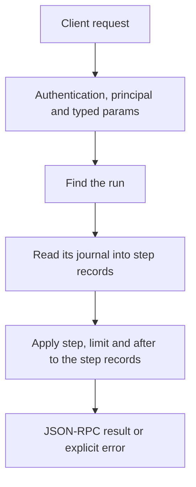

# flows.run_get

> **Built in the first release of Automation (draft).** Names and fields may still change before a release that has them. See [Automation](../README.md).

Returns a run in full: the run object, the trigger's data, and the step records (for loops, one per item or round, page by page). Large outputs are file references; read them with `fs.read`.

## Endpoint, execution and permissions

| Property | Contract |
|---|---|
| Wire endpoint | `POST /v1/cep`; logical method `flows.run_get` |
| Execution | Synchronous: the result is in the JSON-RPC `result` |
| Required scope | `read` |
| MCP facade | Listed for MCP clients (read-only) |
| Called from a flow (`call` step) | Yes |
| Side effects | None (read-only) |

Send a Bearer token when API authentication is enabled. Authentication failures are HTTP 401; method errors are JSON-RPC error objects with HTTP 200. See [the common CEP contract](../../api/cep/README.md).

## How it works

1. Find the run
2. Read its journal into step records
3. Apply `step`, `limit` and `after` to the step records



## Parameters, defaults and value effects

| Parameter | Type | Required | Meaning, default and constraints |
|---|---|---|---|
| `run_id` | string | Yes | The run |
| `steps` | boolean \| null | No | Include step records (default true) |
| `io` | boolean \| null | No | Include inputs and outputs in step records (default true) |
| `step` | string \| null | No | Only this step's records (all its items or rounds) |
| `limit` | integer \| null | No | Step records per page, 1–1000 (default 200) |
| `after` | string \| null | No | Cursor from the previous page |

Unknown parameters are rejected (`-32602`). `params._meta` is protocol metadata (such as an approval id), not an option of this method.

## Request examples

Examples describe the contract. Replace names, ids and paths with your own.

### 1. A whole run

```json
{
  "jsonrpc": "2.0",
  "id": 1,
  "method": "flows.run_get",
  "params": {
    "run_id": "run_8f2c51d0"
  }
}
```

### 2. One step's records

For a loop: one record per item.

```json
{
  "jsonrpc": "2.0",
  "id": 2,
  "method": "flows.run_get",
  "params": {
    "run_id": "run_8f2c51d0",
    "step": "summaries"
  }
}
```

### 3. Without data

Statuses and timings only.

```json
{
  "jsonrpc": "2.0",
  "id": 3,
  "method": "flows.run_get",
  "params": {
    "run_id": "run_8f2c51d0",
    "io": false
  }
}
```

## Response and field meanings

An illustrative answer; ids, times and contents will differ:

```json
{
  "id": 1,
  "jsonrpc": "2.0",
  "result": {
    "run": {
      "run_id": "run_8f2c51d0",
      "flow": "weekly-issues",
      "scope": "user",
      "flow_hash": "sha256:4b1e9c…",
      "status": "succeeded",
      "trigger": {
        "id": "schedule_0",
        "kind": "schedule",
        "at": "2026-11-06T18:00:00+05:30"
      },
      "inputs": {},
      "outputs": {
        "report": "This week 4 issues were closed: …"
      },
      "error": null,
      "waiting_for": null,
      "created_at": "2026-11-06T18:00:00+05:30",
      "started_at": "2026-11-06T18:00:00+05:30",
      "finished_at": "2026-11-06T18:00:41+05:30",
      "running_ms": 41210,
      "steps_done": 3,
      "task_id": "task_77e1…",
      "parent": null,
      "rerun_of": null,
      "dry_run": false
    },
    "trigger": {
      "id": "schedule_0",
      "kind": "schedule",
      "at": "2026-11-06T18:00:00+05:30",
      "scheduled_for": "2026-11-06T18:00:00+05:30"
    },
    "steps": [
      {
        "id": "closed",
        "place": "steps[0]",
        "kind": "tool",
        "status": "succeeded",
        "item": null,
        "attempts": [
          {
            "started_at": "2026-11-06T18:00:00+05:30",
            "ms": 1830,
            "error": null
          }
        ],
        "input": {
          "tool": "mcp:github/list_issues",
          "with": {
            "repo": "my/repo",
            "state": "closed",
            "closed_in_last_days": 7
          }
        },
        "output": [
          {
            "number": 412,
            "title": "…"
          }
        ],
        "error": null,
        "tokens": null
      },
      {
        "id": "report",
        "place": "steps[1]",
        "kind": "ask",
        "status": "succeeded",
        "item": null,
        "attempts": [
          {
            "started_at": "2026-11-06T18:00:02+05:30",
            "ms": 38900,
            "error": null
          }
        ],
        "input": {
          "ask": "Write a short weekly report of these closed issues.",
          "with": {
            "issues": "…"
          }
        },
        "output": "This week 4 issues were closed: …",
        "error": null,
        "tokens": {
          "prompt": 1830,
          "completion": 142
        },
        "model": "qwen3-4b"
      }
    ],
    "next": null
  }
}
```

| Field | Meaning |
|---|---|
| `run` | The run object |
| `trigger` | The full trigger data |
| `steps[]` | Step records: see Runs and records |
| `next` | Cursor for more step records |

## Errors and recovery

| Code / boundary | Meaning | Recovery |
|---|---|---|
| HTTP 401 | Missing or wrong token while authentication is on | Send the configured token |
| `-32602` / `invalid_params` | Missing required fields, wrong types or unknown fields | Correct the request; do not retry it unchanged |
| `-32002` / `forbidden` | The caller lacks the scope, owner role or roots; `data.needs` says which | Use an authorized caller |
| `-32004` / `run_not_found` | No run with this id (it may have been removed by retention) | List runs with `flows.runs` |
| `-32004` / `step_not_found` | `step` is not a step of this run's flow | Use an id from the run's `flow.json` |

### Invalid-field example

Deliberately invalid: the extra field must be removed.

```text
{
  "jsonrpc": "2.0",
  "id": 90,
  "method": "flows.run_get",
  "params": {
    "run_id": "run_8f2c51d0",
    "__unknown_option": true
  }
}
```

The answer is `{"jsonrpc":"2.0","id":90,"error":{"code":-32602,"message":"...","data":{"type":"invalid_params","errors":[...]}}}`. Use the code and `data`, not the message text.

## cURL

Save one request above as `request.json`:

```bash
curl --fail-with-body http://127.0.0.1:8000/v1/cep \
  -H "Content-Type: application/json" \
  -H "Authorization: Bearer $CLUAIZ_TOKEN" \
  --data-binary @request.json
```

## Python

```python
import json
import os
import requests

payload = json.loads(r'''{
  "id": 1,
  "jsonrpc": "2.0",
  "method": "flows.run_get",
  "params": {
    "run_id": "run_8f2c51d0"
  }
}''')
response = requests.post(
    "http://127.0.0.1:8000/v1/cep",
    headers={"Authorization": "Bearer " + os.environ["CLUAIZ_TOKEN"]},
    json=payload, timeout=60,
)
response.raise_for_status()
reply = response.json()
if "error" in reply:
    raise RuntimeError(json.dumps(reply["error"], ensure_ascii=False))
print(reply["result"])
```

## JavaScript / Node.js

Use an owner token only in a trusted client.

```javascript
const payload = {
  "id": 1,
  "jsonrpc": "2.0",
  "method": "flows.run_get",
  "params": {
    "run_id": "run_8f2c51d0"
  }
};
const response = await fetch("http://127.0.0.1:8000/v1/cep", {
  method: "POST",
  headers: { "content-type": "application/json", authorization: `Bearer ${process.env.CLUAIZ_TOKEN}` },
  body: JSON.stringify(payload),
});
const raw = await response.text();
if (!response.ok) throw new Error(`HTTP ${response.status}: ${raw}`);
const reply = JSON.parse(raw);
if (reply.error) throw new Error(JSON.stringify(reply.error));
console.log(reply.result);
```

## Limits, state and related operations

Read-only. Secrets are shown as `env:NAME`; outputs with `secret_output` are masked.

- [`flows.runs`](flows.runs.md): list runs
- [`flows.rerun_from`](flows.rerun_from.md): again from a step
- [Automation](../README.md)

## Implementation reference

- Code: `automation/host/src/methods/runs.rs` (the method) and `automation/core` (the format, checks and runner).
