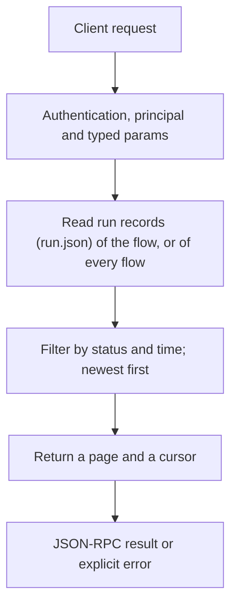

# flows.runs

> **Built in the first release of Automation (draft).** Names and fields may still change before a release that has them. See [Automation](../README.md).

Lists run objects without their step records. Use `flows.run_get` for one run in full.

## Endpoint, execution and permissions

| Property | Contract |
|---|---|
| Wire endpoint | `POST /v1/cep`; logical method `flows.runs` |
| Execution | Synchronous: the result is in the JSON-RPC `result` |
| Required scope | `read` |
| MCP facade | Listed for MCP clients (read-only) |
| Called from a flow (`call` step) | Yes |
| Side effects | None (read-only) |

Send a Bearer token when API authentication is enabled. Authentication failures are HTTP 401; method errors are JSON-RPC error objects with HTTP 200. See [the common CEP contract](../../api/cep/README.md).

## How it works

1. Read run records (`run.json`) of the flow, or of every flow
2. Filter by status and time; newest first
3. Return a page and a cursor



## Parameters, defaults and value effects

| Parameter | Type | Required | Meaning, default and constraints |
|---|---|---|---|
| `name` | string \| null | No | One flow (default every flow) |
| `scope` | "project" \| "user" \| null | No | Which flow of that name. Absent: the project's, then the user's |
| `status` | string[] \| null | No | Only these statuses |
| `since` | string \| null | No | Only runs created at or after this time |
| `limit` | integer \| null | No | Runs per page, 1–200 (default 20) |
| `after` | string \| null | No | The `next` cursor of the previous page |

Unknown parameters are rejected (`-32602`). `params._meta` is protocol metadata (such as an approval id), not an option of this method.

## Request examples

Examples describe the contract. Replace names, ids and paths with your own.

### 1. Last runs of a flow

```json
{
  "jsonrpc": "2.0",
  "id": 1,
  "method": "flows.runs",
  "params": {
    "name": "weekly-issues",
    "limit": 5
  }
}
```

### 2. Failed runs of every flow this week

```json
{
  "jsonrpc": "2.0",
  "id": 2,
  "method": "flows.runs",
  "params": {
    "status": [
      "failed"
    ],
    "since": "2026-11-03T00:00:00+05:30"
  }
}
```

### 3. Waiting runs

Runs waiting for approvals, times or webhooks.

```json
{
  "jsonrpc": "2.0",
  "id": 3,
  "method": "flows.runs",
  "params": {
    "status": [
      "waiting"
    ]
  }
}
```

## Response and field meanings

An illustrative answer; ids, times and contents will differ:

```json
{
  "id": 1,
  "jsonrpc": "2.0",
  "result": {
    "runs": [
      {
        "run_id": "run_8f2c51d0",
        "flow": "weekly-issues",
        "scope": "user",
        "flow_hash": "sha256:4b1e9c…",
        "status": "succeeded",
        "trigger": {
          "id": "schedule_0",
          "kind": "schedule",
          "at": "2026-11-06T18:00:00+05:30"
        },
        "inputs": {},
        "outputs": {
          "report": "This week 4 issues were closed: …"
        },
        "error": null,
        "waiting_for": null,
        "created_at": "2026-11-06T18:00:00+05:30",
        "started_at": "2026-11-06T18:00:00+05:30",
        "finished_at": "2026-11-06T18:00:41+05:30",
        "running_ms": 41210,
        "steps_done": 3,
        "task_id": "task_77e1…",
        "parent": null,
        "rerun_of": null,
        "dry_run": false
      }
    ],
    "next": null
  }
}
```

| Field | Meaning |
|---|---|
| `runs[]` | Run objects (see Runs and records), without step records |
| `next` | Cursor for the next page, or `null` |

## Errors and recovery

| Code / boundary | Meaning | Recovery |
|---|---|---|
| HTTP 401 | Missing or wrong token while authentication is on | Send the configured token |
| `-32602` / `invalid_params` | Missing required fields, wrong types or unknown fields | Correct the request; do not retry it unchanged |
| `-32002` / `forbidden` | The caller lacks the scope, owner role or roots; `data.needs` says which | Use an authorized caller |
| `-32004` / `flow_not_found` | No flow with this name in the scope (or in either scope when `scope` is absent) | List flows with `flows.list`; check `scope` |

### Invalid-field example

Deliberately invalid: the extra field must be removed.

```text
{
  "jsonrpc": "2.0",
  "id": 90,
  "method": "flows.runs",
  "params": {
    "name": "weekly-issues",
    "limit": 5,
    "__unknown_option": true
  }
}
```

The answer is `{"jsonrpc":"2.0","id":90,"error":{"code":-32602,"message":"...","data":{"type":"invalid_params","errors":[...]}}}`. Use the code and `data`, not the message text.

## cURL

Save one request above as `request.json`:

```bash
curl --fail-with-body http://127.0.0.1:8000/v1/cep \
  -H "Content-Type: application/json" \
  -H "Authorization: Bearer $CLUAIZ_TOKEN" \
  --data-binary @request.json
```

## Python

```python
import json
import os
import requests

payload = json.loads(r'''{
  "id": 1,
  "jsonrpc": "2.0",
  "method": "flows.runs",
  "params": {
    "name": "weekly-issues",
    "limit": 5
  }
}''')
response = requests.post(
    "http://127.0.0.1:8000/v1/cep",
    headers={"Authorization": "Bearer " + os.environ["CLUAIZ_TOKEN"]},
    json=payload, timeout=60,
)
response.raise_for_status()
reply = response.json()
if "error" in reply:
    raise RuntimeError(json.dumps(reply["error"], ensure_ascii=False))
print(reply["result"])
```

## JavaScript / Node.js

Use an owner token only in a trusted client.

```javascript
const payload = {
  "id": 1,
  "jsonrpc": "2.0",
  "method": "flows.runs",
  "params": {
    "name": "weekly-issues",
    "limit": 5
  }
};
const response = await fetch("http://127.0.0.1:8000/v1/cep", {
  method: "POST",
  headers: { "content-type": "application/json", authorization: `Bearer ${process.env.CLUAIZ_TOKEN}` },
  body: JSON.stringify(payload),
});
const raw = await response.text();
if (!response.ok) throw new Error(`HTTP ${response.status}: ${raw}`);
const reply = JSON.parse(raw);
if (reply.error) throw new Error(JSON.stringify(reply.error));
console.log(reply.result);
```

## Limits, state and related operations

Read-only. Runs removed by retention are not listed.

- [`flows.run_get`](flows.run_get.md): one run in full
- [Automation](../README.md)

## Implementation reference

- Code: `automation/host/src/methods/runs.rs` (the method) and `automation/core` (the format, checks and runner).
