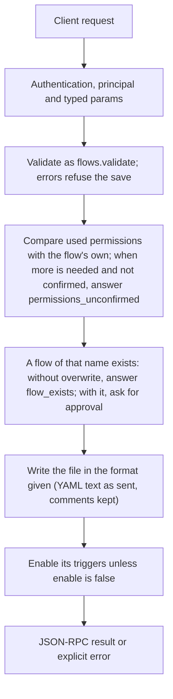

# flows.save

> **Built in the first release of Automation (draft).** Names and fields may still change before a release that has them. See [Automation](../README.md).

Writes a flow file into the project's `.agents/flows/` or the user's `flows/` folder, after the checks of `flows.validate`. When the flow uses more than its `permissions` list (or has none), the first call answers `permissions_unconfirmed` with the list; the caller shows it to the owner and calls again with `permissions_confirmed: true`, and the list is written into the file.

## Endpoint, execution and permissions

| Property | Contract |
|---|---|
| Wire endpoint | `POST /v1/cep`; logical method `flows.save` |
| Execution | Synchronous: the result is in the JSON-RPC `result` |
| Required scope | `write`; owner principal required |
| MCP facade | Not exposed to MCP clients |
| Called from a flow (`call` step) | No (`not_callable`) |
| Side effects | Deletes or replaces files; asks for approval |

Send a Bearer token when API authentication is enabled. Authentication failures are HTTP 401; method errors are JSON-RPC error objects with HTTP 200. See [the common CEP contract](../../api/cep/README.md).

## How it works

1. Validate as `flows.validate`; errors refuse the save
2. Compare used permissions with the flow's own; when more is needed and not confirmed, answer `permissions_unconfirmed`
3. A flow of that name exists: without `overwrite`, answer `flow_exists`; with it, ask for approval
4. Write the file in the format given (YAML text as sent, comments kept)
5. Enable its triggers unless `enable` is false



## Parameters, defaults and value effects

| Parameter | Type | Required | Meaning, default and constraints |
|---|---|---|---|
| `flow` | object \| null | No | The flow as JSON. Send `flow`, or `text` with `format` |
| `text` | string \| null | No | The flow as JSON or YAML text (comments in YAML are kept on save) |
| `format` | "json" \| "yaml" \| null | No | The format of `text`; required with `text` |
| `scope` | "project" \| "user" \| null | No | Where to save; default `user`. `project` needs a current workspace |
| `overwrite` | boolean \| null | No | Replace a flow of the same name (asks for approval); default false |
| `permissions_confirmed` | boolean \| null | No | The owner accepted `permissions_needed` from the last answer |
| `enable` | boolean \| null | No | Turn its triggers on after saving (default true) |

Unknown parameters are rejected (`-32602`). `params._meta` is protocol metadata (such as an approval id), not an option of this method.

## Request examples

Examples describe the contract. Replace names, ids and paths with your own.

### 1. First save

Usually answers `permissions_unconfirmed` with the list to show.

```json
{
  "jsonrpc": "2.0",
  "id": 1,
  "method": "flows.save",
  "params": {
    "flow": {
      "flow": "cluaiz.flow/1",
      "name": "weekly-issues",
      "on": [
        {
          "schedule": "0 18 * * 5"
        }
      ],
      "steps": [
        {
          "id": "closed",
          "tool": "mcp:github/list_issues",
          "with": {
            "repo": "my/repo",
            "state": "closed",
            "closed_in_last_days": 7
          }
        },
        {
          "id": "report",
          "ask": "Write a short weekly report of these closed issues.",
          "with": {
            "issues": "${{ steps.closed.output }}"
          }
        },
        {
          "tool": "mcp:notify/send",
          "with": {
            "text": "${{ steps.report.output }}"
          }
        }
      ]
    },
    "scope": "user"
  }
}
```

### 2. Save with confirmed permissions

The list is written into the file.

```json
{
  "jsonrpc": "2.0",
  "id": 2,
  "method": "flows.save",
  "params": {
    "flow": {
      "flow": "cluaiz.flow/1",
      "name": "weekly-issues",
      "on": [
        {
          "schedule": "0 18 * * 5"
        }
      ],
      "steps": [
        {
          "id": "closed",
          "tool": "mcp:github/list_issues",
          "with": {
            "repo": "my/repo",
            "state": "closed",
            "closed_in_last_days": 7
          }
        },
        {
          "id": "report",
          "ask": "Write a short weekly report of these closed issues.",
          "with": {
            "issues": "${{ steps.closed.output }}"
          }
        },
        {
          "tool": "mcp:notify/send",
          "with": {
            "text": "${{ steps.report.output }}"
          }
        }
      ]
    },
    "scope": "user",
    "permissions_confirmed": true
  }
}
```

### 3. Replace a flow, keep it off

Asks for approval because it replaces a file.

```json
{
  "jsonrpc": "2.0",
  "id": 3,
  "method": "flows.save",
  "params": {
    "text": "…",
    "format": "yaml",
    "overwrite": true,
    "enable": false,
    "permissions_confirmed": true
  }
}
```

## Response and field meanings

An illustrative answer; ids, times and contents will differ:

```json
{
  "id": 1,
  "jsonrpc": "2.0",
  "result": {
    "flow": {
      "name": "weekly-issues",
      "scope": "user",
      "path": "~/.cluaiz/flows/weekly-issues.flow.yaml",
      "format": "yaml",
      "description": "Every Friday evening, a short report of the issues closed this week.",
      "enabled": true,
      "triggers": [
        {
          "id": "schedule_0",
          "kind": "schedule",
          "status": "active",
          "next_at": "2026-11-13T18:00:00+05:30"
        }
      ],
      "hash": "sha256:4b1e9c…",
      "updated_at": "2026-11-10T17:40:02+05:30",
      "last_run": {
        "run_id": "run_8f2c51d0",
        "status": "succeeded",
        "finished_at": "2026-11-06T18:00:41+05:30"
      },
      "warnings": 0,
      "tags": [
        "github",
        "reports"
      ]
    },
    "permissions": {
      "tools": [
        "mcp:github/list_issues",
        "mcp:notify/send"
      ],
      "models": [
        "*"
      ],
      "scopes": [
        "read"
      ]
    },
    "problems": []
  }
}
```

| Field | Meaning |
|---|---|
| `flow` | The saved flow's summary (as in `flows.list`) |
| `permissions` | The permissions now in the file |
| `problems` | Warnings (errors refuse the save) |

## Errors and recovery

| Code / boundary | Meaning | Recovery |
|---|---|---|
| HTTP 401 | Missing or wrong token while authentication is on | Send the configured token |
| `-32602` / `invalid_params` | Missing required fields, wrong types or unknown fields | Correct the request; do not retry it unchanged |
| `-32002` / `forbidden` | The caller lacks the scope, owner role or roots; `data.needs` says which | Use an authorized caller |
| `-32602` / `invalid_flow` | The flow has errors; `data.problems` lists them (see Validation) | Fix each problem at its `path`; `flows.validate` checks without saving |
| `-32005` / `permissions_unconfirmed` | The flow needs permissions that are not confirmed; `data.permissions_needed` and `data.permissions_missing` list them | Show them to the owner; call again with `permissions_confirmed: true` |
| `-32005` / `flow_exists` | A flow of this name exists in the scope | Send `overwrite: true`, or another `name` |
| `-32003` / `approval_required` | Replacing a file needs the owner's approval | Approve, then retry with `params._meta.approval` |
| `-32005` / `no_workspace` | `scope: project` without a current workspace | Set one with `workspace.set`, or save with `scope: user` |
| `-32006` / `too_large` | The text is over 1 MB | Split the flow |

### Invalid-field example

Deliberately invalid: the extra field must be removed.

```text
{
  "jsonrpc": "2.0",
  "id": 90,
  "method": "flows.save",
  "params": {
    "flow": {
      "flow": "cluaiz.flow/1",
      "name": "weekly-issues",
      "on": [
        {
          "schedule": "0 18 * * 5"
        }
      ],
      "steps": [
        {
          "id": "closed",
          "tool": "mcp:github/list_issues",
          "with": {
            "repo": "my/repo",
            "state": "closed",
            "closed_in_last_days": 7
          }
        },
        {
          "id": "report",
          "ask": "Write a short weekly report of these closed issues.",
          "with": {
            "issues": "${{ steps.closed.output }}"
          }
        },
        {
          "tool": "mcp:notify/send",
          "with": {
            "text": "${{ steps.report.output }}"
          }
        }
      ]
    },
    "scope": "user",
    "__unknown_option": true
  }
}
```

The answer is `{"jsonrpc":"2.0","id":90,"error":{"code":-32602,"message":"...","data":{"type":"invalid_params","errors":[...]}}}`. Use the code and `data`, not the message text.

## cURL

Save one request above as `request.json`:

```bash
curl --fail-with-body http://127.0.0.1:8000/v1/cep \
  -H "Content-Type: application/json" \
  -H "Authorization: Bearer $CLUAIZ_TOKEN" \
  --data-binary @request.json
```

## Python

```python
import json
import os
import requests

payload = json.loads(r'''{
  "id": 1,
  "jsonrpc": "2.0",
  "method": "flows.save",
  "params": {
    "flow": {
      "flow": "cluaiz.flow/1",
      "name": "weekly-issues",
      "on": [
        {
          "schedule": "0 18 * * 5"
        }
      ],
      "steps": [
        {
          "id": "closed",
          "tool": "mcp:github/list_issues",
          "with": {
            "repo": "my/repo",
            "state": "closed",
            "closed_in_last_days": 7
          }
        },
        {
          "id": "report",
          "ask": "Write a short weekly report of these closed issues.",
          "with": {
            "issues": "${{ steps.closed.output }}"
          }
        },
        {
          "tool": "mcp:notify/send",
          "with": {
            "text": "${{ steps.report.output }}"
          }
        }
      ]
    },
    "scope": "user"
  }
}''')
response = requests.post(
    "http://127.0.0.1:8000/v1/cep",
    headers={"Authorization": "Bearer " + os.environ["CLUAIZ_TOKEN"]},
    json=payload, timeout=60,
)
response.raise_for_status()
reply = response.json()
if "error" in reply:
    raise RuntimeError(json.dumps(reply["error"], ensure_ascii=False))
print(reply["result"])
```

## JavaScript / Node.js

Use an owner token only in a trusted client.

```javascript
const payload = {
  "id": 1,
  "jsonrpc": "2.0",
  "method": "flows.save",
  "params": {
    "flow": {
      "flow": "cluaiz.flow/1",
      "name": "weekly-issues",
      "on": [
        {
          "schedule": "0 18 * * 5"
        }
      ],
      "steps": [
        {
          "id": "closed",
          "tool": "mcp:github/list_issues",
          "with": {
            "repo": "my/repo",
            "state": "closed",
            "closed_in_last_days": 7
          }
        },
        {
          "id": "report",
          "ask": "Write a short weekly report of these closed issues.",
          "with": {
            "issues": "${{ steps.closed.output }}"
          }
        },
        {
          "tool": "mcp:notify/send",
          "with": {
            "text": "${{ steps.report.output }}"
          }
        }
      ]
    },
    "scope": "user"
  }
};
const response = await fetch("http://127.0.0.1:8000/v1/cep", {
  method: "POST",
  headers: { "content-type": "application/json", authorization: `Bearer ${process.env.CLUAIZ_TOKEN}` },
  body: JSON.stringify(payload),
});
const raw = await response.text();
if (!response.ok) throw new Error(`HTTP ${response.status}: ${raw}`);
const reply = JSON.parse(raw);
if (reply.error) throw new Error(JSON.stringify(reply.error));
console.log(reply.result);
```

## Limits, state and related operations

Owner only, never from MCP or from a flow. Saving does not run the flow. A project flow written by someone else (in the project folder) is not enabled until its permissions are confirmed here.

- [`flows.validate`](flows.validate.md): the same checks without saving
- [`flows.enable`](flows.enable.md): turn triggers on later
- [`flows.get`](flows.get.md): read it back
- [Automation](../README.md)

## Implementation reference

- Code: `automation/host/src/methods/files.rs` (the method) and `automation/core` (the format, checks and runner).
