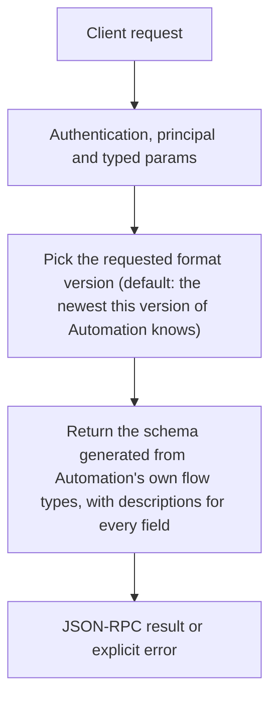

# flows.schema

> **Built in the first release of Automation (draft).** Names and fields may still change before a release that has them. See [Automation](../README.md).

Returns the JSON Schema (draft 2020-12) of the flow file for a format version. Editors use it to check files as they are typed, applications to build forms, and `flows.draft` gives it to the model.

## Endpoint, execution and permissions

| Property | Contract |
|---|---|
| Wire endpoint | `POST /v1/cep`; logical method `flows.schema` |
| Execution | Synchronous: the result is in the JSON-RPC `result` |
| Required scope | `read` |
| MCP facade | Listed for MCP clients (read-only) |
| Called from a flow (`call` step) | Yes |
| Side effects | None (read-only) |

Send a Bearer token when API authentication is enabled. Authentication failures are HTTP 401; method errors are JSON-RPC error objects with HTTP 200. See [the common CEP contract](../../api/cep/README.md).

## How it works

1. Pick the requested format version (default: the newest this version of Automation knows)
2. Return the schema generated from Automation's own flow types, with descriptions for every field



## Parameters, defaults and value effects

| Parameter | Type | Required | Meaning, default and constraints |
|---|---|---|---|
| `version` | string \| null | No | A format version such as `cluaiz.flow/1`; default the newest |

Unknown parameters are rejected (`-32602`). `params._meta` is protocol metadata (such as an approval id), not an option of this method.

## Request examples

Examples describe the contract. Replace names, ids and paths with your own.

### 1. Newest schema

Without parameters the newest version is returned.

```json
{
  "jsonrpc": "2.0",
  "id": 1,
  "method": "flows.schema",
  "params": {}
}
```

### 2. A given version

Pin the version an editor was built for.

```json
{
  "jsonrpc": "2.0",
  "id": 2,
  "method": "flows.schema",
  "params": {
    "version": "cluaiz.flow/1"
  }
}
```

## Response and field meanings

An illustrative answer; ids, times and contents will differ:

```json
{
  "id": 1,
  "jsonrpc": "2.0",
  "result": {
    "version": "cluaiz.flow/1",
    "versions": [
      "cluaiz.flow/1"
    ],
    "formats": [
      "json",
      "yaml"
    ],
    "schema": {
      "$schema": "https://json-schema.org/draft/2020-12/schema",
      "title": "Cluaiz flow",
      "type": "object",
      "required": [
        "flow",
        "name",
        "steps"
      ],
      "properties": {
        "flow": {
          "const": "cluaiz.flow/1"
        },
        "name": {
          "type": "string",
          "pattern": "^[a-z0-9][a-z0-9_-]{0,63}$"
        },
        "…": {}
      }
    }
  }
}
```

| Field | Meaning |
|---|---|
| `version` | The version returned |
| `versions` | Every format version Automation reads |
| `formats` | Text formats accepted |
| `schema` | The JSON Schema. Each property has `description`; step kinds are a `oneOf` keyed by their kind field |

## Errors and recovery

| Code / boundary | Meaning | Recovery |
|---|---|---|
| HTTP 401 | Missing or wrong token while authentication is on | Send the configured token |
| `-32602` / `invalid_params` | Missing required fields, wrong types or unknown fields | Correct the request; do not retry it unchanged |
| `-32002` / `forbidden` | The caller lacks the scope, owner role or roots; `data.needs` says which | Use an authorized caller |
| `-32602` / `unknown_version` | `version` is not one this version of Automation knows | Use a value from `versions` |

### Invalid-field example

Deliberately invalid: the extra field must be removed.

```text
{
  "jsonrpc": "2.0",
  "id": 90,
  "method": "flows.schema",
  "params": {
    "__unknown_option": true
  }
}
```

The answer is `{"jsonrpc":"2.0","id":90,"error":{"code":-32602,"message":"...","data":{"type":"invalid_params","errors":[...]}}}`. Use the code and `data`, not the message text.

## cURL

Save one request above as `request.json`:

```bash
curl --fail-with-body http://127.0.0.1:8000/v1/cep \
  -H "Content-Type: application/json" \
  -H "Authorization: Bearer $CLUAIZ_TOKEN" \
  --data-binary @request.json
```

## Python

```python
import json
import os
import requests

payload = json.loads(r'''{
  "id": 1,
  "jsonrpc": "2.0",
  "method": "flows.schema",
  "params": {}
}''')
response = requests.post(
    "http://127.0.0.1:8000/v1/cep",
    headers={"Authorization": "Bearer " + os.environ["CLUAIZ_TOKEN"]},
    json=payload, timeout=60,
)
response.raise_for_status()
reply = response.json()
if "error" in reply:
    raise RuntimeError(json.dumps(reply["error"], ensure_ascii=False))
print(reply["result"])
```

## JavaScript / Node.js

Use an owner token only in a trusted client.

```javascript
const payload = {
  "id": 1,
  "jsonrpc": "2.0",
  "method": "flows.schema",
  "params": {}
};
const response = await fetch("http://127.0.0.1:8000/v1/cep", {
  method: "POST",
  headers: { "content-type": "application/json", authorization: `Bearer ${process.env.CLUAIZ_TOKEN}` },
  body: JSON.stringify(payload),
});
const raw = await response.text();
if (!response.ok) throw new Error(`HTTP ${response.status}: ${raw}`);
const reply = JSON.parse(raw);
if (reply.error) throw new Error(JSON.stringify(reply.error));
console.log(reply.result);
```

## Limits, state and related operations

Read-only and fast. The schema changes only with the Cluaiz version; cache it by `version`.

- [`flows.validate`](flows.validate.md): checks a flow against this schema and more
- [`flows.nodes`](flows.nodes.md): what steps can run
- [Automation](../README.md)

## Implementation reference

- Code: `automation/host/src/methods/files.rs` (the method) and `automation/core` (the format, checks and runner).
