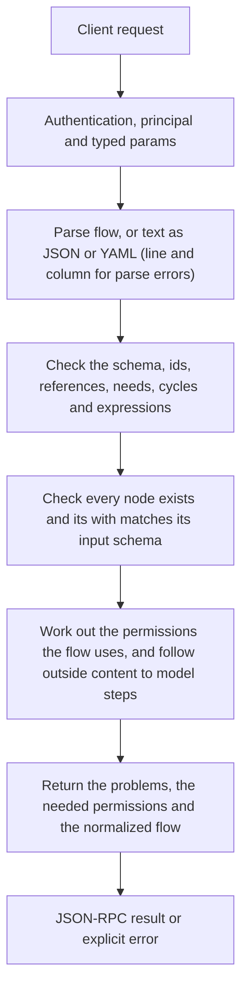

# flows.validate

> **Built in the first release of Automation (draft).** Names and fields may still change before a release that has them. See [Automation](../README.md).

Runs every check that `flows.save` runs, and returns the problems instead of refusing. Editors call it as the flow is edited; models drafting a flow use it to correct themselves. Nothing is saved or run.

## Endpoint, execution and permissions

| Property | Contract |
|---|---|
| Wire endpoint | `POST /v1/cep`; logical method `flows.validate` |
| Execution | Synchronous: the result is in the JSON-RPC `result` |
| Required scope | `read` |
| MCP facade | Listed for MCP clients (read-only) |
| Called from a flow (`call` step) | Yes |
| Side effects | None (read-only) |

Send a Bearer token when API authentication is enabled. Authentication failures are HTTP 401; method errors are JSON-RPC error objects with HTTP 200. See [the common CEP contract](../../api/cep/README.md).

## How it works

1. Parse `flow`, or `text` as JSON or YAML (line and column for parse errors)
2. Check the schema, ids, references, `needs`, cycles and expressions
3. Check every node exists and its `with` matches its input schema
4. Work out the permissions the flow uses, and follow outside content to model steps
5. Return the problems, the needed permissions and the normalized flow



## Parameters, defaults and value effects

| Parameter | Type | Required | Meaning, default and constraints |
|---|---|---|---|
| `flow` | object \| null | No | The flow as JSON. Send `flow`, or `text` with `format` |
| `text` | string \| null | No | The flow as JSON or YAML text (comments in YAML are kept on save) |
| `format` | "json" \| "yaml" \| null | No | The format of `text`; required with `text` |
| `name` | string \| null | No | Validate a saved flow instead (with `scope`) |
| `scope` | "project" \| "user" \| null | No | Which flow of that name. Absent: the project's, then the user's |

Unknown parameters are rejected (`-32602`). `params._meta` is protocol metadata (such as an approval id), not an option of this method.

## Request examples

Examples describe the contract. Replace names, ids and paths with your own.

### 1. A flow as JSON

The usual call from an editor.

```json
{
  "jsonrpc": "2.0",
  "id": 1,
  "method": "flows.validate",
  "params": {
    "flow": {
      "flow": "cluaiz.flow/1",
      "name": "weekly-issues",
      "on": [
        {
          "schedule": "0 18 * * 5"
        }
      ],
      "steps": [
        {
          "id": "closed",
          "tool": "mcp:github/list_issues",
          "with": {
            "repo": "my/repo",
            "state": "closed",
            "closed_in_last_days": 7
          }
        },
        {
          "id": "report",
          "ask": "Write a short weekly report of these closed issues.",
          "with": {
            "issues": "${{ steps.closed.output }}"
          }
        },
        {
          "tool": "mcp:notify/send",
          "with": {
            "text": "${{ steps.report.output }}"
          }
        }
      ]
    }
  }
}
```

### 2. YAML text

Text keeps line numbers in problems.

```json
{
  "jsonrpc": "2.0",
  "id": 2,
  "method": "flows.validate",
  "params": {
    "text": "flow: cluaiz.flow/1\nname: water-reminder\non: [{ schedule: \"0 * * * *\" }]\nsteps:\n  - tool: mcp:notify/send\n    with: { text: \"Drink some water\" }\n",
    "format": "yaml"
  }
}
```

### 3. A saved flow

Check a flow after tools changed.

```json
{
  "jsonrpc": "2.0",
  "id": 3,
  "method": "flows.validate",
  "params": {
    "name": "weekly-issues",
    "scope": "user"
  }
}
```

## Response and field meanings

An illustrative answer; ids, times and contents will differ:

```json
{
  "id": 1,
  "jsonrpc": "2.0",
  "result": {
    "valid": true,
    "problems": [
      {
        "severity": "warning",
        "code": "no_retry_network",
        "path": "/steps/0",
        "message": "mcp:github/list_issues reaches the network; add retry",
        "fix": {
          "retry": {
            "max": 3
          }
        }
      }
    ],
    "permissions_needed": {
      "tools": [
        "mcp:github/list_issues",
        "mcp:notify/send"
      ],
      "models": [
        "*"
      ],
      "scopes": [
        "read"
      ]
    },
    "permissions_missing": null,
    "outside_content": false,
    "normalized": {
      "flow": "cluaiz.flow/1",
      "name": "weekly-issues",
      "…": {}
    },
    "hash": "sha256:4b1e9c…"
  }
}
```

| Field | Meaning |
|---|---|
| `valid` | `true` when there are no errors (warnings allowed) |
| `problems[]` | Each problem: `severity`, `code`, `path` (JSON Pointer), `line`/`column` for text, `message`, `fix`. Codes: see Validation |
| `permissions_needed` | What the flow uses, in the `permissions` shape |
| `permissions_missing` | What it uses beyond its own `permissions` field; `null` when covered |
| `outside_content` | Whether outside content reaches any step |
| `normalized` | The flow as JSON with defaults filled in |
| `hash` | The hash the flow would have when saved |

## Errors and recovery

| Code / boundary | Meaning | Recovery |
|---|---|---|
| HTTP 401 | Missing or wrong token while authentication is on | Send the configured token |
| `-32602` / `invalid_params` | Missing required fields, wrong types or unknown fields | Correct the request; do not retry it unchanged |
| `-32002` / `forbidden` | The caller lacks the scope, owner role or roots; `data.needs` says which | Use an authorized caller |
| `-32006` / `too_large` | The text is over 1 MB | Split the flow; use `run` steps for parts |

### Invalid-field example

Deliberately invalid: the extra field must be removed.

```text
{
  "jsonrpc": "2.0",
  "id": 90,
  "method": "flows.validate",
  "params": {
    "flow": {
      "flow": "cluaiz.flow/1",
      "name": "weekly-issues",
      "on": [
        {
          "schedule": "0 18 * * 5"
        }
      ],
      "steps": [
        {
          "id": "closed",
          "tool": "mcp:github/list_issues",
          "with": {
            "repo": "my/repo",
            "state": "closed",
            "closed_in_last_days": 7
          }
        },
        {
          "id": "report",
          "ask": "Write a short weekly report of these closed issues.",
          "with": {
            "issues": "${{ steps.closed.output }}"
          }
        },
        {
          "tool": "mcp:notify/send",
          "with": {
            "text": "${{ steps.report.output }}"
          }
        }
      ]
    },
    "__unknown_option": true
  }
}
```

The answer is `{"jsonrpc":"2.0","id":90,"error":{"code":-32602,"message":"...","data":{"type":"invalid_params","errors":[...]}}}`. Use the code and `data`, not the message text.

## cURL

Save one request above as `request.json`:

```bash
curl --fail-with-body http://127.0.0.1:8000/v1/cep \
  -H "Content-Type: application/json" \
  -H "Authorization: Bearer $CLUAIZ_TOKEN" \
  --data-binary @request.json
```

## Python

```python
import json
import os
import requests

payload = json.loads(r'''{
  "id": 1,
  "jsonrpc": "2.0",
  "method": "flows.validate",
  "params": {
    "flow": {
      "flow": "cluaiz.flow/1",
      "name": "weekly-issues",
      "on": [
        {
          "schedule": "0 18 * * 5"
        }
      ],
      "steps": [
        {
          "id": "closed",
          "tool": "mcp:github/list_issues",
          "with": {
            "repo": "my/repo",
            "state": "closed",
            "closed_in_last_days": 7
          }
        },
        {
          "id": "report",
          "ask": "Write a short weekly report of these closed issues.",
          "with": {
            "issues": "${{ steps.closed.output }}"
          }
        },
        {
          "tool": "mcp:notify/send",
          "with": {
            "text": "${{ steps.report.output }}"
          }
        }
      ]
    }
  }
}''')
response = requests.post(
    "http://127.0.0.1:8000/v1/cep",
    headers={"Authorization": "Bearer " + os.environ["CLUAIZ_TOKEN"]},
    json=payload, timeout=60,
)
response.raise_for_status()
reply = response.json()
if "error" in reply:
    raise RuntimeError(json.dumps(reply["error"], ensure_ascii=False))
print(reply["result"])
```

## JavaScript / Node.js

Use an owner token only in a trusted client.

```javascript
const payload = {
  "id": 1,
  "jsonrpc": "2.0",
  "method": "flows.validate",
  "params": {
    "flow": {
      "flow": "cluaiz.flow/1",
      "name": "weekly-issues",
      "on": [
        {
          "schedule": "0 18 * * 5"
        }
      ],
      "steps": [
        {
          "id": "closed",
          "tool": "mcp:github/list_issues",
          "with": {
            "repo": "my/repo",
            "state": "closed",
            "closed_in_last_days": 7
          }
        },
        {
          "id": "report",
          "ask": "Write a short weekly report of these closed issues.",
          "with": {
            "issues": "${{ steps.closed.output }}"
          }
        },
        {
          "tool": "mcp:notify/send",
          "with": {
            "text": "${{ steps.report.output }}"
          }
        }
      ]
    }
  }
};
const response = await fetch("http://127.0.0.1:8000/v1/cep", {
  method: "POST",
  headers: { "content-type": "application/json", authorization: `Bearer ${process.env.CLUAIZ_TOKEN}` },
  body: JSON.stringify(payload),
});
const raw = await response.text();
if (!response.ok) throw new Error(`HTTP ${response.status}: ${raw}`);
const reply = JSON.parse(raw);
if (reply.error) throw new Error(JSON.stringify(reply.error));
console.log(reply.result);
```

## Limits, state and related operations

Read-only; no tool is called and no model runs. A flow sent as `flow` and as `text` gives the same problems; only `text` has line numbers.

- [`flows.save`](flows.save.md): saves after the same checks
- [`flows.schema`](flows.schema.md): the schema used
- [Automation](../README.md)

## Implementation reference

- Code: `automation/host/src/methods/files.rs` (the method) and `automation/core` (the format, checks and runner).
