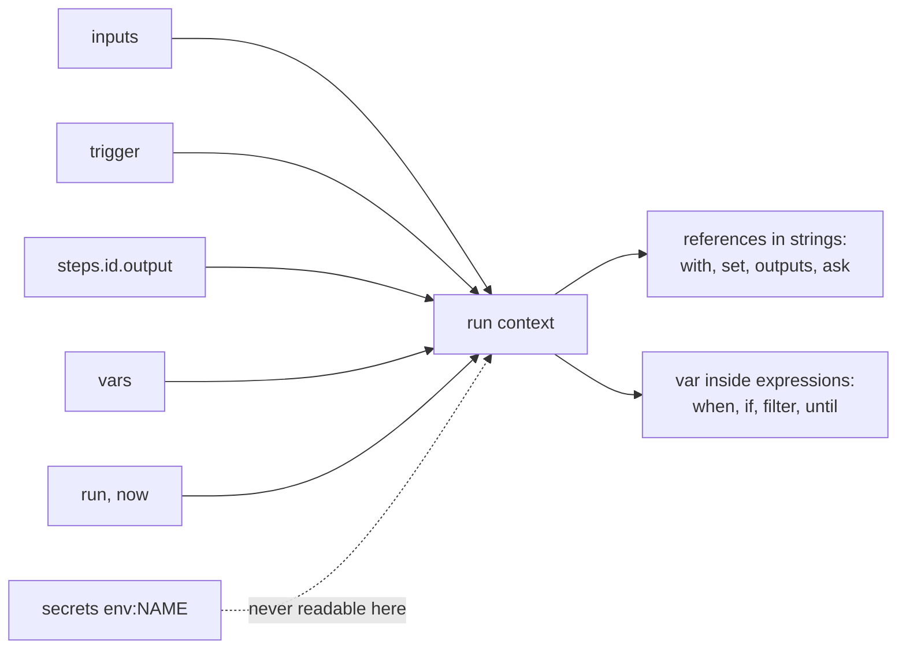
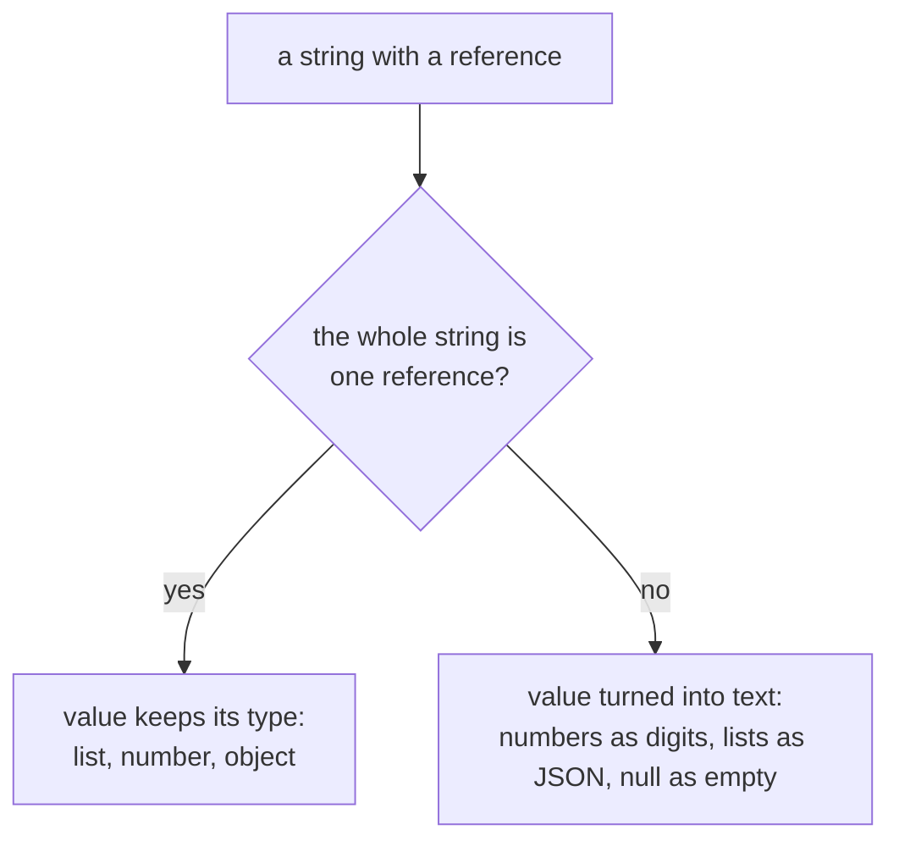
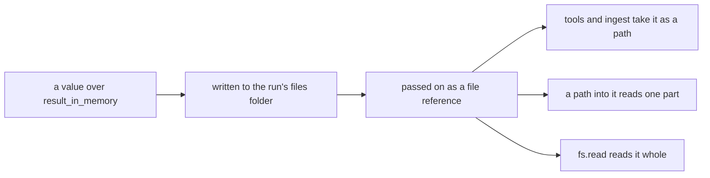

# References

> **Draft for review.** Automation is partly built; what is and is not: [Automation](README.md).

A reference reads a value from the run's context.

| Where | Form | Example |
| --- | --- | --- |
| Inside a string (in `with`, `set`, `outputs`, `ask`, …) | `${{ path }}` | `"Hello ${{ inputs.name }}"` |
| Inside an [expression](expressions.md) | `{ "var": "path" }` | `{ "gt": [{ "var": "steps.a.output" }, 3] }` |
| As a value that should be computed | `{ "expr": <expression> }` | `{ "expr": { "upper": { "var": "inputs.name" } } }` |

`${{ }}` holds a path only, never a calculation. Calculations are expressions, which are JSON and
cannot run code.

## The context



| Path | Holds | Available |
| --- | --- | --- |
| `inputs.<name>` | The run's inputs (with defaults) | Everywhere |
| `trigger` | What started the run (see [Triggers](triggers.md)) | Everywhere |
| `steps.<id>.output` | A step's output | After that step, see [where ids can be read](steps/README.md#ids-and-where-they-can-be-read) |
| `steps.<id>.status`, `.error`, `.attempts`, `.ms`, `.tokens` | The step's record | Same |
| `vars.<name>` | Values from `set` | After the `set` |
| `item` (or the `as` name), `index`, `items` | Inside `each` | Inside `do` |
| `round` | Inside `repeat` | Inside `repeat` |
| `error` | `{ kind, message, step, details }` | Inside `on_error` steps |
| `result` | The step's raw result | Inside that step's `output` only |
| `run.id`, `run.flow`, `run.started_at`, `run.webhook_url`, `run.attempt` | About this run | Everywhere |
| `now` | The current time (RFC 3339) | Everywhere; read when used |
| `env.<NAME>` | Not available | Secrets are never readable as values; see [Secrets](#secrets) |

## Paths

| Syntax | Means | Example |
| --- | --- | --- |
| `a.b` | Field `b` of `a` | `steps.order.output.total` |
| `a[2]` | Item 2 of a list (from 0) | `trigger.body.items[0]` |
| `a[-1]` | The last item | `steps.rows.output[-1]` |
| `a["key with spaces"]` | A field whose name has other characters | `trigger.headers["x-shop-id"]` |

A path that does not exist (a missing field, an index past the end, a field of `null`) gives `null`,
not an error. `flows.validate` reports paths to steps that do not exist, or that cannot have run yet.

## Types in strings



A string that is **only** one reference keeps the value's type:

```yaml
with:
  rows: "${{ steps.sheet.output.rows }}"     # a list stays a list
  count: "${{ steps.sheet.output.total }}"   # a number stays a number
```

A reference **inside other text** is turned into text:

| Value | Becomes |
| --- | --- |
| Text | Itself |
| Number | Its shortest form (`3`, `2.5`, `1e-7`) |
| `true`, `false` | `true`, `false` |
| `null` | Empty text |
| List or object | Compact JSON |
| File reference | The file's path |

## Escaping

`$${{` gives the text `${{`, for writing about references without making one:

```yaml
ask: "Explain what $${{ steps.x.output }} means in a flow file."
```

## Values are data, never code

References are resolved into **values** passed to the step. They are never pasted into code or a
command's text. A `code` step receives `with` as JSON; a `tool` step receives its arguments as
JSON. So a webhook body containing `"; rm -rf ~` stays a piece of text.

`flows.validate` warns (`reference_in_code`) when a reference appears inside text that a tool runs
as code or a command (a tool input marked in its schema as `x-cluaiz-code: true`, such as a shell
command or an SQL query); pass the value as a separate parameter instead.

## File references



Large values, and files that steps produce (images, audio, downloads), are kept in the run's folder
and passed on as a file reference:

```json
{ "$file": "runs/morning-news/run_8f2c/files/news.output.json", "bytes": 4810233, "media_type": "application/json" }
```

- A step that takes a path or a data URI (a `tool`, `call: ingest`, `ask` attachments) accepts a file
  reference in its place.
- `${{ steps.x.output.items[0] }}` into a JSON file reference reads that part of the file.
- `fs.read` with the reference's path reads it whole.
- The size above which a value becomes a file is `limits.result_in_memory` (default `1MB`).

## Secrets

A secret is named in the flow's `secrets` and written `env:NAME` in a field that takes a secret: a
webhook's `secret`, a tool's `settings`, a `code` step's `secrets` (*proposed*). The value is read
from the environment, else from `config/.env` of the Cluaiz folder, when the step runs.

- A secret cannot be read with `${{ }}` and cannot be put into text, so it cannot be sent to a model
  or to a tool argument by mistake.
- Records show `env:NAME`, never the value. Error messages are masked.
