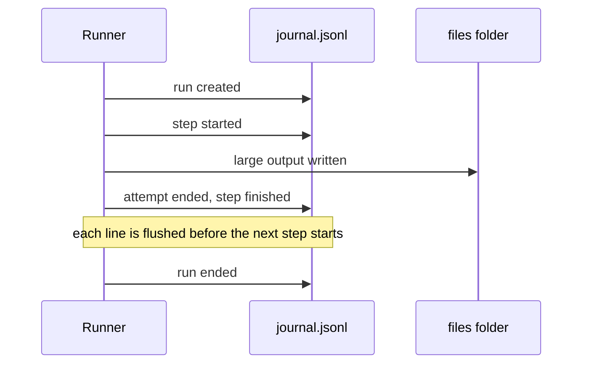
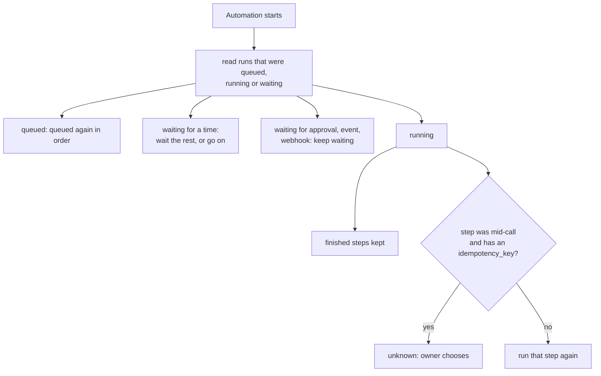

# Runs and records

> **Draft for review.** Automation is partly built; what is and is not: [Automation](README.md).

## The run object

`flows.runs`, `flows.run_get` and `tasks.result` of a `flows.run` task return runs in this shape:

```json
{
  "run_id": "run_8f2c51d0",
  "flow": "support-reply",
  "scope": "user",
  "flow_hash": "sha256:4b1e…",
  "status": "waiting",
  "trigger": { "id": "webhook_0", "kind": "webhook", "at": "2026-11-10T18:02:11+05:30" },
  "inputs": {},
  "outputs": null,
  "error": null,
  "waiting_for": { "kind": "approval", "step": "ok", "approval_id": "ap_19d0…", "until": "2026-11-10T22:02:12+05:30" },
  "created_at": "2026-11-10T18:02:11+05:30",
  "started_at": "2026-11-10T18:02:11+05:30",
  "finished_at": null,
  "running_ms": 4120,
  "steps_done": 3,
  "task_id": "task_77e1…",
  "parent": null,
  "rerun_of": null,
  "dry_run": false
}
```

| Field | Meaning |
| --- | --- |
| `run_id` | `run_` and 8 or more hex characters; unique on this machine |
| `flow`, `scope` | Which flow |
| `flow_hash` | The hash of the flow file the run used; a run keeps using that version even if the file changes |
| `status` | `queued`, `running`, `waiting`, `succeeded`, `failed`, `cancelled` |
| `trigger` | `id`, `kind`, `at`; the full trigger data is in `flows.run_get` |
| `inputs`, `outputs` | The run's inputs; its outputs once `succeeded` |
| `error` | The [error object](errors.md#the-error-object) when `failed` |
| `waiting_for` | When `waiting`: `kind` (`approval`, `time`, `event`, `webhook`, `retry`, `slot`), the step, and until when |
| `running_ms` | Running time so far (waiting not counted) |
| `steps_done` | Steps finished (all kinds) |
| `task_id` | The CEP task of the run, for `tasks.get` and `tasks.cancel` |
| `parent` | `{ run_id, step }` when started by a `run` step |
| `rerun_of` | `{ run_id, from_step }` for `flows.rerun_from` |
| `dry_run` | `true` for test runs |

## Step records

`flows.run_get` returns one record per step that started (and per item of `each`, per round of
`repeat`):

```json
{
  "id": "summary",
  "place": "steps[2]",
  "kind": "ask",
  "status": "succeeded",
  "item": null,
  "attempts": [
    { "started_at": "2026-11-10T18:02:12+05:30", "ms": 3120, "error": null }
  ],
  "input": { "ask": "Summarise …", "with": { "document": { "$file": "runs/…/files/text.output.json", "bytes": 2210488 } } },
  "output": "Five lines …",
  "error": null,
  "tokens": { "prompt": 1830, "completion": 142 },
  "model": "qwen3-4b",
  "detail": { "thinking": null, "first_token_ms": 410 }
}
```

| Field | Meaning |
| --- | --- |
| `id`, `place` | The step's id (or generated id) and where it is in the file |
| `kind`, `status` | As in [Steps](steps/README.md#step-statuses), plus `reused` (an `idempotency_key` hit) and `unknown` (stopped mid-call) |
| `item` | `{ index }` inside `each`, `{ round }` inside `repeat`, `{ branch }` inside `parallel` |
| `attempts` | Each attempt's start, time and error |
| `input` | The step's fields with references resolved; secrets as `env:NAME`; large values as file references |
| `output` | The kept output, or a file reference; masked with `secret_output` |
| `tokens`, `model` | For `ask` and `agent` |
| `detail` | By kind: an agent's rounds, a tool's raw answer size, a sub-run's id, a wait's event |

## The journal



Each run has a folder: `<Cluaiz folder>/flows/runs/<flow>/<run_id>/`.

| File | Holds |
| --- | --- |
| `run.json` | The run object, rewritten when the status changes |
| `journal.jsonl` | One line per event, appended: run created, step started, attempt ended, step finished, waiting, resumed, ended |
| `flow.json` | The flow as it was when the run started (the version `flow_hash` names) |
| `files/` | Large values and files steps produced, named `<step>.<what>` |

Lines are written and flushed before the next step starts, so the journal is never behind the run
by more than the step in progress. The journal is plain JSON lines: it can be read with any tool,
and nothing needs a database.

## After a restart



When Automation starts, it reads the runs that were `queued`, `running` or `waiting`:

| The run was | Then |
| --- | --- |
| `queued` | It is queued again, in the same order |
| `waiting` for a time | It waits for the rest of the time (or goes on if the time passed) |
| `waiting` for an approval, event or webhook | It keeps waiting; the approval is shown again |
| `running` | Finished steps are kept. Steps that had started are run again, except a step with an `idempotency_key`, which is marked `unknown` and waits for the owner (see [Doing a thing once](errors.md#doing-a-thing-once-idempotency_key)) |

`trigger.by`, `run.attempt` (how many times the run has been resumed) and the journal record each
resume.

## Progress while a run goes

A run is a CEP task. `tasks.get` with `after` returns its events since a cursor; the events are
listed in [Events](events.md#run-events). An application can show a run live by polling `tasks.get`
every `poll_ms`.
