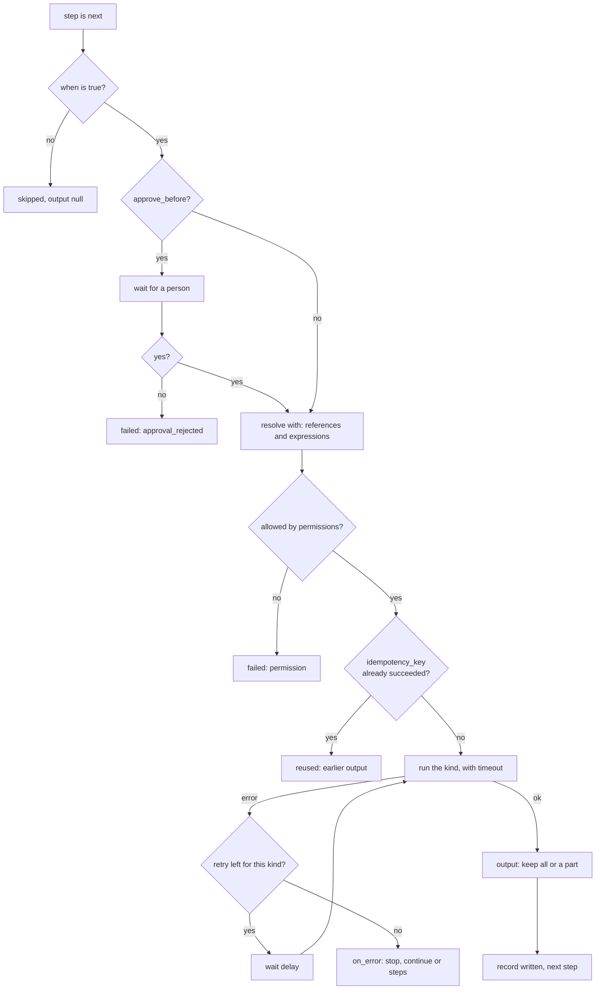
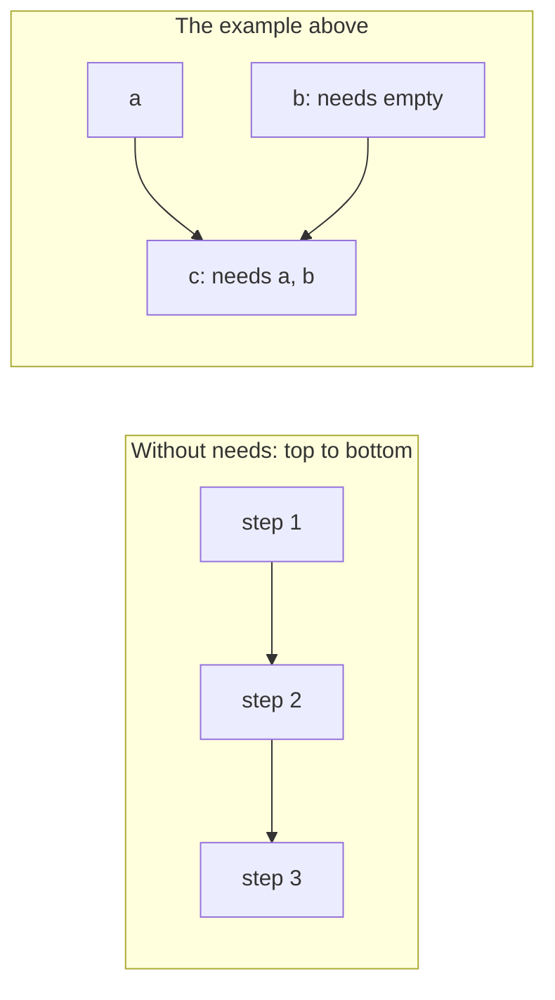
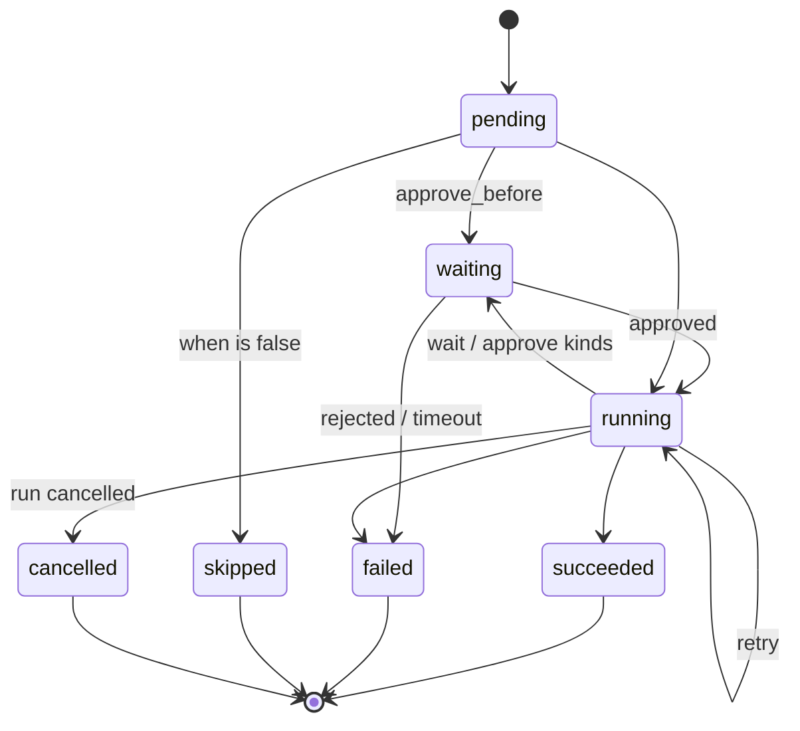

# Steps

> **Draft for review.** Automation is partly built; what is and is not: [Automation](../README.md).

A step is a JSON object (a YAML mapping) with **exactly one kind key** and any of the
[fields every step may have](#fields-every-step-may-have).

```yaml
- id: summary            # common field
  ask: "Summarise this."  # the kind key, with its value
  with: { text: "${{ steps.text.output }}" }
  model: qwen3-4b         # a field of this kind
  timeout: 2m             # common field
```

## The kinds

| Kind | Page | Does | Output |
| --- | --- | --- | --- |
| `tool` | [tool](tool.md) | An installed MCP tool, plugin function or skill | The tool's result |
| `call` | [call](call.md) | A CEP method or an Engine route | The method's result |
| `ask` | [ask](ask.md) | One answer from a model | Text, or JSON with `output_schema` |
| `agent` | [agent](agent.md) | A model with several rounds of tool calls | As `ask` |
| `code` | [code](code.md) | Your WebAssembly module | Its JSON answer |
| `if` | [if](if.md) | `then` or `else` | The branch's last output |
| `switch` | [switch](switch.md) | The first case that holds | The case's last output |
| `each` | [each](each.md) | Steps for every item of a list | A list, one entry per item |
| `parallel` | [parallel](parallel.md) | Named branches at once | An object by branch name |
| `repeat` | [repeat](repeat.md) | Steps again until a condition holds | The last round's last output |
| `wait` | [wait](wait.md) | A time, a duration, an event or a webhook | What arrived |
| `approve` | [approve](approve.md) | A person's yes or no | `{ approved, by, note }` |
| `set` | [set](set.md) | Values into `vars` | The values set |
| `run` | [run](run.md) | Another flow | Its outputs |
| `emit`, `return`, `fail` | [emit, return, fail](emit-return-fail.md) | Send an event; end with outputs; end with an error | — |

## How one step runs



## Fields every step may have

| Field | Type | Default | Meaning |
| --- | --- | --- | --- |
| `id` | string | Generated | 1–64 characters: letters, digits, `_`; starts with a letter. Unique in the whole flow, branches included. Needed when another step reads the step's output or waits for it |
| `name` | string | — | Text for people: run records, `flows.explain`, applications |
| `when` | expression | — | Checked just before the step would start. False: the step's status is `skipped`, its output `null`, and the steps after it go on |
| `needs` | list of ids | The step above | Steps this one waits for. See [Order](#order-and-needs) |
| `with` | any | — | The step's input, with [references](../references.md) resolved just before it starts |
| `output` | any | The whole result | What is kept as `steps.<id>.output`: a reference into the result (`"${{ result.items }}"`) or a new shape (`{ count: "${{ result.total }}" }`). `result` is the step's raw result, only inside `output` |
| `retry` | object | No retries | See [Errors and retries](../errors.md#retry) |
| `timeout` | duration | The kind's default | The step fails with kind `timeout` after this long. Waiting steps use their own `timeout` |
| `on_error` | `stop`, `continue`, list of steps | `stop` | See [Errors and retries](../errors.md#on_error) |
| `approve_before` | string | — | A question; the step waits for a person's yes before it starts. See [approve](approve.md) |
| `idempotency_key` | string with references | — | A step with this key that already succeeded (in any run of this flow, kept for `dedupe_for` of the flow's longest trigger, at least 24 hours) is not run again; its earlier output is used |
| `secret_output` | boolean | `false` | The output is masked in records and never shown in `flows.run_get` |

## Order and `needs`

- Steps in one list run **top to bottom**: each step needs the step above it, unless it has its own
  `needs`.
- `needs: [a, b]` replaces that: the step starts when `a` and `b` have finished. `needs: []` starts it
  at once, together with whatever started before it.
- A step can only need steps in **the same list or an outer list**, never a step inside another
  branch.
- A step waits until each step it needs is `succeeded` or `skipped`, or `failed` with
  `on_error: continue`. A needed step that stops the run ends the run anyway.
- At most `limits.max_parallel` steps run at the same time; the rest wait their turn in file order.
- Cycles are refused at validation (`cycle`).

```yaml
steps:
  - id: a
    tool: mcp:x/one
  - id: b            # runs at the same time as a
    needs: []
    tool: mcp:x/two
  - id: c            # after both
    needs: [a, b]
    ask: "Compare these."
    with: { one: "${{ steps.a.output }}", two: "${{ steps.b.output }}" }
```



## Ids and where they can be read

- A step without `id` gets one from its place (`_2`, `_2.then.0`). It appears in records but cannot
  be referred to.
- `steps.<id>` can be read by any step that runs after it, in the same list or deeper inside.
- Inside an [`each`](each.md), `steps.<id>` of a step inside the loop is that step **for the current
  item**. Outside the loop, only the `each` step's own output (the list) can be read.
- Inside a branch of `if`, `switch` or `parallel`, steps of the same branch can be read. After the
  branching step, use its output.

## What a step record holds

After a step, `steps.<id>` has:

| Field | Meaning |
| --- | --- |
| `output` | The kept output (`null` when skipped or failed) |
| `status` | `succeeded`, `failed`, `skipped`, `cancelled` |
| `error` | `{ kind, message, details }` when it failed; else `null` |
| `attempts` | How many times it ran (1 without retries) |
| `started_at`, `finished_at`, `ms` | Timing |
| `tokens` | `{ prompt, completion }` for `ask` and `agent`; else `null` |

The run's record has more (the input after references, each attempt): see
[Runs and records](../runs.md#step-records).

## Step statuses



## Default timeouts

| Kind | Default `timeout` (*proposed*) |
| --- | --- |
| `tool`, `call` | `10m` |
| `ask` | `10m` |
| `agent` | `30m` |
| `code` | `1m` (and its fuel limit) |
| `wait`, `approve` | Their own `timeout`; none means the run's `limits.max_wait` |
| Steps that hold other steps (`if`, `each`…) | None of their own; their inner steps have theirs |

The run's `limits.timeout` counts running time and ends everything still going; time spent waiting
counts toward `limits.max_wait` instead (see [Limits](../limits.md)).
