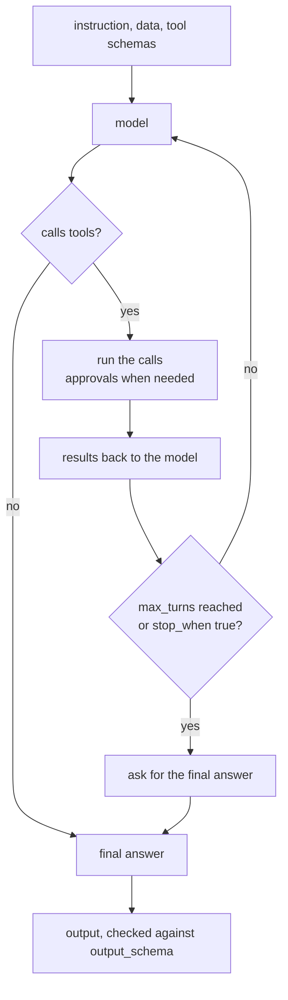

# `agent`: a model with several rounds of tools

> **Draft for review.** Built. Not built yet: `tool_search`, `attachments` and `session`; with them the step says so. Names and fields may change before a release. See [Automation](../README.md).

Like [`ask`](ask.md), but the model may call tools, read their results and call more, for up to
`max_turns` rounds, before it answers. Use it when the steps are not known in advance; use fixed
steps when they are, since fixed steps are faster and the same every time.

```yaml
- id: fix
  agent: "Find why the nightly build failed and write a short report with the likely cause."
  with: { log: "${{ steps.log.output }}" }
  tools: ["mcp:github/get_file", "mcp:github/search_code", "plugin:git/log"]
  max_turns: 12
  output_schema:
    type: object
    properties: { cause: { type: string }, files: { type: array, items: { type: string } } }
    required: [cause]
```



## Fields

All fields of [`ask`](ask.md) (with `agent` in place of `ask` as the instruction), and:

| Field | Type | Default | Meaning |
| --- | --- | --- | --- |
| `tools` | list | — (required) | Tools the agent may call |
| `max_turns` | integer | `10` (*proposed*) | Most rounds of tool calls. At the limit the agent is asked for its final answer |
| `tool_search` | boolean | `false` | Let the agent find and load other installed tools that `permissions.tools` allows, as the coding agent does |
| `stop_when` | expression | — | Checked after each round with `round` (`{ index, calls, results }`); true stops the agent and asks for its answer |

## How it runs

1. The model gets the instruction, the data and the tools' schemas.
2. Each round, it calls one or more tools. Calls that need approval wait for it; the run is
   `waiting` meanwhile.
3. Results go back to the model. Long results are shortened to fit the context, with a note.
4. When the model answers without calling a tool, or `max_turns` is reached, the answer is the
   output (checked against `output_schema`, as in `ask`).

## Record

The step's record keeps every round: the calls, their inputs and results, tokens and time.
`flows.run_get` shows them, so an agent's choices can be read afterwards.

## Output and errors

As [`ask`](ask.md), plus:

| Kind | When |
| --- | --- |
| `limit` | `max_turns` reached and the model gave no usable answer when asked |
| `tool` | A tool failed and the model could not go on (a single failed call is given to the model as a result, not an error) |

Default `timeout`: `30m`.
