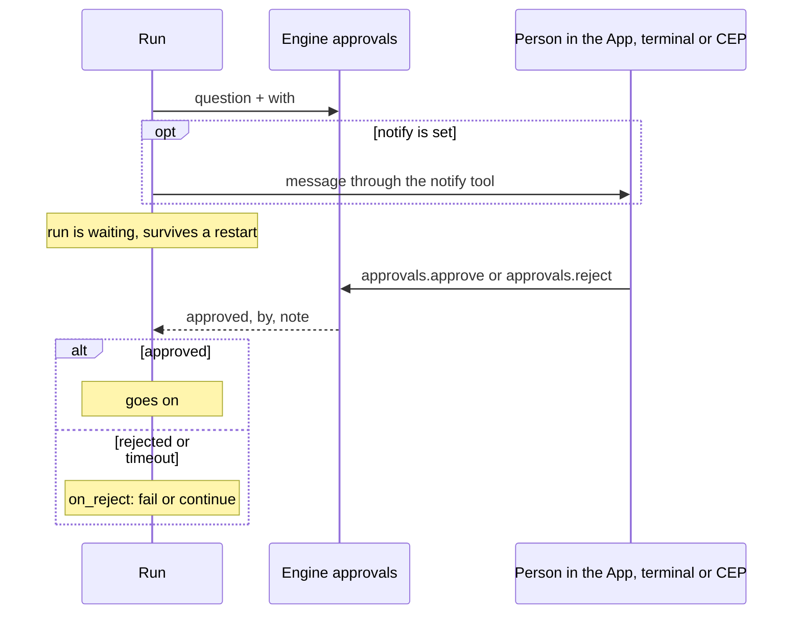

# `approve`: a person's yes or no

> **Draft for review.** Built. Names and fields may change before a release. See [Automation](../README.md).

```yaml
- id: ok
  approve: "Send this reply to the customer?"
  with: { reply: "${{ steps.draft.output }}", to: "${{ trigger.body.customer }}" }
  timeout: 4h
  on_timeout: reject
```



## Fields

| Field | Type | Default | Meaning |
| --- | --- | --- | --- |
| `approve` | string | — (required) | The question, in plain words |
| `with` | any | — | What the person should see to decide (shown with the question) |
| `timeout` | duration | The run's `limits.max_wait` | How long to wait |
| `on_timeout` | `reject`, `approve`, `fail` | `reject` | What a timeout counts as |
| `on_reject` | `fail`, `continue` | `fail` | `fail`: kind `approval_rejected`. `continue`: the run goes on, the output says no |
| `notify` | tool name | — | A tool called when the question is asked, to reach the person (such as `mcp:telegram/send`); it gets `{ question, with, flow, run_id }` |
| Common fields | | | |

## How it is answered

The question becomes an Engine approval, like those of chats and tools:

- `approvals.list` shows it with `method: "flow:<name>"` and the step's id; `approvals.approve` and
  `approvals.reject` answer it (with `feedback` as the note).
- The App and the terminal show it where they show other approvals.
- The run is `waiting` until then; it survives a restart.

Unlike chat approvals (which expire after 5 minutes), a flow's approval lasts until its `timeout`.

## Output

`{ approved: true | false, by, note, at }`: `by` is who answered (`owner`, or `timeout`), `note` the
feedback text.

## `approve_before` on any step

```yaml
- tool: mcp:shop/refund
  with: { order: "${{ trigger.body.order_id }}" }
  approve_before: "Refund order ${{ trigger.body.order_id }}?"
```

Asks the same way before the step starts, showing the step's resolved input. A no fails the step
with kind `approval_rejected` (or follows its `on_error`).
