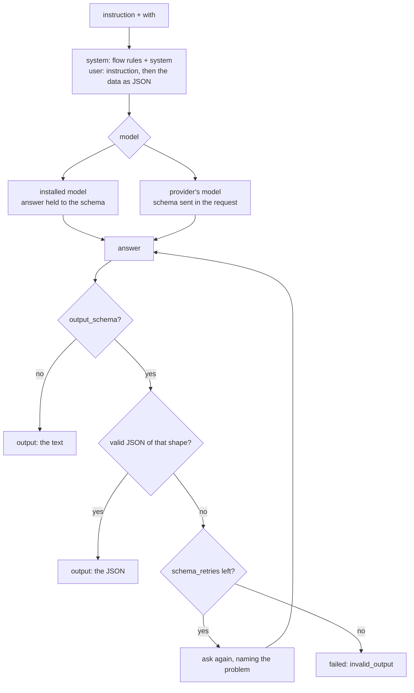

# `ask`: one answer from a model

> **Draft for review.** Built. Not built yet: `tools`, `attachments` and `session`; with them the step says so. Names and fields may change before a release. See [Automation](../README.md).

Gives a model an instruction and data, and keeps its answer. Any chat model works: one installed in
Cluaiz, or a provider's (`<provider>/<model>`).

```yaml
- id: label
  ask: "Classify this issue."
  with: { title: "${{ trigger.body.issue.title }}", body: "${{ trigger.body.issue.body }}" }
  output_schema:
    type: object
    properties:
      kind: { enum: [bug, feature, question] }
      confidence: { type: number, minimum: 0, maximum: 1 }
    required: [kind]
```



## Fields

| Field | Type | Default | Meaning |
| --- | --- | --- | --- |
| `ask` | string | — (required) | The instruction. References are allowed |
| `with` | any | — | The data the model works on |
| `model` | string | The default chat model | An installed model id, or `<provider>/<model>` |
| `system` | string | — | Extra system text, before the instruction |
| `output_schema` | JSON Schema | — | The answer must be JSON of this shape. See [JSON answers](#json-answers) |
| `tools` | list of tool names | `[]` | Tools the model may call while answering (same names as [`tool`](tool.md)); for several rounds, use [`agent`](agent.md) |
| `attachments` | list | `[]` | Files, images or sounds for the model: paths, data URIs or [file references](../references.md#file-references) |
| `think` | `on`, `off`, `auto` | `auto` | Thinking, as in chat. The thinking is kept in the record, not in the output |
| `effort` | `low`, `medium`, `high` | — | Thinking effort, where the model supports it |
| `max_tokens` | integer | The model's | Most tokens in the answer |
| `temperature`, `top_p`, `seed` | number | settings.json | As in chat |
| `session` | string | — | A chat id: the model gets that chat's memory and notes, and the exchange is added to it. Without it, every `ask` starts fresh |
| `schema_retries` | integer | `1` | Times to ask again when the answer does not match `output_schema` |
| Common fields | | | See [Steps](README.md#fields-every-step-may-have) |

## What the model receives

1. A system message: Automation's step instructions ("You are one step of an automated flow;
   answer only what is asked"), then `system`.
2. A user message: the instruction, then the data:

   ```text
   <instruction>

   Data:
   {"title": "...", "body": "..."}
   ```

   `with` is sent as JSON exactly as resolved. A string `with` is sent as it is.
3. With `output_schema`, the request carries it as `response_format` (`json_schema`). On an
   installed model, the Engine also holds the answer to the schema while it is generated, so it is
   well-formed JSON. A provider's model gets the schema in its request; whether it is followed
   depends on the provider, and the answer is checked either way.

## Output

| Case | `steps.<id>.output` |
| --- | --- |
| No `output_schema` | The answer's text, trimmed |
| With `output_schema` | The parsed JSON, checked against the schema |

`steps.<id>.tokens` is `{ prompt, completion }`. The record also keeps the model's name, the
thinking (if any) and the time to the first token.

## JSON answers

When the answer is not valid JSON, or does not match `output_schema`, Automation asks again (up to
`schema_retries` times) with the problem named ("`kind` must be one of bug, feature, question").
If it still does not match, the step fails with kind `invalid_output`, and `error.details` holds the
last answer and the problems.

Use small schemas with `enum`s and `required` fields: they are easier for models and for later
conditions.

## Tools inside `ask`

With `tools`, the model may call those tools while it answers; each call is recorded inside the
step, and tools that need approval ask for it. One `ask` allows up to 3 rounds of calls
(*proposed*); for more, use [`agent`](agent.md). Tools must also be in `permissions.tools`.

## Outside content

Text from webhooks, web pages, mails or files from others can carry instructions meant for the
model. When an `ask` step gets such data **and** can use tools that send data out **and** the flow
can read private data, `flows.validate` warns (`untrusted_with_tools`) and the step waits for
approval before it runs. See [Permissions and security](../permissions.md#outside-content-and-ai-steps).

## Errors

| Kind | When |
| --- | --- |
| `invalid_output` | The answer never matched `output_schema` |
| `provider` | A provider's model failed (key, rate limit, the provider's error) |
| `rate_limit` | The provider is limiting the key |
| `model` | An installed model could not load or generate (memory, missing file) |
| `limit` | The request does not fit the model's context, even after leaving old turns out |
| `permission` | The model or a tool is not allowed |
| `timeout` | Longer than `timeout` (default `10m`) |
