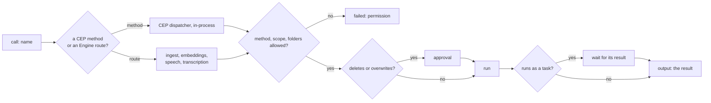

# `call`: run an Engine method or route

> **Draft for review.** Built for CEP methods. Not built yet: the Engine routes (`ingest`, `embeddings`, `speech`, `transcription`). Names and fields may change before a release. See [Automation](../README.md).

Runs one CEP method, or one of the Engine's own routes, through the Engine's CEP dispatcher in the same program (not over HTTP).

```yaml
- id: text
  call: ingest
  with: { source: "${{ trigger.path }}" }

- id: saved
  call: fs.write
  with: { path: "~/Notes/${{ trigger.name }}.md", text: "${{ steps.summary.output }}" }
```



## Fields

| Field | Type | Required | Meaning |
| --- | --- | --- | --- |
| `call` | string | Yes | A CEP method name, or a route name from the table below |
| `with` | object | No | The method's `params`, or the route's request body |
| Common fields | | | See [Steps](README.md#fields-every-step-may-have) |

## What can be called

**CEP methods.** Any method in the [CEP reference](../../api/cep/README.md), with the same
parameters as there. A method that runs as a task (`audio.run`, `tools.install`, `models.download`)
is waited for; its task result is the output.

**Engine routes**, by name:

| Name | Route | `with` is |
| --- | --- | --- |
| `ingest` | `POST /v1/ingest` | [Ingest](../../api/inference/ingest.md) request |
| `embeddings` | `POST /v1/embeddings` | [Embeddings](../../api/inference/embeddings.md) request |
| `speech` | `POST /v1/audio/speech` | [Text-to-speech](../../api/inference/audio_speech.md) request; `stream` is ignored |
| `transcription` | `POST /v1/audio/transcriptions` | [Speech-to-text](../../api/inference/audio_transcriptions.md) request; `stream` is ignored |

For a chat answer, use [`ask`](ask.md) or [`agent`](agent.md), not a route.

**Not callable from a flow** (`not_callable`): `flows.*` methods that change flows (`flows.save`,
`flows.remove`, `flows.enable`, `flows.disable`), `flows.draft` and `flows.fix`, `tokens.*`, `system.exec`, `config.set`, and
`approvals.approve` / `approvals.reject`. A flow does not change its own rules, mint tokens or run
programs; use a plugin for a program, through [`tool`](tool.md) or [`code`](code.md).

## Output

The method's `result`, or the route's JSON answer. A speech answer's audio is written to the run's
folder and the output's `audio_data` becomes a [file reference](../references.md#file-references).

## Permissions

The method must be in `permissions.methods` (`fs.write`, or a group: `fs.*`). Paths in `with` must be
inside `permissions.folders`. The method's own scope (`read`, `write`, `exec`, `admin`) must be one
the flow was granted when it was saved. `fs.delete` and overwriting with `fs.write` ask for approval
as they do for any caller.

## Errors

| Kind | When |
| --- | --- |
| `invalid_input` | `with` does not match the method's parameters (CEP `-32602`) |
| `not_found` | The method's target does not exist (CEP `-32004`) |
| `permission` | The method, a path or a scope is not allowed (CEP `-32002`) |
| `approval_rejected` | The method asked for approval (CEP `-32003`) and the person said no |
| `conflict` | CEP `-32005`, such as a download already running |
| `limit` | CEP `-32006`, too large |
| `unavailable` | CEP `-32010`: a backend is missing or failed |
| `timeout` | Longer than `timeout` |

`steps.<id>.error.details` keeps the CEP error's `data` (`type`, `needs`, `errors`…).
