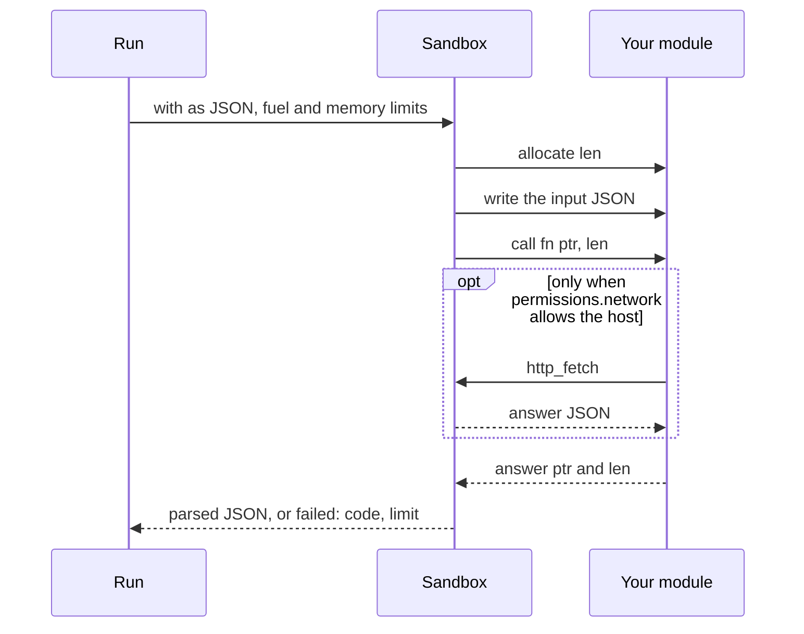

# `code`: your WebAssembly module

> **Draft for review.** Built. Names and fields may change before a release. See [Automation](../README.md).

Runs a function of a WebAssembly module in the WebAssembly sandbox (the same one plugins use). The module gets the step's input as
JSON and returns JSON. Write it in any language that compiles to WebAssembly.

```yaml
- id: scored
  code: score.wasm
  fn: main
  with: { leads: "${{ steps.leads.output }}" }
  memory: 64MB
```



## Fields

| Field | Type | Default | Meaning |
| --- | --- | --- | --- |
| `code` | string | — (required) | A `.wasm` file, relative to the flow file's folder; or `plugin:<name>` for an installed plugin's module |
| `fn` | string | `main` | The exported function |
| `with` | any | `null` | The input, as JSON |
| `memory` | size | `256MB` (the most) | Memory the module may use |
| `fuel` | integer | `2000000000` | Instructions it may run; a module that runs longer stops with kind `limit` |
| Common fields | | | `timeout` defaults to `1m` |

## The module's interface

The same interface as Cluaiz plugins (`agents/src/plugins/wasm.rs`):

| Export | Signature | Meaning |
| --- | --- | --- |
| `memory` | memory | The module's memory |
| `allocate` | `(len: i32) -> i32` | Returns where the host may write `len` bytes |
| `<fn>` | `(ptr: i32, len: i32) -> i64` | Reads the input JSON at `ptr`/`len`; returns `(answer_ptr << 32) \| answer_len` of its JSON answer |

The host writes `with` as UTF-8 JSON, calls `<fn>`, reads the answer and parses it. The module
may answer `{ "error": "message" }` to fail the step with kind `code`.

A module built for the WebAssembly component model (WASI 0.2/0.3, with a WIT interface) is planned
for a later version that updates wasmtime; until then, use the interface above.

## What a module can reach

Nothing outside its own memory, except these host functions (module `cluaiz`):

| Import | Allowed when |
| --- | --- |
| `now_utc_ms() -> i64` | Always |
| `utc_offset_minutes() -> i32` | Always |
| `os_platform() -> i32` | Always |
| `http_fetch(ptr, len) -> i64` | The host is in the flow's `permissions.network`. The request and answer are JSON, as for plugins |

No files, no programs, no other tools. To work with files, read them in an earlier step and pass
their contents in `with`; write the answer in a later step.

## Languages

| Language | How |
| --- | --- |
| Rust | `cargo build --target wasm32-unknown-unknown` with the three exports above |
| Go | TinyGo, `-target wasm` |
| JavaScript | Javy or QuickJS-based tools, with a small wrapper that provides the exports |
| Python | Through a Python-to-WebAssembly toolchain; modules are large (tens of MB) and start slower |
| C, C++, Zig | Any compiler with a WebAssembly target |

A starter for each language is planned in the Cluaiz Tools registry.

## Why WebAssembly only

Running JavaScript or Python inside a server process with a homemade sandbox has led to repeated
escapes in other automation tools. A WebAssembly module has no access to the computer unless the
host hands it a function, and the fuel and memory limits stop a module that loops or grows.

## Errors

| Kind | When |
| --- | --- |
| `code` | The module trapped, or answered `{ "error": … }` |
| `limit` | Out of fuel or memory |
| `invalid_output` | The answer is not JSON |
| `permission` | `http_fetch` to a host not in `permissions.network` (the module receives a refusal it can handle) |
| `timeout` | Longer than `timeout` |
