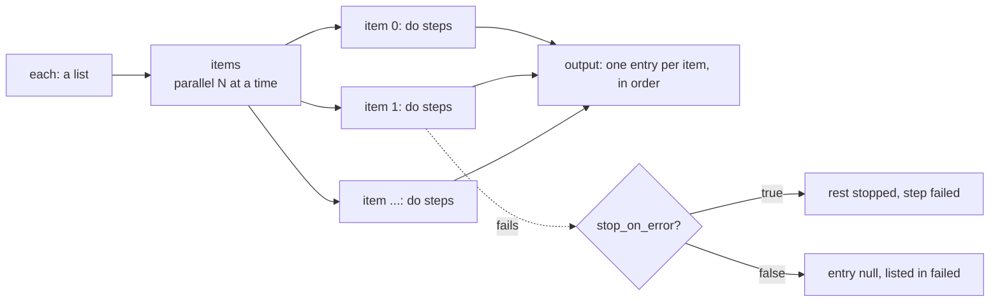

# `each`: steps for every item

> **Draft for review.** Built. Names and fields may change before a release. See [Automation](../README.md).

```yaml
- id: summaries
  each: "${{ steps.files.output }}"
  as: file
  parallel: 3
  do:
    - id: text
      call: fs.read
      with: { path: "${{ file.path }}" }
    - id: one
      ask: "Summarise in one line."
      with: { text: "${{ steps.text.output.text }}" }
```



## Fields

| Field | Type | Default | Meaning |
| --- | --- | --- | --- |
| `each` | reference to a list | — (required) | The items. An object is turned into a list of `{ key, value }` |
| `as` | string | `item` | The name of the current item in references |
| `do` | list of steps | — (required) | The steps for each item |
| `parallel` | integer | `1` | Items at the same time (also bounded by `limits.max_parallel`) |
| `batch` | integer | — | Groups of this many items: the steps run once per group, with `items` (the group) instead of the item |
| `stop_on_error` | boolean | `true` | `true`: the first failed item stops the rest and fails the step. `false`: every item runs; the step succeeds, and failed items are listed |
| `delay` | duration | — | Wait this long between starting items (for rate-limited services) |
| Common fields | | | |

## Inside the loop

| Reference | Is |
| --- | --- |
| `item` (or the `as` name) | The current item |
| `index` | Its position, from 0 |
| `items` | The current group, with `batch` |
| `steps.<id>` | A step inside `do`, for the current item |

Steps outside the loop can be read as usual.

## Output

A list with one entry per item, in the order of the items (also with `parallel`): the output of the
last step of `do` for that item. With `stop_on_error: false`, a failed item's entry is `null`, and:

| Field | Is |
| --- | --- |
| `steps.<id>.failed` | `[{ index, error }]` for each failed item |
| `steps.<id>.succeeded_count`, `failed_count` | Counts |

With `batch`, one entry per group.

## Large lists

- A list of more than `limits.result_in_memory` is read from its file as the loop goes; it is not
  held whole in memory.
- Each item's step records are kept; `flows.run_get` returns them page by page.
- Every item counts toward `limits.max_steps` (steps × items).
- After a restart, finished items are not run again; the loop goes on from the first unfinished item.

## Errors

| Kind | When |
| --- | --- |
| `expression` | `each` is not a list or an object |
| Any step error | With `stop_on_error: true`, the first failed item's error |
| `limit` | `limits.max_steps` reached |
