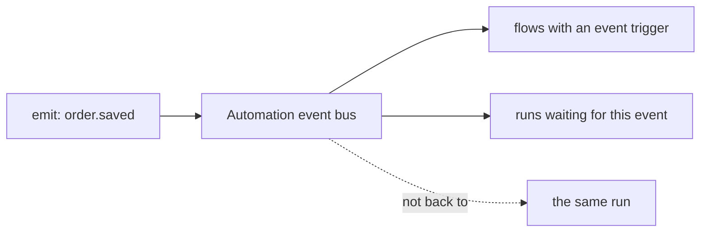
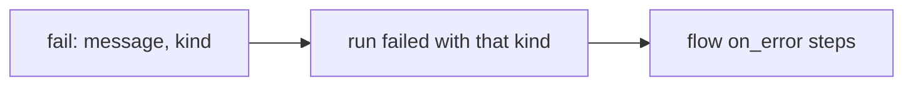

# `emit`, `return`, `fail`

> **Draft for review.** Built. Names and fields may change before a release. See [Automation](../README.md).

## `emit`



Sends an event that other flows can start on ([`event` trigger](../triggers.md#event)) or wait for
([`wait`](wait.md)).

```yaml
- emit: order.saved
  with: { id: "${{ steps.saved.output.id }}", total: "${{ steps.saved.output.total }}" }
```

| Field | Type | Meaning |
| --- | --- | --- |
| `emit` | string | The event's name: letters, digits, `.`, `-`, `_`. Names starting with `engine.` are reserved |
| `with` | any | The event's data (at most 1 MB, *proposed*) |

- Output: `{ name, delivered }`, where `delivered` is how many flows have an `event` trigger for it
  (runs waiting for it with `wait` are not counted).
- Delivery is on this machine only. An event is not stored: flows that are disabled when it is sent
  do not get it later.
- The event's `from` is `{ flow, run_id }` of this run. A run does not receive its own events.

## `return`

Ends the run with these outputs. Steps after it do not run (status `skipped`).

```yaml
- return:
    summary: "${{ steps.short.output }}"
    count: "${{ steps.rows.output.total }}"
```

| Field | Type | Meaning |
| --- | --- | --- |
| `return` | any | The run's outputs; replaces the flow's `outputs` |

Inside a branch or loop, `return` still ends the whole run. The run's status is `succeeded`.

## `fail`



Ends the run with an error, as a failed step would. The flow's `on_error` steps run.

```yaml
- when: { empty: { var: steps.orders.output } }
  fail: "No orders found for ${{ inputs.day }}"
  kind: no_data
```

| Field | Type | Default | Meaning |
| --- | --- | --- | --- |
| `fail` | string | — | The message |
| `kind` | string | `failed` | The error kind recorded (letters, digits, `_`), for `on_error` and for `retry.on` in a parent flow |
| `details` | any | — | Kept in `error.details` |
