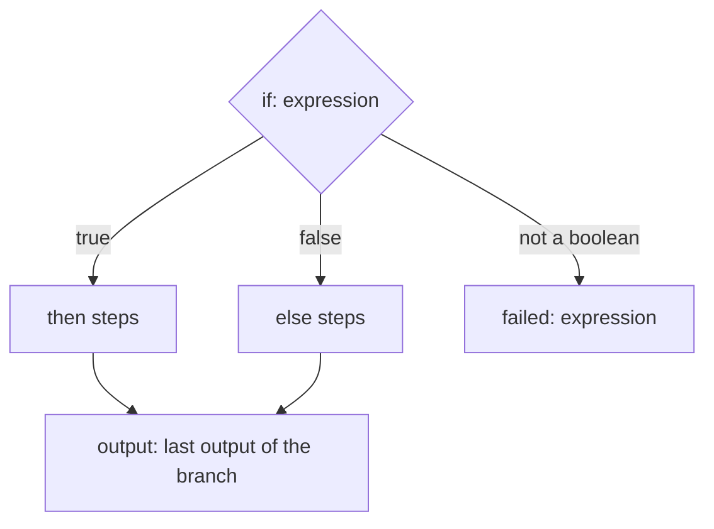

# `if`: one of two branches

> **Draft for review.** Built. Names and fields may change before a release. See [Automation](../README.md).

```yaml
- id: big
  if: { gt: [{ var: steps.order.output.total }, 5000] }
  then:
    - tool: mcp:notify/send
      with: { text: "Big order: ${{ steps.order.output.id }}" }
  else:
    - set: { big: false }
```



## Fields

| Field | Type | Required | Meaning |
| --- | --- | --- | --- |
| `if` | [expression](../expressions.md) | Yes | Checked once, when the step starts |
| `then` | list of steps | Yes | Runs when the expression is true |
| `else` | list of steps | No | Runs when it is false |
| Common fields | | | See [Steps](README.md#fields-every-step-may-have) |

## Behaviour

- The expression must give a boolean. Another type fails the step with kind `expression` (there is
  no "truthy": `0`, `""` and `null` are not false; write `{ empty: … }` or `{ eq: [x, 0] }`).
- The chosen branch's steps run in order, as any list. The other branch's steps get status `skipped`.
- Output: the output of the last step that ran in the chosen branch; `null` when the branch is
  empty or `else` is absent and the expression is false.
- `steps.<id>.branch` is `then` or `else`.

## `if` or `when`?

`when` on a step decides whether **that one step** runs. `if` chooses between **two lists** of steps.

```yaml
# the same thing, two ways
- when: { eq: [{ var: inputs.notify }, true] }
  tool: mcp:notify/send
  with: { text: "Done" }

- if: { eq: [{ var: inputs.notify }, true] }
  then:
    - tool: mcp:notify/send
      with: { text: "Done" }
```
