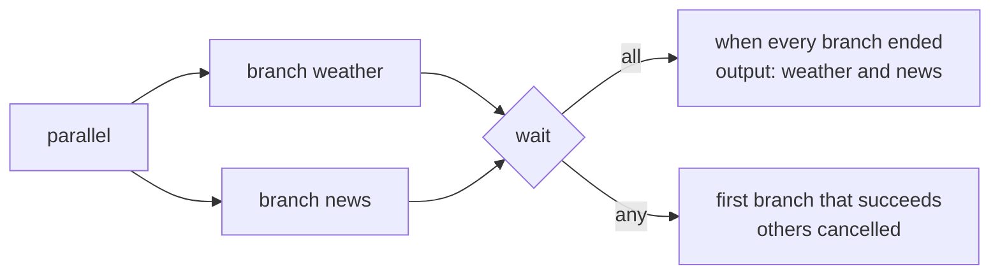

# `parallel`: named branches at the same time

> **Draft for review.** Built. Names and fields may change before a release. See [Automation](../README.md).

```yaml
- id: lookup
  parallel:
    weather:
      - tool: mcp:weather/today
        with: { city: "${{ inputs.city }}" }
    news:
      - tool: mcp:web-search/search
        with: { query: "${{ inputs.city }} news" }
  wait: all
```



## Fields

| Field | Type | Default | Meaning |
| --- | --- | --- | --- |
| `parallel` | object: branch name → list of steps | — (required) | Branch names: letters, digits, `_` |
| `wait` | `all`, `any` | `all` | `all`: the step ends when every branch has. `any`: it ends when the first branch succeeds; the others are cancelled |
| `stop_on_error` | boolean | `true` | `true`: a failed branch cancels the others and fails the step. `false`: the others go on, and the failed branch's entry is `null` |
| Common fields | | | |

## Behaviour

- Branches start together; steps inside a branch run in order. All branches together use at most
  `limits.max_parallel` steps at a time.
- A branch's steps can read steps before the `parallel` step and earlier steps of the same branch,
  not steps of other branches.
- Output: an object with each branch's last output by name: `{ weather: …, news: … }`. With
  `wait: any`, the object has the winning branch only, and `steps.<id>.winner` is its name.
- `steps.<id>.failed` lists failed branches with `stop_on_error: false`.
