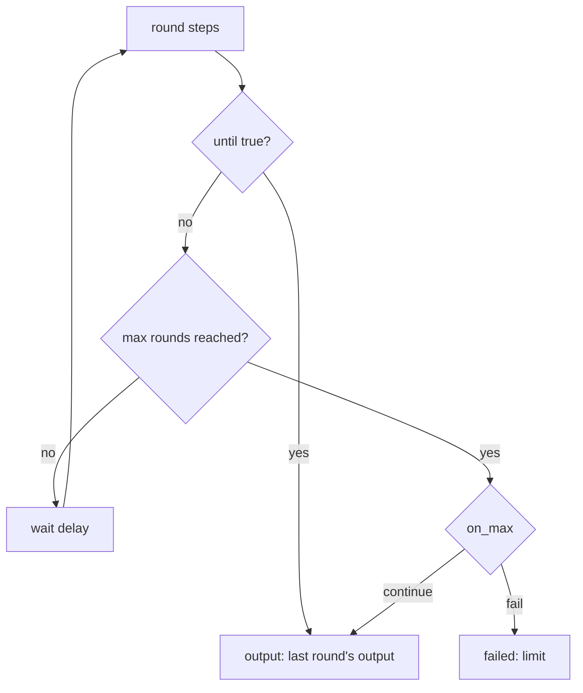

# `repeat`: again until a condition holds

> **Draft for review.** Built. Names and fields may change before a release. See [Automation](../README.md).

```yaml
- id: ready
  repeat:
    - id: status
      tool: mcp:deploy/status
  until: { eq: [{ var: steps.status.output.state }, "ready"] }
  max: 20
  delay: 30s
```



## Fields

| Field | Type | Default | Meaning |
| --- | --- | --- | --- |
| `repeat` | list of steps | — (required) | The steps of one round |
| `until` | expression | — (required) | Checked after each round; true ends the step |
| `max` | integer | — (required) | Most rounds, 1–10,000. There is no repeat without a limit |
| `delay` | duration | — | Wait between rounds (the run is `waiting` meanwhile, holding no worker) |
| `on_max` | `fail`, `continue` | `fail` | When `max` rounds ran and `until` never held: fail with kind `limit`, or go on |
| Common fields | | | |

## Inside the loop

| Reference | Is |
| --- | --- |
| `round` | The round number, from 0 |
| `steps.<id>` | A step inside `repeat`, from the current round |
| `steps.<repeat id>.previous` | The previous round's last output (`null` in round 0) |

## Behaviour

- The steps run, then `until` is checked with the round's results.
- Output: the last round's last output. `steps.<id>.rounds` is how many rounds ran.
- Every round's step records are kept. Each round's steps count toward `limits.max_steps`.
- After a restart, the loop goes on from the round it was in.

To wait for something outside Cluaiz without asking repeatedly, use [`wait`](wait.md) with an
event or a webhook when the other side can send one.
