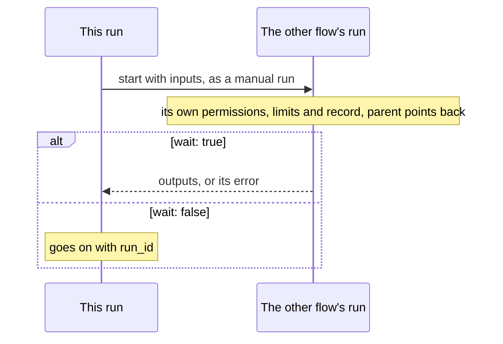

# `run`: another flow

> **Draft for review.** Built. Names and fields may change before a release. See [Automation](../README.md).

```yaml
- id: report
  run: weekly-report
  with: { team: "${{ inputs.team }}" }
```

## Fields

| Field | Type | Default | Meaning |
| --- | --- | --- | --- |
| `run` | string | — (required) | The other flow's name |
| `scope` | `project`, `user` | The project's, then the user's | Which flow of that name |
| `with` | object | `{}` | Its inputs, checked against its `inputs` |
| `wait` | boolean | `true` | `true`: wait for it and use its outputs. `false`: start it and go on; the output is `{ run_id }` |
| Common fields | | | |



## Behaviour

- The other flow runs as its own run, with its own record (`parent` points to this run), its own
  `permissions` and its own `limits`. It does not get this flow's permissions.
- Its triggers do not matter: `run` starts it as a manual run (`trigger.by` is `flow`).
- Output: its outputs (its `return`, or its `outputs`).
- A failed sub-run fails this step with the sub-run's error kind; `error.details.run_id` points to it.
- Cancelling this run cancels a sub-run it waits for.
- A flow cannot run itself, directly or through others (`cycle`, checked at validation and when it
  runs). Nesting is limited to 10 levels (*proposed*).
