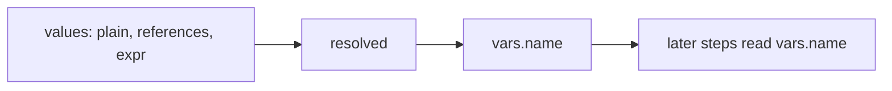

# `set`: keep values

> **Draft for review.** Built. Names and fields may change before a release. See [Automation](../README.md).

```yaml
- set:
    city: "${{ steps.ip.output.city }}"
    tries: 0
    names: { expr: { pluck: [{ var: steps.users.output }, "name"] } }
    title: { expr: { upper: { var: inputs.title } } }
```

## Fields

| Field | Type | Meaning |
| --- | --- | --- |
| `set` | object | Name → value. Values may be plain values, [references](../references.md), or `{ expr: … }` with an [expression](../expressions.md) |
| Common fields | | `when`, `needs`, `id` and the others |



## Behaviour

- Each value is resolved, then stored in `vars.<name>`. Later steps read `vars.city`.
- Names: letters, digits, `_`; starting with a letter.
- Setting a name again replaces it. A `set` inside `each`, `parallel` or `repeat` writes the run's
  shared `vars`: with `parallel` (or `each` with `parallel`), the last write wins, so prefer the
  loop's output for per-item values.
- Output: the object of values set.
- Values follow the same size rule as outputs: a large value is kept as a file reference.
