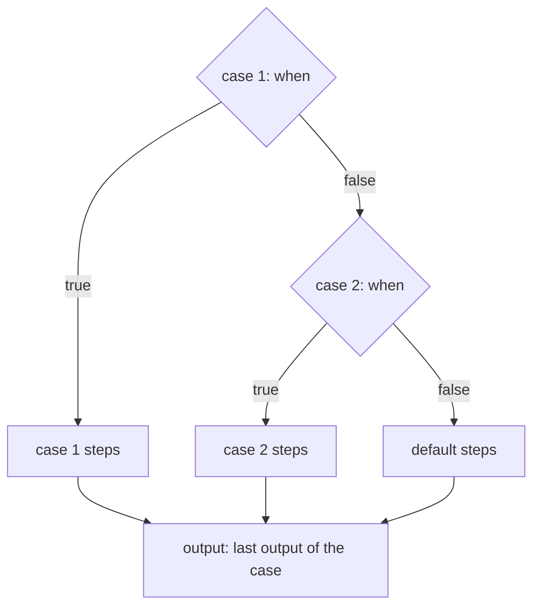

# `switch`: the first case that holds

> **Draft for review.** Built. Names and fields may change before a release. See [Automation](../README.md).

```yaml
- id: route
  switch:
    - when: { eq: [{ var: steps.label.output.kind }, "bug"] }
      do:
        - tool: mcp:github/add_label
          with: { label: bug }
    - when: { in: [{ var: steps.label.output.kind }, ["feature", "idea"]] }
      do:
        - tool: mcp:github/add_label
          with: { label: enhancement }
  default:
    - tool: mcp:github/add_label
      with: { label: question }
```



## Fields

| Field | Type | Required | Meaning |
| --- | --- | --- | --- |
| `switch` | list of cases | Yes | Each case: `when` (expression), `do` (list of steps), optional `name` |
| `default` | list of steps | No | Runs when no case holds |
| `match` | value with references | No | Short form: each case has `is` (a value or a list of values) instead of `when` |
| Common fields | | | |

Short form:

```yaml
- id: route
  switch:
    - is: bug
      do: [ { tool: mcp:github/add_label, with: { label: bug } } ]
    - is: [feature, idea]
      do: [ { tool: mcp:github/add_label, with: { label: enhancement } } ]
  match: "${{ steps.label.output.kind }}"
```

`is: x` means `{ eq: [match, x] }`; `is: [a, b]` means `{ in: [match, [a, b]] }`. A switch uses one
form or the other, not both.

## Behaviour

- Cases are checked top to bottom; the first that is true runs, the rest are not checked.
- A case's `when` must give a boolean (else kind `expression`).
- Output: the last output of the case that ran (or of `default`); `null` when none ran.
- `steps.<id>.case` is the index of the case that ran, or `default`, or `null`.
