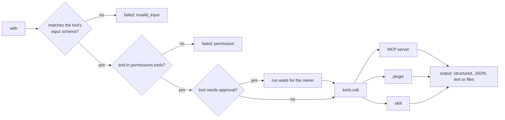

# `tool`: run an installed tool

> **Draft for review.** Built. Not built yet: `settings`; with it the step says so. Names and fields may change before a release. See [Automation](../README.md).

Runs one function of an installed MCP server, plugin or skill, through the Engine's `tools.call`.

```yaml
- id: issue
  tool: mcp:github/create_issue
  with:
    repo: "${{ inputs.repo }}"
    title: "Nightly build failed"
    body: "${{ steps.log.output }}"
```



## Fields

| Field | Type | Required | Meaning |
| --- | --- | --- | --- |
| `tool` | string | Yes | The tool's name, see [Names](#names) |
| `with` | object | No | The function's arguments. Must match its input schema |
| `settings` | object | No | Settings for this call only, for tools that declare settings (`tools.get_settings`); values may be `env:NAME` |
| Common fields | | | See [Steps](README.md#fields-every-step-may-have) |

## Names

| Form | Example | Runs |
| --- | --- | --- |
| `mcp:<server>/<tool>` | `mcp:github/create_issue` | A tool of an installed MCP server |
| `plugin:<name>/<function>` | `plugin:pdf/extract_text` | An exported function of an installed plugin |
| `plugin:<name>` | `plugin:pdf` | The plugin's default function |
| `skill:<name>` | `skill:code-review` | The skill's instructions (its `SKILL.md`) as text; useful as input to an `ask` step |

`flows.nodes` lists the names on this Engine, with each input and output schema. A tool that is
not installed is a validation error (`unknown_node`), and `flows.draft` suggests where to get it.

## Input

`with` is checked against the function's input schema before the call (`invalid_input` when it does
not match: a missing required field, a wrong type). Fields the schema does not list are refused when
the schema says `additionalProperties: false`, and passed on otherwise.

## Output

| The tool answers | `steps.<id>.output` is |
| --- | --- |
| MCP `structuredContent` | That object |
| One text item that is valid JSON | The parsed JSON |
| Text items | Their text, joined with new lines |
| Images, audio or embedded files | A list of [file references](../references.md#file-references), written to the run's folder |
| A plugin's JSON answer | The JSON |
| A skill | `{ name, description, text }` |

An MCP answer with `isError: true` fails the step with kind `tool`, and the tool's text as message.

## Errors

| Kind | When |
| --- | --- |
| `invalid_input` | `with` does not match the input schema |
| `tool` | The tool answered with an error |
| `permission` | The tool is not in `permissions.tools`, or it reaches a folder or host the flow does not allow |
| `approval_rejected` | The tool needs approval (it is destructive, or its settings say so) and the person said no |
| `timeout` | Longer than `timeout` (default `10m`) |
| `network` | An MCP server over HTTP could not be reached |

Retry `network` and `timeout`, not `tool`, unless the tool's errors are known to be passing.

## Approvals

A tool marked destructive, or one the owner set to "ask", waits for approval as it does in a chat;
the run is `waiting` meanwhile. An `approve_before` on the step asks first, with your own question.
