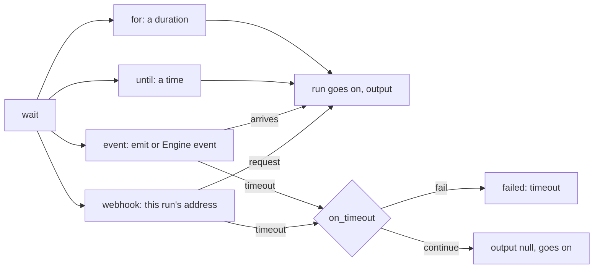

# `wait`: until a time, an event or a webhook

> **Draft for review.** Built. Names and fields may change before a release. See [Automation](../README.md).

A waiting run holds no worker and no memory beyond its record; it survives a restart.

## Forms



| Form | Waits | Output |
| --- | --- | --- |
| `wait: { for: 10m }` | This long | `{ waited_ms }` |
| `wait: { until: "2026-12-01T09:00:00+05:30" }` | Until this time (a reference is allowed); a time in the past goes on at once | `{ waited_ms }` |
| `wait: { event: "order.paid", filter: … }` | An event from [`emit`](emit-return-fail.md#emit) or an [Engine event](../events.md), optionally matching `filter` (with `event` filled in) | `{ name, data, from }` |
| `wait: { webhook: true }` | A request to the run's own address | `{ method, headers, query, body }` |

Fields for every form:

| Field | Type | Default | Meaning |
| --- | --- | --- | --- |
| `timeout` | duration | The run's `limits.max_wait` | How long to wait for an event or webhook |
| `on_timeout` | `fail`, `continue` | `fail` | `fail`: kind `timeout`. `continue`: output `null`, the run goes on |

## Webhook form

```yaml
- id: link
  set: { pay_url: "${{ run.webhook_url }}" }
- tool: mcp:shop/send_payment_link
  with: { callback: "${{ vars.pay_url }}" }
- id: paid
  wait: { webhook: true, timeout: 2d }
```

`run.webhook_url` is the address for this run: `POST /v1/hooks/runs/<run_id>/<token>`. The token is
made for the run and is the request's proof; it works once. The address works only while a `wait`
with `webhook: true` is waiting. See [Webhooks](../webhooks.md#run-addresses).

## Events while waiting

An event that arrives before the `wait` step starts is not kept for it: start waiting first, then
cause the event. To avoid missing a fast event, put the step that causes it and the `wait` in
`parallel`, or use `wait` first with `needs: []` on the causing step.
