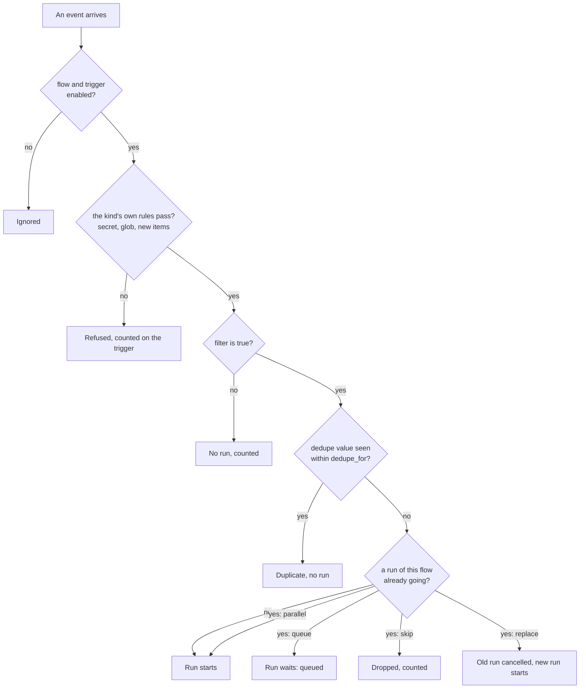
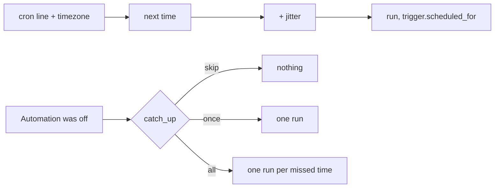
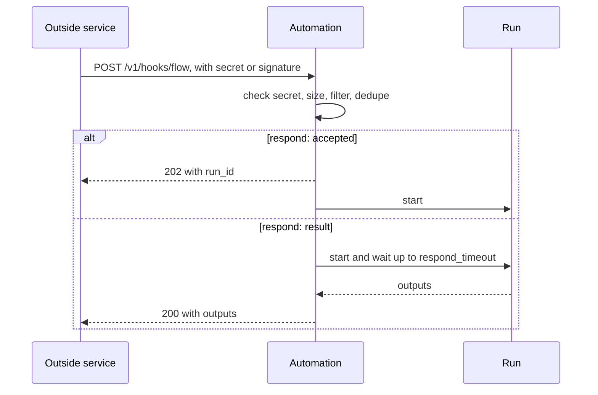
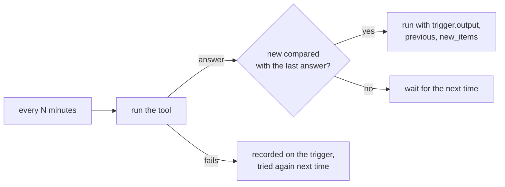
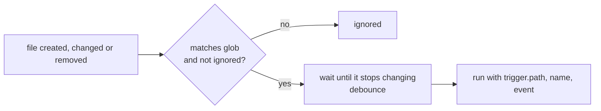
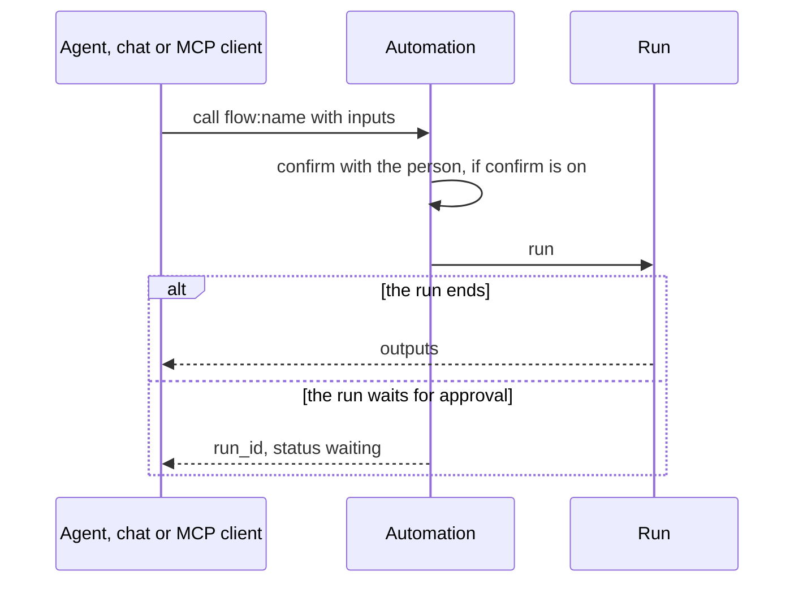

# Triggers

> **Draft for review.** Every trigger below is built, with every field. `tool` offers flows to MCP
> clients, to chats and to the coding agent. See [Automation](README.md).

`on` is a list. Each item is one trigger: **one kind key**, plus the [fields every trigger may
have](#fields-every-trigger-may-have). A flow may have several triggers; any of them starts a run.

```yaml
on:
  - schedule: "0 9 * * 1-5"
  - file: { path: "~/Inbox", glob: "*.csv" }
    filter: { gt: [{ var: trigger.size }, 0] }
```

A flow can always be started by hand (`flows.run`, `cluaiz flow run`), with or without triggers.
Triggers are active only while the flow is enabled (`flows.enable`, `flows.disable`).

## Fields every trigger may have

| Field | Type | Default | Meaning |
| --- | --- | --- | --- |
| `id` | string | The kind and its position (`schedule_0`) | Names the trigger in records (`trigger.id`) |
| `filter` | expression | — | Checked with `trigger` filled in; false means no run and nothing recorded except a counter |
| `dedupe` | string with references | — | Two events whose `dedupe` value is the same start one run |
| `dedupe_for` | duration | `24h` (*proposed*) | How long a `dedupe` value is remembered |
| `inputs` | object | — | The run's inputs; values may refer to `trigger` (`"${{ trigger.body.repo }}"`) |
| `enabled` | boolean | `true` | Turns this one trigger off without removing it |

Order of checks when an event arrives: `enabled` → the kind's own rules (secret, glob…) → `filter` →
`dedupe` → `concurrency` → a run is created.

## The path of an event



## Every trigger at a glance

| Kind | Starts a run when | `trigger` holds |
| --- | --- | --- |
| [`manual`](#manual) | Someone or something starts it | `kind`, `by` |
| [`schedule`](#schedule) | A cron time comes | `kind`, `at`, `scheduled_for` |
| [`every`](#every) | An interval passes | `kind`, `at` |
| [`webhook`](#webhook) | An outside request arrives | `kind`, `method`, `headers`, `query`, `body`, `remote` |
| [`poll`](#poll) | A tool's answer is new | `kind`, `output`, `previous`, `new_items` |
| [`file`](#file) | A file appears, changes or goes | `kind`, `path`, `name`, `extension`, `event`, `size`, `modified_at` |
| [`engine`](#engine) | Something happens in the Engine | `kind`, `event`, `data`, `at` |
| [`event`](#event) | Another flow sends an event | `kind`, `name`, `data`, `from` |
| [`tool`](#tool) | The flow is called as a tool | `kind`, `caller` |
| [`startup`](#startup) | Automation starts (with the Engine) | `kind`, `at` |

Every `trigger` also has `id` (the trigger's id) and `at` (when the event arrived, RFC 3339).

## `manual`

```yaml
on: [{ manual: {} }]
```

Listing `manual` is optional; it documents that the flow is meant to be started by hand and lets
`flows.list` show it. `trigger.by` is who started it: `cli`, `cep`, `agent`, `app`, `mcp`, or
`rerun` for `flows.rerun_from`.

## `schedule`



```yaml
- schedule: "30 8 * * 1-5"      # 08:30, Monday to Friday
  catch_up: once
```

| Field | Type | Default | Meaning |
| --- | --- | --- | --- |
| `schedule` | string | — | Five fields: minute, hour, day of month, month, day of week. `*`, lists (`1,15`), ranges (`1-5`), steps (`*/10`); day names `mon`–`sun` and month names `jan`–`dec` |
| `timezone` | string | The flow's `timezone` | IANA name |
| `catch_up` | `skip`, `once`, `all` | `skip` | Times missed while Automation was off or the flow disabled: none, one run for all of them, or one run each (at most 100, *proposed*) |
| `jitter` | duration | `0s` | A random delay up to this long, so many flows at 09:00 do not start together |

`trigger.scheduled_for` is the planned time; `trigger.at` is when the run was created. Across a
daylight-saving change, a time that does not exist is skipped and a time that happens twice runs once.

## `every`

```yaml
- every: 15m
  starting: "2026-11-11T08:00:00+05:30"
```

| Field | Type | Default | Meaning |
| --- | --- | --- | --- |
| `every` | duration | — | At least `1m` (*proposed*) |
| `starting` | time | When the flow is enabled | The first time |
| `catch_up` | `skip`, `once`, `all` | `skip` | As for `schedule` |

The next time is counted from the planned time, not from the end of the last run, so runs do not
drift. With `concurrency: skip`, a run still going at the next time means that time is skipped.

## `webhook`



```yaml
- webhook:
    secret: env:SHOP_HOOK
    signature: hmac-sha256
    respond: accepted
```

| Field | Type | Default | Meaning |
| --- | --- | --- | --- |
| `secret` | `env:NAME` | — (required) | The secret callers must prove they have |
| `signature` | `header`, `hmac-sha256` | `header` | `header`: the request carries the secret in `X-Cluaiz-Hook-Secret`. `hmac-sha256`: the request carries `X-Cluaiz-Signature: sha256=<hex>`, the HMAC of the raw body with the secret (as GitHub and many shops send) |
| `signature_header` | string | `X-Cluaiz-Signature` | Another header name for the signature, such as `X-Hub-Signature-256` |
| `methods` | list | `["POST"]` | Allowed HTTP methods |
| `respond` | `accepted`, `result` | `accepted` | `accepted`: answer `202` with the run id at once. `result`: wait for the run (up to `respond_timeout`) and answer with its outputs |
| `respond_timeout` | duration | `30s` | For `respond: result`; after it, `202` with the run id |
| `max_body` | size | `1MB` | Larger bodies get `413` and start nothing |

The address is `POST /v1/hooks/<flow name>` (`/v1/hooks/<flow name>/<trigger id>` when a flow has
several webhooks). The full contract, answers and errors: [Webhooks](webhooks.md).

`trigger.body` is the parsed body: JSON as JSON, form data as an object, other content as text.
`trigger.headers` has lower-case names; the secret and signature headers are removed.
`trigger.remote` is the caller's address.

The webhook's body is outside content. See [Permissions and security](permissions.md#outside-content-and-ai-steps).

## `poll`



```yaml
- poll:
    tool: mcp:mail/unread
    with: { folder: INBOX }
    every: 5m
    new_when: new_items
    key: id
```

| Field | Type | Default | Meaning |
| --- | --- | --- | --- |
| `tool` or `call` | node | — | What to run each time (as in a [`tool`](steps/tool.md) or [`call`](steps/call.md) step) |
| `with` | object | `{}` | Its input |
| `every` | duration | — | At least `1m` (*proposed*) |
| `new_when` | `changed`, `new_items`, expression | `changed` | `changed`: the output differs from the last one. `new_items`: the output is a list (or has one at `items`) and some items were not seen before. An expression: checked with `trigger.output` and `trigger.previous` |
| `items` | path in the output | The output itself | Where the list is, for `new_items` |
| `key` | path in an item | The whole item | What makes an item the same item, for `new_items` |
| `first` | `skip`, `run` | `skip` | On the first poll there is nothing to compare: `skip` only remembers the answer; `run` starts a run |

`trigger.output` is the latest answer, `trigger.previous` the one before, `trigger.new_items` the
items not seen before (for `new_items`). Seen keys are remembered (the last 10,000, *proposed*). A
poll that fails is recorded on the trigger (`flows.get` shows it) and tried again at the next time;
it does not start a run.

## `file`



```yaml
- file:
    path: "~/Downloads"
    glob: "*.pdf"
    events: [created]
    recursive: false
```

| Field | Type | Default | Meaning |
| --- | --- | --- | --- |
| `path` | folder | — | Inside the flow's `permissions.folders` |
| `glob` | string | `*` | Matched against the file name (`*.pdf`), or the path below `path` with `recursive` (`**/*.md`) |
| `events` | list of `created`, `changed`, `removed` | `[created]` | |
| `recursive` | boolean | `false` | Include sub-folders |
| `debounce` | duration | `2s` | Wait until the file has not changed for this long, so a file still being written is not read half-way |
| `ignore` | list of globs | Hidden and temporary files (`.*`, `*.tmp`, `*.part`, `~*`) | Never start a run |

`trigger.path` is the full path, `trigger.name` the name without the extension, `trigger.extension`
without the dot, `trigger.size` in bytes (`null` for `removed`). A file moved in counts as `created`.
Events while Automation was off are not replayed; on start, Automation does not treat existing files
as new.

## `engine`

```yaml
- engine: model.downloaded
- engine: chat.finished
  filter: { contains: [{ var: trigger.data.model }, "qwen"] }
```

`trigger.event` is the event's name and `trigger.data` its data. The events and their data are
listed in [Events](events.md#engine-events).

## `event`

```yaml
- event: order.saved
```

Starts when a flow runs an [`emit`](steps/emit-return-fail.md#emit) step with this name.
`trigger.data` is the emitted data; `trigger.from` is `{ flow, scope, run_id }` of the sender; `trigger.hops` counts the events that led to this one (a chain of flows starting each other stops at 8). A
flow never starts on its own events, so an event cannot start the flow that sends it again and
again.

## `tool`



```yaml
- tool:
    description: "Release notes from the commits since the last tag"
    confirm: auto
```

`confirm` is only about calls from outside. Runs from schedules, webhooks, files and the other
triggers never wait for the owner, whatever the owner's security mode; the owner confirmed the
flow's permissions once, when it was saved. A flow waits for a person only at the `approve`
steps (and `approve_before`) its author wrote.

| Field | Type | Default | Meaning |
| --- | --- | --- | --- |
| `description` | string | The flow's `description` | What a calling model reads |
| `title` | string | The flow's name | Shown in tool lists |
| `confirm` | boolean or mode | `sandboxed` | Whether the owner is asked (an approval) before a call runs the flow. `true`: always. `false`: never. A mode: `strict` always, `sandboxed` when the flow changes something (it runs tools, calls a method that is not read-only, or reaches the network), `full_access` never, `auto` as the owner's agent security mode (`agent_security_mode`) is at the time of the call |

An enabled flow with a `tool` trigger, valid and with its permissions confirmed, is offered as a
tool, in three places. Its parameters are the flow's `inputs` (an input without a `default` is
required); its title and description are the trigger's, else the flow's.

| Where | Name | When it is offered | Who is asked when `confirm` says so |
| --- | --- | --- | --- |
| MCP clients (`POST /mcp`, `cluaiz mcp-server`) | `flow.<name>` | Always, next to the Engine's methods | The owner, with an approval (`approvals.list`), open five minutes; no answer is a no |
| Chats (the App, `/v1/chat/completions`) | `flow_<name>` (function names cannot hold a `.`) | When the message fits the flow's name, title or description, as installed tools are matched; at most five | The owner, on the chat's approval card |
| The coding agent (`cluaiz agent`) | `flow_<name>` | While a server answers (flows run there); with no server, none | The person at the terminal, as for other calls (`--allowed-tools "flow:<name>"` allows it). A run with nobody to ask is not offered such a flow |

A call from an MCP client or a chat checks the arguments against `inputs` and starts a run
through the trigger's `filter` and `dedupe`; the run's inputs are the arguments, unless the
trigger has its own `inputs`. The coding agent runs the flow with `flows.run` (as the owner), so
`filter` and `dedupe` do not apply to its calls. `trigger.caller` is `{ kind: "mcp" | "chat" |
"agent", chat_id }` and `trigger.arguments` the arguments.

A call waits for the run and answers `{ run_id, status: "succeeded", outputs }`; a failed run is
an error result with the run's error. A run that waits for a person (`approve`, `wait`) answers
at once with `{ run_id, status: "waiting", waiting_for }`; it goes on, and `flows.run_get` shows
how it ends.

## `startup`

```yaml
- startup: {}
```

Runs once each time Automation starts, after the flows are loaded and the scheduler is running.
Useful for checks and catching up. Not run again when a flow is enabled while Automation runs.
