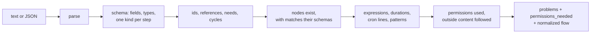

# Validation

> **Draft for review.** Automation is partly built; what is and is not: [Automation](README.md).

`flows.validate` checks a flow without saving or running it. `flows.save` runs the same checks and
refuses a flow with errors. A flow with warnings can be saved and run.

## The checks, in order



## The problem object

```json
{ "severity": "error", "code": "unknown_step", "path": "/steps/3/with/text", "message": "steps.sumary does not exist; did you mean steps.summary?", "fix": "steps.summary" }
```

| Field | Meaning |
| --- | --- |
| `severity` | `error` (the flow cannot be saved) or `warning` |
| `code` | One of the codes below |
| `path` | A JSON Pointer into the flow (the same for JSON and YAML) |
| `line`, `column` | In the text, when the flow was sent as text |
| `message` | Plain words |
| `fix` | A suggested value, when there is an obvious one |

## Errors

| Code | When |
| --- | --- |
| `parse_error` | The text is not valid JSON or YAML (with line and column) |
| `unknown_version` | `flow` is not a format version this release of Automation knows |
| `missing_field` | A required field is absent (`name`, `steps`, a step's kind field such as `then` of `if`) |
| `unknown_field` | A field the schema does not have (outside `ui` and `meta`); `fix` suggests a close name |
| `wrong_type` | A field has the wrong type |
| `invalid_value` | A value outside its allowed set or range (`concurrency: maybe`, `max: 0`) |
| `name_mismatch` | `name` differs from the file name |
| `no_kind` | A step has none of the kind keys |
| `many_kinds` | A step has more than one kind key (`tool` and `ask`) |
| `duplicate_id` | Two steps with the same id |
| `invalid_id` | An id with characters that are not allowed |
| `unknown_step` | A reference or `needs` names a step that does not exist |
| `not_reachable` | A reference names a step that cannot have run before this one (later in the list, inside another branch) |
| `cycle` | `needs` form a loop, or a flow runs itself through `run` steps |
| `unknown_node` | A `tool` or `call` names something not installed or not a method; `fix` suggests a close name, and `details.registry` where to get it |
| `not_callable` | A `call` to a method flows may not use |
| `invalid_input` | A step's `with` does not match the node's input schema |
| `unknown_operator` | An expression uses an operator that does not exist |
| `bad_arguments` | An operator has the wrong number or kind of arguments |
| `bad_pattern` | A regular expression does not compile, or is over 1,000 characters |
| `bad_duration`, `bad_time`, `bad_cron`, `bad_timezone` | A duration, time, cron line or timezone does not parse |
| `unknown_flow` | A `run` step names a flow that does not exist |
| `unknown_secret` | `env:NAME` where `NAME` is not in `secrets` |
| `secret_in_text` | A secret reference inside text, or a value that looks like a key (long random text in a key-like field) |
| `bad_inputs_schema` | An `inputs` entry is not a valid JSON Schema |
| `repeat_without_max` | A `repeat` without `max` |
| `webhook_without_secret` | A `webhook` trigger without `secret` |
| `too_large` | The text is over 1 MB |

## Warnings

| Code | When |
| --- | --- |
| `permission_needed` | The flow uses something its `permissions` do not list (the save asks for confirmation) |
| `untrusted_with_tools` | An `ask` or `agent` step receives outside content, can read private data, and can send data out (see [Outside content](permissions.md#outside-content-and-ai-steps)) |
| `reference_in_code` | A reference inside a tool input marked as code or a command |
| `large_each` | `each` over data that may be large, without `batch` |
| `large_repeat` | A `repeat` with `max` over 1,000 |
| `no_retry_network` | A `tool` step on a network service without `retry` |
| `no_idempotency` | A step that sends (mail, post, payment, by the tool's schema `x-cluaiz-sends: true`) after a wait or in a webhook flow, without `idempotency_key` |
| `unused_output` | A step's `output` is never read and the step has no side effect |
| `model_not_installed` | `model` names a model that is not installed now (it may be installed later) |
| `deprecated` | A field that still works but will go in a later format version |

## Normalized form

`flows.validate` also returns the flow as JSON with defaults filled in (`normalized`), and its hash.
Applications can use it to show what Automation will actually run.
