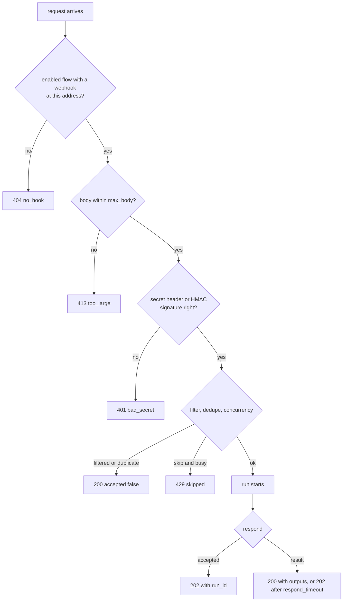

# Webhooks: `POST /v1/hooks/{flow}`

> **Draft for review.** Built, as the one exception to "every operation is a CEP method": outside
> services (shops, GitHub, forms, payment providers) send plain HTTP requests and cannot send
> JSON-RPC. Not built yet: multipart and binary bodies (they answer `415`). Code:
> `automation/host/src/webhook.rs` and, for run addresses, `automation/host/src/reach.rs`.
> See [Automation](README.md).

An outside service starts a flow by sending a request to the flow's address. The request proves it
may do so with the flow's **secret**, not with the Engine's API token: the owner's token never has
to be given to another service.

## Addresses

| Address | Starts |
| --- | --- |
| `POST /v1/hooks/<flow>` | The flow's webhook trigger |
| `POST /v1/hooks/<flow>/<trigger id>` | One of several webhook triggers of the flow |
| `POST /v1/hooks/runs/<run_id>/<token>` | Not a new run: wakes a run waiting in a [`wait` step with `webhook: true`](steps/wait.md#webhook-form). See [Run addresses](#run-addresses) |

The full address an outside service needs is the Cluaiz server's address plus this path, for example
`https://engine.example.com/v1/hooks/support-reply`. The Cluaiz server must be reachable from that service
(a public address, a tunnel or a reverse proxy); Cluaiz does not open ports or tunnels itself.

## Proving the secret



The trigger's `signature` field chooses how:

| `signature` | The request carries | Checked |
| --- | --- | --- |
| `header` (default) | `X-Cluaiz-Hook-Secret: <secret>` | Equal to the secret, compared in constant time |
| `hmac-sha256` | `X-Cluaiz-Signature: sha256=<hex>` (or the header named in `signature_header`, such as `X-Hub-Signature-256`) | The HMAC-SHA256 of the raw body, with the secret as key, compared in constant time |

The secret is the value of `env:NAME` from the trigger. A request that does not prove it gets
`401` and starts nothing; the attempt is counted on the trigger (`flows.get`).

## The request

| Part | Becomes in `trigger` |
| --- | --- |
| Method | `trigger.method` |
| Headers | `trigger.headers`, names in lower case, without the secret and signature headers |
| Query | `trigger.query`, an object |
| Body `application/json` | `trigger.body` as JSON |
| Body `application/x-www-form-urlencoded` or `multipart/form-data` | `trigger.body` as an object; uploaded files become [file references](references.md#file-references) |
| Other bodies | `trigger.body` as text (binary bodies as a file reference) |
| Caller's address | `trigger.remote` |

The trigger's `filter` and `dedupe` are then applied as for any trigger.

## The answer

| Case | Status | Body |
| --- | --- | --- |
| `respond: accepted` (default) | `202` | `{ "accepted": true, "run_id": "run_…", "status": "running" \| "queued" }` |
| `respond: result`, the run ended within `respond_timeout` | `200` | The run's outputs as JSON; a `return` step's value is the body. A failed run answers `500` with `{ "error": { "kind", "message" } }` |
| `respond: result`, still going after `respond_timeout` | `202` | As for `accepted` |
| `filter` false, or a `dedupe` repeat | `200` | `{ "accepted": false, "reason": "filtered" \| "duplicate" }` |

Many services retry a webhook that does not answer `2xx` quickly, and send the same event again.
Use `respond: accepted` for them, and `dedupe` on the event's id.

## Errors

| Status | `error.type` | When |
| --- | --- | --- |
| `401` | `bad_secret` | Secret or signature missing or wrong |
| `404` | `no_hook` | No enabled flow has a webhook at this address (a disabled flow answers the same, so the address does not reveal whether a flow exists) |
| `405` | `method_not_allowed` | The method is not in `methods` |
| `413` | `too_large` | Body over `max_body` |
| `400` | `bad_body` | The body says `application/json` and is not JSON |
| `415` | `unsupported_media_type` | A body type the trigger does not accept (in this release: multipart and binary bodies) |
| `429` | `skipped` | `concurrency: skip` and a run is going, or the queue is full; `Retry-After` is set |
| `500` | `flow_not_started` | The flow cannot run now: it has errors, its permissions are not confirmed, or the trigger's inputs do not fit; the trigger's `last_error` says which |
| `503` | `automation_starting` | Automation is still loading flows |

Error bodies are `{ "error": { "type", "message" } }`.

## Run addresses

A run that sends a link to an outside service and waits for its answer (payments, sign-ups) uses
`run.webhook_url`: `POST /v1/hooks/runs/<run_id>/<token>`.

- The token is made for that run when the `wait` step starts, and is the only proof needed.
- It works once, while the `wait` step waits; afterwards the address answers `404`.
- The answer is `200 { "accepted": true }`; the request becomes the `wait` step's output.

## Security

- The route does not use the API Bearer token, and is the only route that does not. It accepts only
  requests for enabled flows with a webhook trigger, proved by that trigger's secret.
- `api_auth.required`, host, port and CORS stay the owner's settings; this route follows the same
  host and port as the API.
- A body is outside content: model steps that read it follow the
  [outside-content rule](permissions.md#outside-content-and-ai-steps).
- Requests are limited per flow (60 per minute by default, *proposed*); more get `429`.
- Every accepted, refused and failed request is in the audit log with the flow, the trigger and the
  caller's address (not the body).

## Example

```bash
BODY='{"message":"Where is my order 1042?","order_id":"1042","customer":"c_77"}'
SIG=$(printf '%s' "$BODY" | openssl dgst -sha256 -hmac "$SHOP_HOOK" | sed 's/^.* //')
curl -X POST http://127.0.0.1:8000/v1/hooks/support-reply \
  -H "Content-Type: application/json" \
  -H "X-Cluaiz-Signature: sha256=$SIG" \
  --data "$BODY"
```

```json
{ "accepted": true, "run_id": "run_8f2c51d0", "status": "running" }
```
