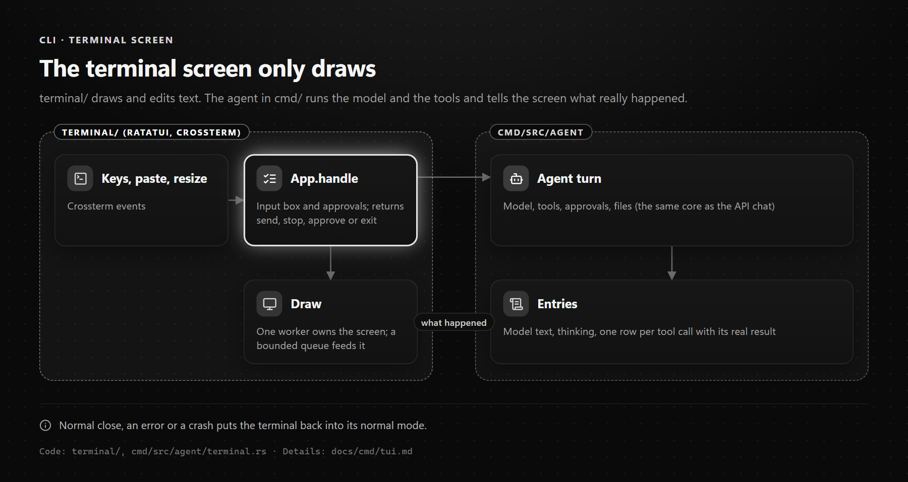
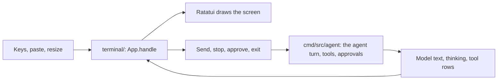

# The terminal screen

`cluaiz agent` has two ways to show its work: a full screen (rich mode) and plain printed lines.
This page covers the full screen: when it is used, how it is laid out, and every key it takes.
What the agent itself does is in [Coding agent](agent.md).

## When the screen is used

| `--ui` | What you get |
|---|---|
| `auto` (default) | the full screen in an interactive terminal; plain lines when output is redirected or a task is given on the command line |
| `tui` | always the full screen; refused when the terminal cannot show it (redirected output, a dumb terminal) |
| `plain` | printed lines; for scripts and logs |

`cluaiz run` (terminal chat) does not use this screen. It prints lines and reads one line at a
time; `/models` inside it opens a table of the catalogue ([Terminal chat](chat.md)).

## How it is built

The screen is the `terminal/` crate: [Ratatui](https://ratatui.rs) for drawing, Crossterm for keys,
paste and resize. It only draws and edits text. It runs no tools and loads no model: the agent
(`cmd/src/agent/terminal.rs`) sends it what really happened (model text, thinking, tool rows,
approval questions) and gets back what you did (send, stop, approve, exit).

One worker owns the screen; the model and the tools send it updates through a bounded queue, so a
fast model cannot flood the terminal. On a normal close, an error or a crash, the terminal is put
back to its normal mode.

## Layout

- **Start entry:** the `>_ CLUAIZ` wordmark, the model, the working folder and the starting settings.
  It scrolls up with the conversation; PgUp brings it back.
- **Conversation:** your messages, the model's answers (with Markdown: headings, lists, tables, code
  blocks), its thinking in dim text, and one row per tool call with its real result.
- **Input box:** always at the bottom. You can type while the model works; one more message can
  wait in line.
- **Status line:** while nothing is printed, what the model is doing (reading the prompt, writing,
  writing a tool call), with tokens and seconds.

Running thinking and running tools stay open; when the step ends they fold to one line. Click a
folded tool row to open it, or press Ctrl+O to open or fold all of them. Only rows that really ran
appear: if the model says it ran something and there is no row, it did not.

## Keys

The list below is the one the screen shows on `?` (`terminal/src/keymap.rs`).

| Key | Action |
|---|---|
| `?` (on empty input) | shortcuts |
| Enter | send |
| Ctrl+J, Alt+Enter | new line (Shift+Enter too, when the terminal passes it on) |
| `/` | commands ([list](agent.md#commands-inside-the-agent)) |
| `@` | files of the working folder (inserts the path only; reads nothing) |
| Tab, arrows | choose a suggestion |
| Ctrl+O | show or fold thinking and tool details |
| Alt+T | thinking on or off for the next request |
| Shift+Tab | switch between Ask and Strict approvals |
| Alt+V, Ctrl+V | paste an image, a file or text |
| Alt+Backspace | remove the last attachment |
| F2 | theme: Auto, Dark, Light, High contrast, No color |
| PgUp, PgDn | scroll |
| Ctrl+End | latest output |
| Ctrl+Z, Ctrl+Y | undo, redo in the input box |
| Esc | stop the answer (a finished file change or command is not undone; `/undo` does that) |
| Ctrl+Q | exit |

While an approval question is open, Esc refuses it. A long proposed change must be scrolled to its
last line before it can be allowed.

## Limits

- The conversation on screen is a bounded view in memory. When old entries are dropped, a notice
  says so; the saved conversation (`--continue`, `--resume`) is not affected.
- A command's output appears when it finishes, except for interactive commands (`!command`, or
  `run_command` with `interactive: true`), which run in a real terminal and show output live.
- There is no syntax highlighting or side-by-side diff viewer; changes show as `-` and `+` lines.
- Keyboard behaviour was tested on Windows (`cmd/tests/agent_keyboard.rs`); Linux and macOS
  terminals are not tested yet.

Code: `terminal/` (screen), `cmd/src/agent/terminal.rs` (the agent side).
