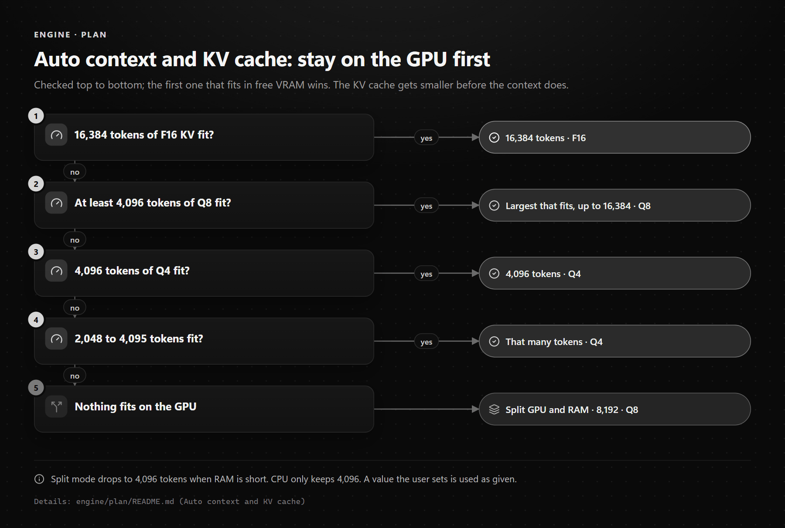

# Load and Speed Settings (`settings.json` → `optimization`)

These settings control how a GGUF model is loaded and run by llama.cpp. They are the
`optimization` section of `settings.json` (`OptimizationControl` in
`engine/core/src/settings.rs`). Change them with `cluaiz config set optimization.<field> <value>`
or CEP `config.set`.

Most fields are empty by default. Empty means the planner (`engine/plan`) decides from this
machine's free memory, or llama.cpp's own default applies. A value you set wins over the planner.

## Placement

| Field | Default | Meaning |
|---|---|---|
| `n_gpu_layers` | planner | Layers on the GPU. `0` = CPU only, `-1` = all layers, `N` = exactly N |
| `n_cpu_moe` | planner | llama.cpp `--n-cpu-moe`: the routed experts of the first N blocks stay in RAM, the rest of those blocks stays on the GPU |
| `offload_kqv` | planner | llama.cpp `offload_kqv`: `false` keeps the whole KV cache in RAM |
| `op_offload` | llama.cpp default | llama.cpp `op_offload`: large batches of weights held in RAM are copied to the GPU to compute there |
| `custom_vram_buffer_gb` | auto | VRAM kept free. Auto: 1.0 GB, lowered down to 0.5 GB when that lets the model fit on the GPU |
| `custom_ram_buffer_gb` | auto | RAM kept free. Auto: 1.0 GB, lowered down to 0.5 GB when that lets the model fit in RAM |
| `use_mmap` | `true` | Memory-map the GGUF file |

### When a load does not fit

What a model really takes on this GPU is measured after each load and kept in
`config/vram_margins.json`; the next plan for the same model and settings uses it instead of the
fixed buffer. If llama.cpp still cannot allocate a planned GPU placement (most often the KV cache or
a compute buffer), the Engine records the miss and plans once more with the larger margin: fewer GPU
layers, a smaller context or a smaller KV type. The plan report then says "load retry". When the
GPU layers or `n_cpu_moe` are set by hand there is no retry: the error is shown as it is.

### Measured speed

Without measurements the planner picks placements in a fixed order: full GPU, MoE split, GPU + RAM
split, CPU only. `cluaiz bench <model> --placements` runs the speed test (llama-bench's `pp` and
`tg`) on every placement that fits for that model, on the same context and KV type, and keeps the
numbers in `config/vram_margins.json`. A plain `cluaiz bench <model>` keeps the numbers of the
placement it loaded with.

From then on the planner loads another placement instead of the rule-order one when both were
measured, it generates at least 5% faster, and it does not read prompts more than 5% slower. A
measurement still counts when free VRAM moves the split by up to 2 blocks. A normal load never
measures anything, so it is not slower. The plan report shows the measured speeds and, when they
changed the choice, "measured faster". Placements set by hand are never replaced.

Removing a model (`cluaiz rm`, or `models.remove` over CEP) also drops its VRAM and speed numbers from
`config/vram_margins.json`; `cluaiz self uninstall` deletes the whole file with the Cluaiz home.

Example on a 4 GB laptop GPU, a 4B Q4_K_M model (qwen35 architecture) at 8192 tokens: GPU + RAM split (22 of 33 blocks on
the GPU) 18.2 t/s generation, 870 t/s prompt; CPU only 10.5 t/s and 48 t/s. The split stays.

## Context and KV cache

| Field | Default | Meaning |
|---|---|---|
| `custom_context_window` | auto | Context size in tokens. Empty = sized by free memory, `0` = the model's native maximum, `N` = exactly N |
| `kv_cache_quantization` | `Auto` | `Kv16` (F16), `Kv8` (Q8_0), `Kv4` (Q4_0). `Auto` = F16 |
| `flash_attention` | `Auto` | `On`, `Off`, `Auto` |
| `context_shifting` | `Auto` | When a chat outgrows the context: `Off` (llama.cpp default: an error, or the answer stops at the limit); `Minimal`, `Standard`, `Aggressive`, `Extreme` drop the oldest whole turns and shift the KV cache, freeing at least 5 / 10 / 25 / 50 % each time; `Auto` frees what is needed |

## Batches and threads

| Field | Default | Meaning |
|---|---|---|
| `batch_size` | 512 | Tokens per batch |
| `ubatch_size` | 512 | Physical micro-batch size |
| `n_threads` | physical cores | CPU threads for generation |
| `n_threads_batch` | same as `n_threads` | CPU threads for prompt processing |

## Thinking

| Field | Default | Meaning |
|---|---|---|
| `think_mode` | `Auto` | Thinking for reasoning models: `On`, `Off`, `Auto` |
| `reasoning_effort` | `auto` | Thinking budget for chats that send no `reasoning_effort`: `auto`, `low`, `medium`, `high`, `max` or a number of tokens. `auto` = 3 minutes of thinking at the model's measured speed, from 1,024 tokens up to `high` ([details](../api/inference/chat_completions.md#reasoning-budget-levels-think_mode--reasoning_effort)). Not a load setting: changing it does not reload the model |
| `thinking_presets` | built in | Share of the room and maximum tokens for Low / Medium / High (High is also the upper limit of `auto`) |
| `reasoning_budget_message` | built in | Text written before the end-of-thinking tag when the budget runs out. Unset = the managed prompt `chat.thinking_close` (Qwen's early-stopping sentence) |

## MTP speculative decoding (experimental)

Some models ship multi-token-prediction (NextN) layers next to the normal ones: Qwen3.5 and 3.6,
GLM-4.5 and later, DeepSeek-V3, Step-3.5, MiMo and others. These layers guess the next few tokens.
The model then checks all guesses in one decode and keeps each one its own sampler would have
picked, so every kept guess saves a decode. The answer is the model's own, though not always
byte-identical to a run without MTP: checking several tokens at once rounds slightly differently,
which can flip a choice between two nearly equal tokens. It is llama.cpp's own
`draft-mtp` drafter, the one behind `llama-server --spec-type draft-mtp`.

`optimization.mtp` in `settings.json` (or the load flag `--mtp`) is `"auto"` by default; `"on"` and
`"off"` force it. With `auto`, each load decides: off when the weights are read from the disk or MTP's
memory would not fit next to the planned placement; on or off by a stored `cluaiz bench <model>
--mtp-compare` result for that placement (on at 5% faster); otherwise on, with a guard in each answer
that times the first tokens with and without guesses and stops guessing where it is slower. The log
says which rule decided (`[MTP] Auto: ...`) and when the guard stopped (`[MTP] Guard: ...`). A model
without NextN layers loads as usual. Environment variables for tests:

| Variable | Default | Meaning |
|---|---|---|
| `CLUAIZ_MTP` | unset (the setting decides, Auto by default) | `on` / `1` / `true` / `yes` turns MTP on for every load (without the Auto guard), `off` / `0` / `false` / `no` turns it off, whatever the setting says; any other value is logged and ignored |
| `CLUAIZ_MTP_DRAFT` | `3` | Most tokens guessed per step (llama-server's `--spec-draft-n-max` default) |
| `CLUAIZ_MTP_PMIN` | `0` | A draft stops at the first guess the drafter gives less than this probability (llama-server `--spec-draft-p-min`) |

Limits today: prompts with images or audio do not draft; after a context shift the rest of that
answer does not draft; the MTP context and the NextN weights are not in the load plan, so a model
that just fits may need a smaller context. A Gemma 4 MTP file published beside the model is
downloaded by `pull` but not used yet.

Measured on an RTX 3050 Laptop (4 GB), `unsloth/Qwen3.5-2B-MTP-GGUF` Q4_K_M, all layers on the GPU,
4096 context, greedy, 222 tokens: 68 t/s without MTP, 85 t/s with it; 64% of guesses kept, same
text. llama.cpp b12534 `llama-server` on the same file and settings: 67 and 82 t/s. The gain depends
on the text: `cluaiz bench <model> --mtp-compare` measures it on your machine (MTP off and on, same
placement), and on free-form prose MTP was slower (35% of guesses kept, 0.85x).

## ONNX models

ONNX models (TTS, STT, embeddings) do not use these fields. Their precision is fixed by the model
file, and they run on CUDA when the ONNX GPU pack is installed and there is room, otherwise on the
CPU.

## See also

- What the planner chose on this machine: `cluaiz show <model>`, CEP `system.plan`.
- KV cache reuse: [prefix_caching_architecture.md](prefix_caching_architecture.md).
