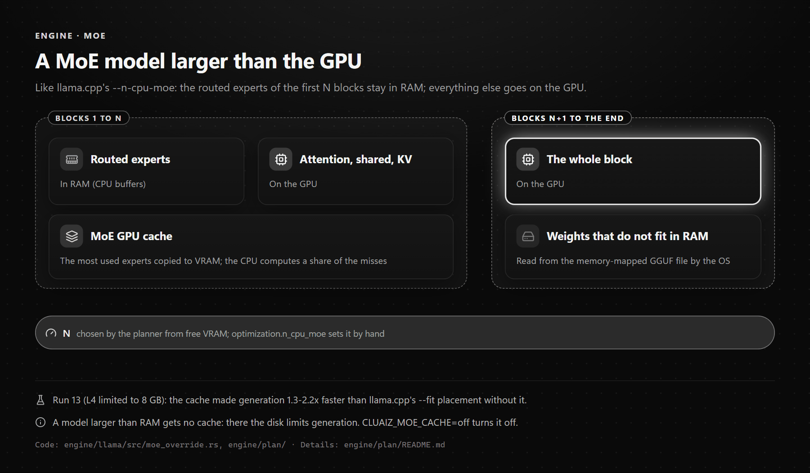

# Mixture-of-Experts Models on Small GPUs

A Mixture-of-Experts (MoE) model can be larger than the GPU. The Engine runs it the same way
llama.cpp does with `--n-cpu-moe`:

- The routed experts of the first N blocks stay in RAM (CPU buffers). Everything else of those
  blocks (attention, shared weights, KV cache) and all later blocks go on the GPU.
- The planner chooses N from free VRAM; `optimization.n_cpu_moe` in `settings.json` sets it by
  hand.
- With `op_offload` (llama.cpp default when any layer is on the GPU), large prompt batches copy
  the RAM-held weights to the GPU to compute there.
- The GGUF file is memory-mapped (`use_mmap`), so weights that do not fit in RAM are read from
  disk by the operating system.

Code: `engine/llama/src/moe_override.rs`, `engine/plan/`.

## MoE GPU cache

When the experts stay in RAM and the model fits in RAM, the planner also turns on llama.cpp's MoE GPU
cache (`moe_cache_size`, `moe_cache_cpu_share`; llama.cpp #29887 and #30966). The cache is llama.cpp
code, not Cluaiz code. It keeps the most used experts in VRAM for generation, and the CPU computes a
share of the misses. Cluaiz's part is the planner, which sizes the cache and the CPU share from the free
VRAM so the user does not set `--moe-cache-mib` by hand.

On an L4 limited to 8 GB the cache made generation 1.3-2.2x faster than llama.cpp's `--fit` placement
without a cache, and 1.1-1.5x faster at 4 GB (experts mmap'd, as the Engine loads them). These numbers
compare the cache against no cache; they are not a Cluaiz-against-llama.cpp result. A model larger than
the RAM the planner sees gets no cache by default: there the disk limits generation, and the cache was
slower than the placement without it in run 13. `CLUAIZ_MOE_CACHE=off` turns the cache off.

Rules and numbers: [engine/plan/README.md](../../engine/plan/README.md#moe-gpu-cache), test record:
[run 13](../../test/cloud/runs/2026-11-15-run13-moe-cache/SUMMARY.md).

## Expert prefetch

With the MoE cache on, each layer uploads the experts it selected from the memory-mapped model file. When
those pages are not in RAM, the upload page-faults them in one after another. The prefetch passes the
addresses of those experts (and of the misses the CPU computes) to llama.cpp's `llama_prefetch` in one
call right before the upload, so the operating system can read them together. On Linux this is
`madvise(MADV_WILLNEED)` in 128 KiB windows, on Windows one `PrefetchVirtualMemory` call. It only hints
experts the router has already chosen; it does not guess future experts. It is advisory: if it fails, a
warning is logged and the upload reads as before. It runs only inside the cache's upload path, so a plan
without a MoE cache has no prefetch.

The prefetch and its cap (the MoE cache size per upload) are Cluaiz's own code, in the llama.cpp fork and
in `engine/plan/src/expert_prefetch.rs`. `optimization.expert_prefetch` in `settings.json` is `auto` by
default; `CLUAIZ_EXPERT_PREFETCH=on|off` overrides it. Auto turns it on only on Linux, and only when the
MoE cache holds at least 20% of the experts. Everywhere else it is off, because nothing measured there
was faster.

What was measured (Qwen3.6-35B-A3B UD-IQ4_XS, 18.2 GB, experts 14.5 GB, NVIDIA L4 with about 8 GB of
VRAM free, RAM capped at 12 GB so the experts are read from the SSD, 4 threads, 3 rounds, median):

| Generation t/s | code | chat | list | long |
|---|---|---|---|---|
| llama.cpp `b54752d`, `--moe-cache-mib 3600 --moe-cache-cpu-share 0.9` | 7.63 | 20.70 | 13.15 | 15.93 |
| Cluaiz, prefetch off (same upstream cache) | 7.74 | 21.34 | 13.44 | 16.05 |
| Cluaiz, default (prefetch on) | 10.21 | 25.11 | 18.83 | 19.76 |

- With the same cache on both sides and the prefetch off, Cluaiz and llama.cpp are equal (1.01-1.03x).
- The prefetch adds 1.21-1.43x over llama.cpp with its cache on this setup.
- BigMoeOnEdge `d02bb94` with its own `--auto` plan generated 4.51 / 10.13 / 6.29 / 4.87 t/s on the same
  machine, so Cluaiz's default was 2.26-4.06x faster. That is BigMoeOnEdge's own default plan, not a tuned
  one; its flags for the same placement as Cluaiz's did not load the model (run 48 SUMMARY).
- Where it does not help: on a Windows laptop with a 4 GB GPU (Gemma 4 26B A4B, little free RAM) the
  cache was only 258-452 MiB and the prefetch slowed generation to 10.23 and 8.68 t/s, against 20.09 and
  17.48 with the cache alone (run 44). The cause is not known. On the same laptop with enough RAM, no
  cache fits in the free VRAM, so the prefetch never runs (run 42).
- Prompt processing: Cluaiz's `cluaiz bench` is about 10% behind llama-bench at 512 and 2048 tokens, equal
  at 4096; the prefetch does not change it. The cause is not known.

These results are from one machine, one model and one setup. They do not say the prefetch helps on other
hardware.

Test records: [run 48](../../test/cloud/runs/2026-11-23-run48-l4-fair-baselines/SUMMARY.md) (main),
[run 43](../../test/cloud/runs/2026-11-23-run43-l4-case-g-prefetch/SUMMARY.md),
[run 45](../../test/cloud/runs/2026-11-23-run45-l4-case-g-pp/SUMMARY.md),
[run 44](../../test/cloud/runs/2026-11-23-run44-laptop-prefetch-low-ram/SUMMARY.md),
[run 42](../../test/cloud/runs/2026-11-23-run42-laptop-prefetch-ab/SUMMARY.md). Rule and decisions:
[engine/plan/README.md](../../engine/plan/README.md#moe-expert-prefetch-llamacpp-fork-auto-on-only-for-the-measured-shape).

## Not built

- No separate SSD streaming engine, no expert heat tracking and no prediction of future experts. An
  earlier version (August 2026, in the `interface-engines` and `inference-engine` crates) had its own
  streaming; it was not ported when those crates were replaced on 2026-10-11 (commits `696db9f1`,
  `b2350380`). The current prefetch is a small hint in front of the cache upload, not a streaming engine.
- No RAM expert cache of the Engine's own and no direct I/O: experts that do not fit in RAM are read
  through the memory-mapped file and the operating system's page cache, as in llama.cpp.
- The prefetch is not on by default on Windows, macOS or with a small cache.

## Under development

Planned for a later release, not in v0.1.0:

- A measured rule for the prefetch with a small cache and on Windows (run 44's slowdown is not explained).
- Draft models such as DFlash for speculative decoding. MTP speculative decoding exists but is
  experimental; see [llm_optimization.md](llm_optimization.md#mtp-speculative-decoding-experimental).

See also: [llm_optimization.md](llm_optimization.md).
