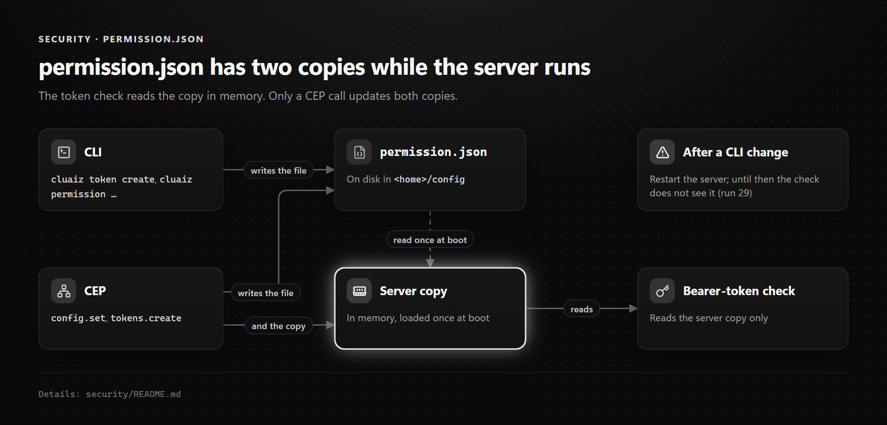
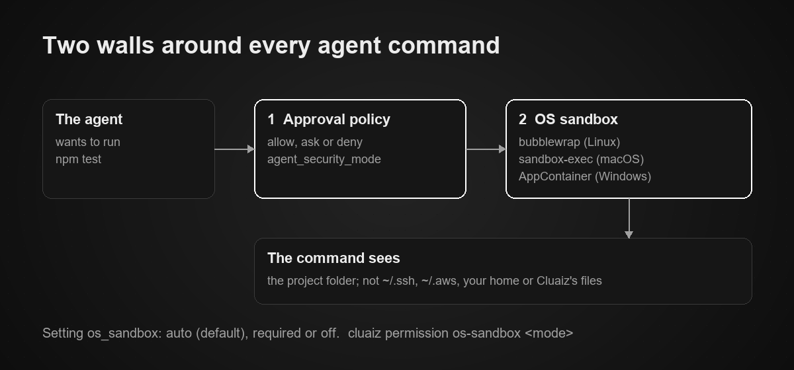

<!-- name: permission.json
description: The permission.json settings: listen address, API keys, approval mode, OS sandbox and system.exec policy. -->

# permission.json

`permission.json` is in the config folder (`~/.cluaiz/config/permission.json`, or
`<CLUAIZ_HOME>/config/permission.json`). The schema is `security/src/permission_schema.rs`.
Missing fields take their defaults. If the file cannot be parsed, the Engine uses the defaults, logs a
warning with the error, and copies the broken file to `permission.json.broken` so its tokens and
settings can be recovered. A save writes a temporary file and renames it, so a crash never leaves a cut file.

Change it with `cluaiz permission …`, `cluaiz token …`, `cluaiz model set-chat|set-vector`, or
from the App settings screen.

## Fields the Engine uses

| Field | Default | What it does |
|---|---|---|
| `active_slots` | `{}` | The model chosen for each slot (`chat_slot`, `embed_slot`, `vision_slot`, `audio_slot`). A slot wins over `chat_models` / `vector_models` |
| `chat_models.text` | none | Default chat model (`model: "auto"` in a chat request) |
| `vector_models.text` | none | Default embedding model for `/v1/embeddings` when the request names none |
| `stream_telemetry` | `false` | Adds usage and timing details to chat responses |
| `model_header_info` | `false` | With `stream_telemetry`, also adds which models are loaded |
| `lazy_load_model` | `true` | `true`: load the chat model on the first request. `false`: start loading it when the server starts (the port opens without waiting) |
| `api_port` | `8000` | HTTP port of `cluaiz serve` |
| `api_host` | `0.0.0.0` | Address the server listens on. The `CLUAIZ_HOST` environment variable wins |
| `connection_protocol` | `http` | Shown by `cluaiz serve` |
| `api_auth.required` | `false` | `true`: every request needs a bearer token (the session token or an API key) |
| `api_auth.tokens` | `[]` | API keys, at most 5 (`cluaiz token create|list|remove`) |
| `agent_security_mode` | `sandboxed` | Approval rule for tool calls, used by the App, the API chat and the terminal agent: `full_access`, `sandboxed` (workspace-gated) or `strict` |
| `exec.allow_shell` | `false` | CEP `system.exec` also accepts a shell line, not only a program with arguments |
| `exec.without_approval` | `false` | CEP `system.exec` runs without the owner's approval of each call |
| `os_sandbox` | `auto` | OS confinement of agent commands, MCP servers and native plugins. `auto`: confine on Linux (bubblewrap) and macOS (sandbox-exec), not on Windows; `required`: confine on every platform or refuse to run the command; `off`: never. Change with `cluaiz permission os-sandbox <mode>`; `CLUAIZ_OS_SANDBOX` wins for one run. Applies from the next command. Ubuntu 23.10 and later block bubblewrap until `/etc/apparmor.d/bwrap` holds `abi <abi/4.0>, include <tunables/global> profile bwrap /usr/bin/bwrap flags=(unconfined) { userns, }` (loaded with `sudo apparmor_parser -r /etc/apparmor.d/bwrap`); without it commands run unconfined (auto) or are refused (required) |

## Network access and API tokens



The defaults are a design choice. You decide who can reach the server, the same way you do with a
database server.

**Who can reach the server.** `api_host` is `0.0.0.0`, so the server listens on every network address of
the machine. Your own computer reaches it at `http://localhost:8000`. Other devices on the same network,
a Docker container, or a phone running the App reach it at the machine's address (for example
`http://192.168.1.20:8000`). A cloud server reaches it at its public address, unless its firewall blocks
the port.

- Listen only on this computer: set `"api_host": "127.0.0.1"` in `permission.json`, or start once with
  `CLUAIZ_HOST=127.0.0.1 cluaiz serve`.
- Change the port: `cluaiz permission port 8011`, or `CLUAIZ_PORT=8011` for one run.

**Who may use the server.** `api_auth.required` is `false`, so every request is answered without a token.
Turn tokens on whenever other people or programs can reach the port: on a shared network, on a cloud
server, or when anything on the machine should not use the Engine freely.

```bash
cluaiz token create        # makes an API key and turns the guard on (api_auth.required = true)
cluaiz token list          # shows the keys (at most 5)
cluaiz token show --all    # prints them in full
cluaiz token remove <key>  # removing the last key turns the guard off again
```

A server that is already running keeps the setting it started with: restart `cluaiz serve` after
`cluaiz token create` (recorded 2026-11-21: HTTP 200 without a key before the restart, 401 after). The CEP
method `tokens.create` adds a key to the running server at once but does not turn the guard on.

With the guard on, every request sends the key as a bearer token:

```bash
curl http://localhost:8000/v1/models -H "Authorization: Bearer <your key>"
```

- `/health` always answers without a token, so uptime checks keep working.
- A program on the same computer can use the session token instead of an API key. The Engine writes a
  new one to `session.token` in the Cluaiz home (`~/.cluaiz/session.token`) each time it starts, and
  the App reads it from there.
- When tokens are off and provider keys are saved, `cluaiz serve` prints a warning: anyone who can reach
  the port can then use those keys.

The code: `security/src/permission_schema.rs` (defaults), `api/src/lib.rs` (host and port),
`api/src/auth.rs` (the token check).

## Approvals and the OS sandbox

Two separate checks guard every command an agent or a tool runs:

1. **Approval policy** (`agent_security_mode`): whether the command may run at all: allowed, asked
   about, or refused.
2. **OS sandbox** (`os_sandbox`): what the running process can touch. On Linux (bubblewrap) and macOS
   (sandbox-exec) it sees the project folder and the system, not your home folder, `~/.ssh`, `~/.aws` or
   Cluaiz's own files; network only when allowed. Windows uses an AppContainer in `required` mode.



Inside the project folder, git's hooks (`.git/hooks`) and config (`.git/config`) stay read-only, and the
`.git` folder cannot be moved or replaced, on every platform. Git runs hooks, and programs the config
names (`core.hooksPath`, `core.fsmonitor`), when you commit later outside the sandbox, so a confined
command must not be able to plant them. The rest of `.git` (objects, index, branches) stays writable.

A workspace that is the Cluaiz home or a folder above it would show Cluaiz's own files (the session
token, the config with provider keys) to the command, so it is never confined: `auto` runs the command
unconfined with a warning, `required` refuses it. With no project open, the Engine's workspace is the
empty folder `~/.cluaiz/workspace`, which is confined as usual.

An approval says "yes, run it"; the sandbox still applies after that. Platform details, tests and
limits: [agents/src/execution/README.md](../../agents/src/execution/README.md#os-sandbox-os_sandboxrs-2026-11-20).
Messages and fixes: [Troubleshooting](../get-started/troubleshooting.md#agent-commands-and-tools).

## Fields that do nothing

Existing files and the App settings screen may still hold these, so they are read and saved, but
no Engine code acts on them and `cluaiz permission` no longer shows or changes them. CEP
`config.get` lists them under `engine.unused_fields`, so a settings screen can hide them or mark
them as not working:

| Field | Default | Why it does nothing |
|---|---|---|
| `wasm_firewall` | `auto` | Not read. A `.wasm` plugin always runs closed in, with limits (`agents/src/plugins/wasm.rs`); any other plugin runs as a child process inside the OS sandbox (`os_sandbox`, `agents/src/plugins/executor.rs`) |
| `vectorize_user_input` | `true` | Messages are not vectorized. Notes use the policy `notes_match` instead |
| `vectorize_ai_response` | `true` | Answers are not vectorized |
| `enable_kvcache` | `true` | Saving a chat's KV cache is controlled by `settings.json` → `chat_memory.enabled` |
| `vector_models.vision`, `vector_models.audio` | none | No request path reads them |

## Related

- Execution policy for commands: `agents/src/execution/policy.rs` (destructive commands are always refused).
- Audit log of write, exec and admin calls: `security/src/audit.rs`, CEP `system.audit`.
- Security overview: [security-and-auth-architecture.md](../architecture/security-and-auth-architecture.md).
