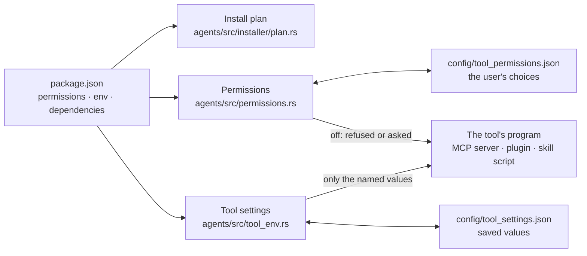

# Tools: permissions, settings and environment

How the Engine treats an installed tool (a skill, a plugin or an MCP server): what it may reach,
which values it gets, and what an install does before anything is downloaded. The package format
itself (`package.json`: `permissions`, `env`, `dependencies`) is defined by Cluaiz Tools:
[package spec](https://github.com/cluaiz/cluaiz-tools/blob/main/docs/package-spec.md) and
[permissions](https://github.com/cluaiz/cluaiz-tools/blob/main/docs/reference/permissions.md).
This page describes what the Engine does with it.



---

## Permissions

A tool lists what it uses under `permissions.<type>` in its `package.json`, with `info` (one
sentence: what it does with it), `allow` (its default) and the type's own options. The Engine
owns the types; a type it does not know is ignored.

| Type | Title | Options | Sensitive when |
|---|---|---|---|
| `network` | Internet | `access`, `hosts` | never |
| `files` | Files | `can`, `where` | anything but `can: ["read"]` with `where: "workspace"` |
| `programs` | Programs | `run` | always |
| `system` | System information | `read` | it reads `hostname` or `username` |
| `location` | Location | `precision` | always |
| `media` | Microphone, camera, screen | `use` | always |
| `clipboard` | Clipboard | `can` | it reads |
| `notifications` | Notifications | | never |
| `native` | Native code | | always |
| `engine` | Engine methods | `methods` | never |

- **Default:** a sensitive permission is off until the user allows it, whatever `allow` says. Any
  other permission takes `allow` (on when absent).
- **The user's choice** is kept in `config/tool_permissions.json`, keyed by `<type>:<id>`
  (`plugin:web-search`), so updating the tool keeps it. Removing the tool removes its choices.
- **A type the tool does not declare is never allowed.**
- **Where a permission is enforced:**
  - A WebAssembly plugin is refused at the call: `network` off answers
    `{"code": "permission_off", "error": "Internet is not allowed for plugin 'web-search'. Allow it with: cluaiz plugin permission web-search network on"}`.
    With `access: "strict"`, it reaches only the hosts in `hosts`.
  - Any other tool (an MCP server, a native plugin, a skill) cannot be closed in by the Engine, so
    a call to a tool with a permission off is asked about first, in every agent mode, also when
    an MCP server marks the call read-only.
- **Change it:** `cluaiz <type> permission <id> [type] [on|off]`, or CEP `tools.get_settings` /
  `tools.set_settings` (`patch.permissions`).

---

## Settings and keys (`env`)

A tool names the values it reads (API keys, a server address) in `env`:

```json
"env": {
  "TAVILY_API_KEY": { "info": "Tavily API key", "need": "optional" },
  "SEARXNG_URL":    { "info": "Address of your own SearXNG server" }
}
```

- A name must be upper case letters, digits and `_`; any other name is ignored.
- `need: "required"` marks a value the tool cannot work without.
- **Where a value comes from:** the system environment variable of that name first, otherwise
  the value the user saved in `config/tool_settings.json` under the tool's id. Every value is
  treated as a secret: saved values are never returned by any method or command.
- **Set it:** `cluaiz <type> config <id>` (asks for missing values), or CEP
  `tools.set_settings` with `patch.user_settings`. `tools.get_settings` lists each name with
  `info`, `required`, `secret`, `set` and `in_system`, never the value.

---

## The program's environment

A tool's program (an MCP server, a plugin that is not WebAssembly, a skill's script) starts from a
cleared environment (`EnvironmentResolver::for_tool` in `agents/src/execution/environment.rs`).
It gets:

1. **The system basics a program needs to run:** `PATH` and the Windows system folders, the
   user's home and temporary folders, language and time zone (`LANG`, `LC_*`, `TZ`), the proxy and
   its certificates (`HTTP_PROXY`, `SSL_CERT_FILE`, `NODE_EXTRA_CA_CERTS`…), language toolchains
   (`JAVA_HOME`, `CARGO_HOME`, `VIRTUAL_ENV`, `NVM_DIR`…), and the Engine's address (`CLUAIZ_HOME`,
   `CLUAIZ_PORT`, `CLUAIZ_API_URL`).
2. **An MCP server's fixed `execution.env`** from its package.
3. **The values named in the tool's `env`.**

Nothing else: the user's provider keys and other tools' values stay out, whatever their names.
A tool that needs a value must name it in `env`.

---

## What an install does

Before downloading, `cluaiz <type> install <id>` (CEP `tools.install`) builds a plan: the tool,
the tools it depends on (`dependencies.<kind>.<id>.need`: `required`, `recommended` or
`optional`; absent means required), and the permissions each asks for. The user's agent mode
decides what is done without asking:

| Dependency | `full_access` | `sandboxed` | `strict` |
|---|---|---|---|
| `required` | installed | installed, unless it asks for a sensitive permission (then asked) | asked |
| `recommended` | installed | asked | asked |
| `optional` | named only, never installed | named only | named only |

| Permission | `full_access` / `sandboxed` | `strict` |
|---|---|---|
| sensitive | asked | asked |
| not sensitive | its default, without asking | asked |

In the terminal the questions are asked one by one; `--yes` answers yes to all, and
`--no-recommended` leaves recommended dependencies out. Without a terminal every question counts
as no, and a required dependency that is not approved stops the install. A mode other than the
three counts as `sandboxed`.

---

## Calling a plugin's function

A plugin lists its functions in `package.json`. A call to a function the plugin does not list
fails and names the functions it has; it never runs another function.

---

## Source

| File | What it holds |
|---|---|
| `agents/src/permissions.rs` | Permission types, sensitivity, the user's choices, approval tags |
| `agents/src/tool_env.rs` | The names in `env`, where each value comes from |
| `agents/src/execution/environment.rs` | The cleared environment of a tool's program |
| `agents/src/installer/plan.rs` | The install plan and the decisions by mode |
| `agents/src/plugins/net.rs` | A WebAssembly plugin's network access, `permission_off`, strict hosts |
| `agents/src/registry/types.rs` | When a call needs the user's approval |
